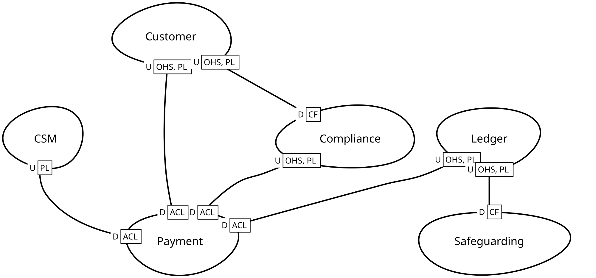

# Intégration

Les bounded contexts s’échangent des appels, des messages et des copies de données. Ces règles gardent chaque échange explicite, tolérant aux changements des deux côtés, et sûr quand le réseau ou l’autre côté tombe.

La [context map](../strategic-design/context-maps/) dit quels bounded contexts se parlent, et avec quel pattern. Cette partie dit comment chaque échange se construit.

## Idées clés {#key-ideas}

- **Un appel ou un message.** Un appel pose une question dont la réponse est nécessaire tout de suite : l’appelant attend, et dépend de la disponibilité de l’autre côté. Un message annonce un fait une fois le commit fait : le consumer agit plus tard, à son rythme. Préférer les messages, et garder les appels pour ce qui ne peut pas attendre.
- **Published language.** Ce qu’un bounded context expose est un contrat, documenté et versionné dans `public`, distinct de son modèle interne. Les consumers lisent ce contrat, jamais le modèle qui est derrière.
- **Anticorruption layer.** Un bounded context downstream traduit ce qu’il reçoit dans ses propres concepts, à un seul endroit, pour que le modèle étranger ne déborde jamais dans le sien.
- **Outbox.** Les events s’écrivent dans la transaction qui change l’état, puis partent dans l’ordre. La livraison est *at least once* : un message peut arriver deux fois, donc chaque consumer élimine les doublons.
- **Eventual consistency.** Entre bounded contexts, l’état converge avec un délai. Un processus qui traverse plusieurs bounded contexts est explicite : il a une identité, un statut, et un chemin pour les échecs.

| Échange | À utiliser quand | Risques principaux | Thèmes |
| --- | --- | --- | --- |
| Appel distant | La réponse est nécessaire pour décider | Timeouts, retries, l’autre côté hors service | [Appels distants](./remote-calls/), [Traduction](./translation/) |
| Message | Un fait auquel d’autres peuvent réagir | Doublons, ordre, messages perdus | [Messagerie](./messaging/), [Contrats](./contracts/) |
| Copie de données | Les lectures ne doivent pas dépendre de l’autre côté | Données périmées, responsabilité de la synchronisation | [Traduction](./translation/) |

## L’exemple, vu de haut {#the-example-from-above}

Sur la context map de la partie [conception stratégique](../strategic-design/) :

- **Ledger → Payment** : Payment demande au Ledger de comptabiliser un paiement, par son open host service. Il a besoin de la réponse pour continuer : c’est un appel.
- **CSM → Payment** : le CSM impose son format de message. Payment le traduit dans une seule anticorruption layer.
- **Ledger → Safeguarding** : Safeguarding reprend tels quels les soldes que le Ledger publie : c’est un conformist.

Les vues d’ensemble des thèmes montrent ensuite chaque mécanisme sur un court exemple.

## En revue de code {#reviewing-a-change}

1. Le changement ajoute-t-il un échange entre bounded contexts ? La context map le déclare, avec son pattern (MAP-01).
2. Est-ce un appel là où un message suffirait ? L’appel a-t-il un timeout, un retry sûr, et une issue quand rien ne répond ? (PRC-01, PRC-02, PRC-03)
3. Un event part-il avec l’état qui l’a produit, par l’outbox ? (MSG-01, MSG-03)
4. Le consumer peut-il recevoir le message deux fois, ou dans le désordre, sans dommage ? (MSG-04, MSG-05, MSG-06)
5. Le contrat est-il documenté, nommé d’après son bounded context, versionné quand il casse, et libre du modèle interne ? (PUB-01, PUB-03, PUB-04)
6. Les données étrangères entrent-elles par une seule traduction, et seulement ce qui est nécessaire ? (ACL-01, ACL-02)
7. Un processus traverse-t-il plusieurs bounded contexts ? Il est explicite, avec une identité, un suivi et un chemin d’échec (PRC-04, PRC-05).

::: tip Ce dont cette partie a besoin
- Une **context map** qui nomme le pattern de chaque côté de chaque relation. Voir [mettre en place un projet](../../start/prerequisites#context-map).
- Un **dossier `public`** dans chaque bounded context qui publie quelque chose : la seule porte d’entrée pour les autres.
- Les **tables de l’outbox** (events enregistrés, suivi des publications, messages traités), et un forwarder. Le choix par défaut est un forwarder in-process, sans broker tant qu’une décision consignée n’en introduit pas : voir les [choix par défaut](../../start/default-choices).
:::

## Thèmes {#themes}

<ThemeTable part="integration" />
