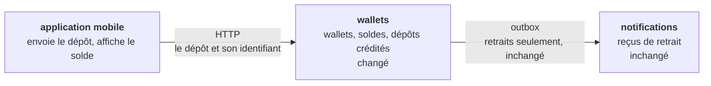
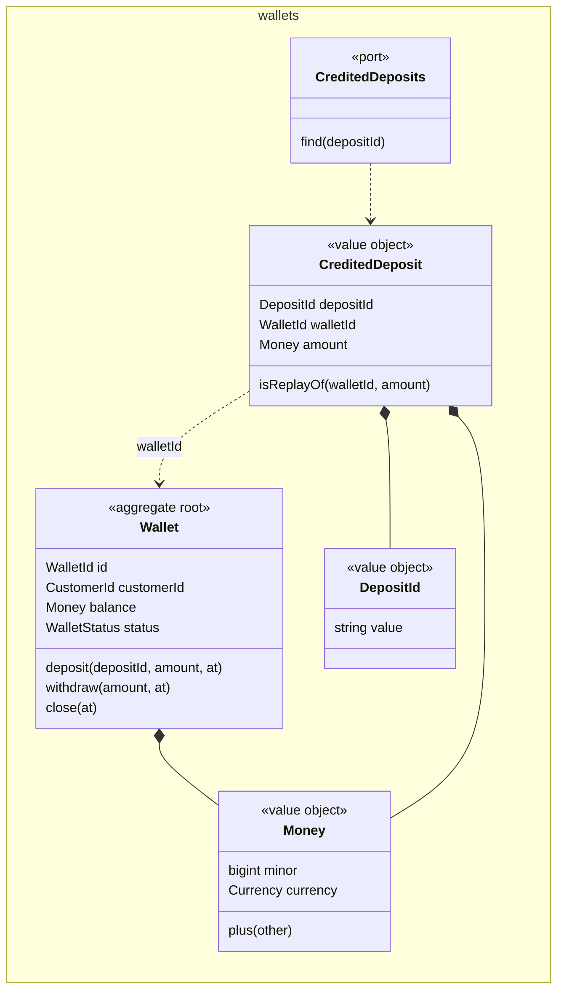
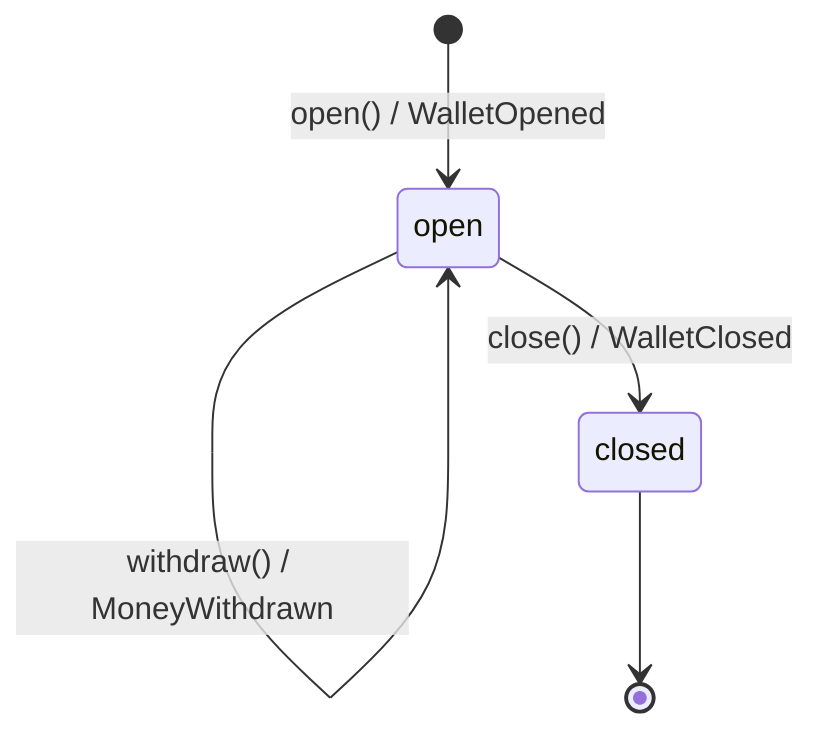
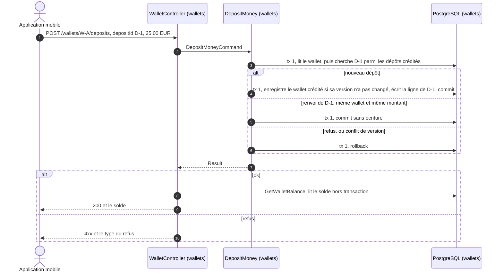
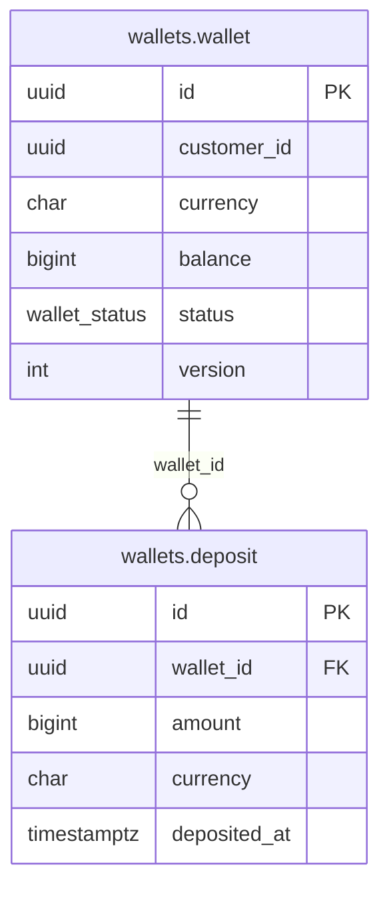

<!--
FILLING RULES. This comment stays in the document: it does not render.

Writing
- The language of the story, headings included. Short sentences, one idea per sentence.
- A section with no content keeps its heading and says "None.". Never remove a section: its absence does not tell whether the question was asked.
- Section numbers (1 to 15, A to C) never change: tools find a section by its number.
- Alveolus rule codes (AGG-06, PUB-07...) go to appendix B. In the body, only when a rule is itself the subject (a question, a waiver).
- Blocks between angle brackets are to be replaced. Help comments are removed once their section is filled, except this one.

Identifiers
- AC-n acceptance criterion, D-n decision, Q-n question, INV-n invariant, T-n test, In increment, ADR-n, W-n waiver.
- Prefix:Name for the elements of the model: AGG:, VO:, ERR:, EVT:, UC:, QRY:, API:, TBL:.
- An element is defined once, in one place:
  - AC, D, Q, INV, T, I, ADR, W: in the first column of a table row ("| AC-1 |").
  - AGG: in a heading "### 7.<n> <context>: AGG:<Name> (<new | existing, changed>)".
  - TBL: in a heading "### TBL:<schema>.<table> (<new | existing>)".
  - VO, ERR, EVT, UC, QRY, API: in the first column of a table row.
- Elsewhere, cite the identifier, never copy the definition.
- When two contexts share a name (CTX-08), prefix it with the context: AGG:payments/Transfer.

Checks before "approved", run by `alveolus-claude design check <file>`
- Every identifier cited is defined.
- Every AC and every INV is proven by at least one T.
- Every D has a reason. Every Q has an assumption and says what it blocks.
- Every increment says why it is safe to merge.
- Every Mermaid diagram renders without error.
-->

# Déposer de l’argent sur un wallet

> **Comment lire ce document.** Le métier lit les parties 1 et 2. L’équipe technique lit tout. Les identifiants (`AC-n`, `D-n`, `Q-n`, `INV-n`, `UC:...`) renvoient à leur définition dans le document. Les règles Alveolus appliquées sont rassemblées dans l’annexe B.

## Résumé

Le client dépose un montant sur l’un de ses wallets ouverts, et l’application mobile affiche aussitôt le nouveau solde. Tout se passe dans le bounded context `wallets` : le wallet refuse lui-même un montant nul, un wallet fermé ou une autre devise, puis augmente son solde. L’application donne à chaque dépôt un identifiant, qu’elle garde pour chaque renvoi. Le serveur garde la trace des dépôts crédités : un renvoi du même dépôt reçoit le solde, sans second crédit. Un refus ne change rien ; une panne annule tout, et l’application renvoie le même dépôt.

| | |
| --- | --- |
| Contextes touchés | wallets (le dépôt, le journal des dépôts crédités, la lecture du solde) |
| Décisions à valider | 10, dans la partie 2 |
| Questions bloquantes | Métier : Q-1. Équipe technique : Q-5, Q-6, Q-7 |
| Livraison | 4 incréments, la route en dernier |

---

# Partie 1. Le besoin

## 1. Story

En tant que client, je veux déposer de l’argent sur mon wallet, pour pouvoir le dépenser ensuite.

**Ce qui existe déjà.** Le bounded context `wallets` ouvre un wallet (`POST /wallets`), y retire de l’argent (`POST /wallets/{id}/withdrawals`) et le ferme quand son solde est nul (`POST /wallets/{id}/closure`). L’aggregate `Wallet` tient son client, son solde (`Money`, en unités mineures) et son statut, ouvert ou fermé. Il refuse déjà un wallet fermé, un montant nul et une autre devise, pour le retrait. Seuls l’euro et le dollar sont acceptés. Le repository vérifie la version du wallet à chaque enregistrement. Le retrait publie `wallets.wallet.MoneyWithdrawn` par l’outbox, pour les reçus de `notifications`. Rien ne lit le solde : aucune query, aucun view port, aucune route `GET`. Aucune route ne connaît son appelant : l’application n’a pas d’authentification. `prisma/` n’a aucune migration commitée, et le dépôt n’a aucun test sur une vraie base. Le dépôt reprend `Wallet`, `Money`, `Currency`, `WalletRepository`, `WalletController` et le registre des event handlers.

## 2. Critères d’acceptation

Contexte commun : Alice a un wallet ouvert en euros, avec un solde de 50,00 €. L’application donne un identifiant à chaque dépôt, avant son premier envoi.

| ID | Étant donné | Quand | Alors |
| --- | --- | --- | --- |
| AC-1 | le wallet d’Alice, à 50,00 € | Alice dépose 25,00 € | le solde passe à 75,00 €, et l’application l’affiche |
| AC-2 | le wallet d’Alice, à 50,00 € | Alice dépose 0,00 € | le dépôt est refusé, et le solde reste à 50,00 € |
| AC-3 | le wallet d’Alice, à 50,00 € | Alice dépose -10,00 € | le dépôt est refusé, et le solde reste à 50,00 € |
| AC-4 | le wallet d’Alice est fermé, à 0,00 € | Alice dépose 25,00 € | le dépôt est refusé, et le solde reste à 0,00 € |
| AC-5 | le wallet d’Alice est en euros, à 50,00 € | Alice dépose 25,00 $ | le dépôt est refusé, et le solde reste à 50,00 € |
| AC-6 | Alice a déposé 25,00 €, le solde est à 75,00 €, et la réponse s’est perdue | l’application renvoie le même dépôt | le dépôt n’est pas crédité une seconde fois : le solde reste à 75,00 €, et l’application l’affiche |
| AC-7 | le wallet d’Alice, à 50,00 € | l’application envoie deux fois le même dépôt de 25,00 €, en même temps | le dépôt n’est crédité qu’une fois : le solde est à 75,00 € |

## 3. Hors périmètre

- Encaisser l’argent : carte, virement ou espèces (Q-1).
- Le reçu de dépôt par e-mail, et tout message vers `notifications` (Q-3).
- La liste des dépôts d’un wallet, et une route qui lit le solde seule.
- Un plafond par dépôt ou par période (Q-2).
- L’authentification de l’appelant, pour toutes les routes de `wallets` (Q-5).
- Le change : un dépôt dans une autre devise est refusé, jamais converti.
- Annuler ou corriger un dépôt crédité.

---

# Partie 2. À valider

## 4. Décisions de conception

| ID | Décision | Pourquoi | Alternative rejetée | ADR |
| --- | --- | --- | --- | --- |
| D-1 | L’application génère l’identifiant du dépôt (VO:DepositId, un UUID) avant le premier envoi, et le renvoie tel quel à chaque nouvel essai. | Seule l’application sait que deux envois sont le même dépôt. Une réponse perdue ne lui laisse rien d’autre pour le dire. | Reconnaître un renvoi à son contenu (wallet, montant, minute) : deux vrais dépôts du même montant seraient confondus. Un identifiant donné par le serveur : l’application ne le reçoit pas quand la réponse se perd. | ADR-1 |
| D-2 | La route est `POST /wallets/{walletId}/deposits`, avec `depositId` dans le corps. Elle répond 200 et le solde, au premier envoi comme à un renvoi. | Même forme que le retrait. Un renvoi reçoit la même réponse que l’envoi perdu. | `PUT /wallets/{walletId}/deposits/{depositId}` : idempotent par nature, mais HTTP exige 201 à la création et 200 au renvoi, donc une command qui dit si elle a crédité. Un en-tête `Idempotency-Key` : une seconde identité pour le même dépôt, et une table technique des réponses. | ADR-1 |
| D-3 | AGG:Wallet crédite lui-même le dépôt : il vérifie son statut, le montant et la devise, augmente son solde et enregistre EVT:MoneyDeposited. Le wallet est le seul aggregate modifié par la transaction. | Les refus du dépôt sont des règles du wallet, comme pour le retrait. Le solde reste à un seul endroit. | Un aggregate `Deposit` enregistré avec le wallet : deux aggregates dans une transaction. Un journal d’écritures qui fait avancer le solde en base : une seconde façon de changer le solde, à côté du retrait. | — |
| D-4 | Les dépôts crédités s’écrivent dans TBL:wallets.deposit, par un event handler synchrone de EVT:MoneyDeposited, dans la transaction du dépôt. La clé de la table est l’identifiant du dépôt. | Le wallet ne peut pas tenir la liste de ses dépôts : elle grandit sans fin. L’historique des dépôts compte pour le métier, et passe par l’event qui le produit. La clé fait refuser par la base un second crédit, que le wallet ne voit pas seul. | La liste des identifiants dans le wallet : chargée à chaque command, sans limite. Le repository du wallet qui écrit le dépôt : le wallet devrait exposer son dernier dépôt pour l’enregistrement. | ADR-1 |
| D-5 | Avant de créditer, UC:DepositMoney cherche l’identifiant parmi les dépôts crédités, par le port `CreditedDeposits`. Même wallet et même montant : c’est un renvoi, la command réussit sans créditer. Sinon : ERR:DepositIdAlreadyUsed. | Un renvoi doit réussir comme le premier envoi, pas échouer sur la clé de la base. La clé reste le filet, pour deux envois simultanés. | La clé seule : le renvoi finirait en erreur, après la mise à jour du wallet. Une méthode du repository du wallet : il ne lit que des wallets. | ADR-1 |
| D-6 | La réponse porte le solde, lu par QRY:GetWalletBalance après la command. | L’application affiche le nouveau solde juste après le dépôt (note de la story). La command ne renvoie que son refus éventuel. | La command renvoie le solde : elle écrirait et lirait à la fois. Répondre 204, puis l’application lit le solde : un aller-retour de plus, sur le réseau mobile qui cause les renvois. | — |
| D-7 | Deux envois simultanés du même dépôt se départagent sur la version du wallet : le premier valide, le second échoue en conflit, et l’application le renvoie (AC-6). | La vérification de version existe déjà, et sépare toute écriture concurrente sur un wallet. Aucun verrou à ajouter. | Verrouiller le wallet (`SELECT … FOR UPDATE`) à chaque dépôt : un verrou tenu pour un cas rare. | — |
| D-8 | Le dépôt ne vérifie pas que le wallet appartient à l’appelant, comme les autres routes de `wallets`, jusqu’à l’authentification de l’application (W-1). | L’application n’a aucune authentification : rien ne dit qui appelle. Un `Caller` pour la seule route du dépôt laisserait les autres ouvertes. | Prendre l’identité du client dans la requête : n’importe qui peut l’écrire. | ADR-2 |
| D-9 | Le dépôt ne publie aucun integration event. | Aucun consumer n’en a besoin : `notifications` ne traite que les retraits. | Publier `wallets.wallet.MoneyDeposited` dès maintenant : un contrat sans consumer, à faire évoluer par versions. | — |
| D-10 | Tous les critères se construisent couche par couche, et la route vient en dernier. | Une route ouverte sans ses refus ou sans son crédit unique créditerait un wallet fermé, ou deux fois le même dépôt. | Un incrément de bout en bout par critère, après la route : chaque incrément laisserait la route ouverte avec un trou. | — |

## 5. Questions ouvertes

### Pour le métier

| ID | Question | Hypothèse en attendant | Bloque |
| --- | --- | --- | --- |
| Q-1 | D’où vient l’argent déposé (carte, virement, espèces), et qui confirme qu’il est reçu ? Sans encaissement, un dépôt crée de l’argent. | L’encaissement est hors périmètre : le wallet crédite le montant annoncé. | La mise en production de I4 |
| Q-2 | Un dépôt a-t-il un plafond, par dépôt ou par période ? | Aucun plafond. La requête borne seulement le format du montant, à 18 chiffres. | Rien pour l’instant. Un plafond ajouterait un AC et un refus à AGG:Wallet |
| Q-3 | Le client reçoit-il un reçu de dépôt par e-mail, comme pour un retrait ? | Non. | D-9 |

### Pour l’équipe technique

| ID | Question | Hypothèse en attendant | Bloque |
| --- | --- | --- | --- |
| Q-4 | Un envoi qui reprend un identifiant déjà crédité, avec un autre montant ou sur un autre wallet : le refuser, ou l’ignorer ? | Refusé par ERR:DepositIdAlreadyUsed (409). Rien n’est crédité. | D-5 |
| Q-5 | L’application n’a aucune authentification. Qui fournit l’identité du client (guard, token), et quand ? | Une tâche à part ajoute un guard et un `Caller` à toutes les routes de `wallets`. UC:DepositMoney vérifiera alors que le wallet appartient à l’appelant. | W-1, la mise en production de I4 |
| Q-6 | `prisma/` n’a aucune migration commitée. Comment la base de production est-elle créée ? | Une migration de référence de l’état actuel est commitée, et marquée appliquée en production, avant I3. I3 n’ajoute que la sienne. | I3 |
| Q-7 | Aucune infrastructure de test sur une base jetable n’existe : ni Testcontainers, ni `src/shared/__test__/`, ni projets Vitest. | Une tâche l’apporte avant I3. À défaut, I3 la porte, hors du compte de lignes. | I3, I4 |
| Q-8 | Un conflit de version répond 500 aujourd’hui. L’application renvoie-t-elle le dépôt après un 5xx ou un délai dépassé ? | Oui, avec le même identifiant. Le serveur garde cette réponse. | AC-7 |

### Sur les règles

| ID | Question | Hypothèse en attendant | Bloque |
| --- | --- | --- | --- |
| Q-9 | MSG-05 traite une opération déclenchée par un message. Aucune règle ne dit comment rendre idempotente une command reçue en HTTP, ni par quel port une command lit une clé métier qui n’est pas un aggregate. UC-08 interdit seulement le view port. | MSG-05 vaut pour le renvoi HTTP. La command lit par un port du domaine, `CreditedDeposits`, comme le `recent-withdrawals.port.ts` de PLC-04, et non par un view port. | D-5 |
| Q-10 | EVT-07 permet à un event handler synchrone d’écrire une trace d’audit ou une projection. Ici, le journal des dépôts tient aussi une unicité (PER-03), que PER-03 voudrait traduite en refus par le `save` d’un repository. | Le journal est l’historique du métier (ENT-17). Sa clé est un filet : la command a déjà écarté le renvoi, et la version du wallet le second envoi simultané. Une violation de la clé reste une panne, levée en exception : seuls deux wallets différents, avec le même identifiant au même instant, l’atteignent. | D-4 |

---

# Partie 3. Conception

## 6. Contextes et langage

### 6.1 Nouveau bounded context

None.

### 6.2 Relations

None.

### 6.3 Glossaire

| Contexte | Terme | Code | Définition | Termes rejetés |
| --- | --- | --- | --- | --- |
| wallets | Dépôt | `Wallet.deposit` | De l’argent que le client ajoute sur l’un de ses wallets ouverts, dans la devise du wallet. | versement, recharge, top-up, crédit |
| wallets | Identifiant du dépôt | VO:DepositId | L’identifiant que l’application donne au dépôt avant son premier envoi, et qu’elle garde à chaque renvoi. | clé d’idempotence, référence |
| wallets | Dépôt crédité | VO:CreditedDeposit | Un dépôt déjà ajouté au solde : son identifiant, son wallet, son montant. | dépôt traité |
| wallets | Renvoi | — | Le même dépôt, envoyé de nouveau par l’application avec le même identifiant. | doublon, retry |

## 7. Modèle

### 7.1 wallets: AGG:Wallet (existant, modifié)

Le wallet tient l’argent d’un client, dans une seule devise. Il décide seul d’un dépôt, comme d’un retrait.

- **Identité** : `WalletId`, un UUIDv7 donné par le repository à l’ouverture. Inchangé.
- **Tient** : le client, le solde, le statut. Aucune liste de dépôts.
- **Référence** : le client, par `CustomerId`.

Chaque méthode est dans le diagramme d’état.

| ID | Invariant | Gardé par | Si cassé |
| --- | --- | --- | --- |
| INV-1 | Un dépôt ne se fait que sur un wallet ouvert. | `Wallet.deposit` | ERR:WalletIsClosed, rien ne change |
| INV-2 | Le montant d’un dépôt est strictement positif. | `Money.of` pour un montant négatif, `Wallet.deposit` pour zéro | ERR:InvalidMoney ou ERR:AmountNotPositive, rien ne change |
| INV-3 | Un dépôt est dans la devise du wallet. | `Wallet.deposit` | ERR:CurrencyMismatch, rien ne change |
| INV-4 | Le solde augmente exactement du montant déposé. | `Wallet.deposit`, par `Money.plus` | Un bug : `Money.plus` lève une exception sur deux devises |
| INV-5 | Un identifiant de dépôt ne crédite qu’un dépôt, une seule fois. | UC:DepositMoney, qui cherche le dépôt avant de créditer ; la clé de TBL:wallets.deposit en filet | Un renvoi réussit sans crédit ; un autre contenu reçoit ERR:DepositIdAlreadyUsed |

### Value objects

| ID | Contexte | Tient | Validité |
| --- | --- | --- | --- |
| VO:DepositId | wallets | L’UUID que l’application donne au dépôt | Tout UUID de la RFC 9562, mis en minuscules, sauf le UUID nil. Sinon ERR:InvalidIdentifier. Aucune génération côté serveur. Nouveau. |
| VO:CreditedDeposit | wallets | L’identifiant du dépôt, l’identité du wallet crédité, le montant | Construit depuis une ligne de TBL:wallets.deposit. `isReplayOf(walletId, amount)` est vrai pour le même wallet et le même montant, devise comprise. Nouveau. |
| VO:Money | wallets | Un montant en unités mineures, et sa devise | Existant. Gagne `plus(other)`, qui renvoie un nouveau `Money`. Deux devises différentes sont un bug : exception. |

### Erreurs

| ID | Contexte | Refus | Levé par |
| --- | --- | --- | --- |
| ERR:DepositIdAlreadyUsed | wallets | L’identifiant a déjà crédité un autre montant, ou un autre wallet. Nouveau. | UC:DepositMoney |
| ERR:WalletIsClosed | wallets | Le wallet est fermé. Existant. | `Wallet.deposit` |
| ERR:AmountNotPositive | wallets | Le montant est nul. Existant. | `Wallet.deposit` |
| ERR:CurrencyMismatch | wallets | Le montant n’est pas dans la devise du wallet. Existant. | `Wallet.deposit` |
| ERR:InvalidMoney | wallets | Le montant est négatif. Existant. | `Money.of` |
| ERR:UnsupportedCurrency | wallets | La devise n’est ni l’euro ni le dollar. Existant. | `Currency.of` |
| ERR:WalletNotFound | wallets | Aucun wallet n’a cette identité. Existant. | UC:DepositMoney, QRY:GetWalletBalance |
| ERR:InvalidIdentifier | wallets | Une identité n’est pas un UUID. Vient de `@alveolus/core`. | `WalletId.of`, `DepositId.of` |

### Ports

| Port | Contexte | Rôle | Implémenté par |
| --- | --- | --- | --- |
| `CreditedDeposits` | wallets | Port du domaine. Trouve un dépôt crédité par son identifiant, ou `undefined`. | `PrismaCreditedDeposits`, dans `driven/prisma` |
| `WalletViews` | wallets | View port de l’application. Lit le solde d’un wallet pour l’afficher. | `PrismaWalletViews`, dans `driven/prisma` |
| `WalletRepository` | wallets | Existant, inchangé. Charge et enregistre le wallet, avec sa version. | `PrismaWalletRepository` |

## 8. Processus et events

Une transaction écrit le dépôt. La lecture du solde suit, hors transaction.

Si le serveur tombe avant le commit, rien n’est crédité, et le renvoi crédite. S’il tombe après le commit, ou si la réponse se perd, le dépôt est crédité et l’application ne le sait pas : son renvoi reçoit le solde, sans second crédit (AC-6).

### Domain events

| ID | Contexte | Fait | Payload | Déclenche |
| --- | --- | --- | --- | --- |
| EVT:MoneyDeposited | wallets | Un dépôt a été crédité sur un wallet. | `aggregateId` (le wallet), `occurredAt`, `depositId`, `customerId`, `amount`, `balance` | `DepositJournalEventHandler`, synchrone : écrit la ligne de TBL:wallets.deposit. Le translator l’ignore : aucun integration event. |

### Messages entre contextes

None.

## 9. Use cases

### wallets

| Use case | Déclenché par | Hors transaction | Dans la transaction | Events |
| --- | --- | --- | --- | --- |
| UC:DepositMoney | API:DepositMoney | Lit `walletId`, `depositId`, la devise et le montant en VO:DepositId, `WalletId`, `Currency` et VO:Money. | Charge le wallet. Cherche le dépôt par `CreditedDeposits`. Sans dépôt crédité : `wallet.deposit`, `save`, puis le dispatcher. | EVT:MoneyDeposited |
| QRY:GetWalletBalance | API:DepositMoney, après UC:DepositMoney | Lit `walletId`, puis le solde par `WalletViews`. Aucun aggregate chargé. | Aucune transaction. | Aucun |

Ce qui vaut pour toute command :

- Avant la transaction, les chaînes de la command deviennent des value objects. Une valeur invalide est refusée avant toute lecture.
- Aucun autre contexte n’est appelé : aucun refus étranger.
- Une panne annule la transaction : rien n’est crédité. L’exception atteint le controller, qui répond 500, et l’application renvoie le même dépôt.
- Un renvoi est reconnu à l’identifiant du dépôt (D-5) : la command réussit sans rien écrire.

Spécificités :

- **UC:DepositMoney** renvoie `Result<void, DepositMoneyError>`. `DepositMoneyError` regroupe ERR:InvalidIdentifier, ERR:UnsupportedCurrency, ERR:InvalidMoney, ERR:WalletNotFound, ERR:WalletIsClosed, ERR:AmountNotPositive, ERR:CurrencyMismatch et ERR:DepositIdAlreadyUsed. Le wallet introuvable est refusé juste après le chargement. Le renvoi est reconnu avant les règles du wallet : un renvoi sur un wallet vidé et fermé depuis réussit, sans crédit. Aucun contrôle de l’appelant (W-1). Un refus n’est pas logué : ce n’est pas une panne.
- **QRY:GetWalletBalance** renvoie `Result<WalletBalanceView, InvalidIdentifier | WalletNotFound>`. `WalletBalanceView` porte l’identité du wallet, et son solde en unités mineures avec sa devise. Aucun contrôle de l’appelant (W-1).

## 10. Contrats

### Routes HTTP

| ID | Requête | Succès | Erreurs | Accès |
| --- | --- | --- | --- | --- |
| API:DepositMoney | `POST /wallets/{walletId}/deposits`, corps `{ "depositId": "0190f5b3-2d4e-7a1b-9c3d-4e5f6a7b8c9d", "amount": { "minor": "2500", "currency": "EUR" } }`. Schéma strict : un champ inconnu est refusé. `minor` tient de 1 à 18 chiffres. | `200 { "balance": { "minor": "7500", "currency": "EUR" } }`, au premier envoi comme à un renvoi | 400 : requête invalide (dont un montant négatif), ERR:InvalidIdentifier, ERR:InvalidMoney. 404 : ERR:WalletNotFound. 409 : ERR:WalletIsClosed, ERR:DepositIdAlreadyUsed. 422 : ERR:UnsupportedCurrency, ERR:AmountNotPositive, ERR:CurrencyMismatch. 500 : panne ou conflit de version, à renvoyer avec le même identifiant. | Aucun contrôle de l’appelant (W-1) |

### Facade wallets

None.

## 11. Données

### TBL:wallets.deposit (nouvelle)

| Colonne | Type | Null | Vient de |
| --- | --- | --- | --- |
| `id` | `uuid` | non | VO:DepositId, donné par l’application |
| `wallet_id` | `uuid` | non | Le wallet crédité, `aggregateId` de EVT:MoneyDeposited |
| `amount` | `bigint` | non | Le montant déposé, en unités mineures |
| `currency` | `char(3)` | non | La devise du montant, celle du wallet |
| `deposited_at` | `timestamptz(3)` | non | `occurredAt` de EVT:MoneyDeposited |

- **Contraintes** : la clé primaire sur `id` refuse un second crédit du même dépôt (INV-5). Une clé étrangère `wallet_id` vers `wallets.wallet(id)`, sans cascade. Toutes les colonnes sont `NOT NULL`.
- **Index** : la clé primaire sert la recherche du dépôt par son identifiant, à chaque dépôt. Aucun index sur `wallet_id` : rien ne lit les dépôts d’un wallet. Une future liste des dépôts ajoutera `@@index([walletId, depositedAt])`.
- **Suppression** : jamais. Une ligne ne change plus après son écriture.

### TBL:wallets.wallet (existante)

| Colonne | Type | Null | Vient de |
| --- | --- | --- | --- |
| `balance` | `bigint` | non | Le solde de AGG:Wallet. Il augmente désormais aussi au dépôt. Aucune colonne ne change. |

- **Contraintes** : inchangées. Le modèle Prisma `Wallet` gagne le champ de relation `deposits`, sans colonne.
- **Index** : inchangés. La clé primaire sert QRY:GetWalletBalance.
- **Suppression** : jamais, inchangé.

### Repositories, views et outbox

| Composant | Contexte | Rôle |
| --- | --- | --- |
| `PrismaWalletRepository` | wallets | Existant, inchangé. Enregistre le wallet crédité, si sa version n’a pas changé. |
| `PrismaCreditedDeposits` | wallets | Implémente `CreditedDeposits`. Lit TBL:wallets.deposit par sa clé, et reconstruit VO:CreditedDeposit par les factories du modèle, avec `CreditedDepositMapper`. |
| `DepositJournalEventHandler` | wallets | Event handler synchrone de EVT:MoneyDeposited. Insère la ligne de TBL:wallets.deposit, avec le client de la transaction en cours. |
| `PrismaWalletViews` | wallets | Implémente `WalletViews`. Lit le solde dans TBL:wallets.wallet. |
| Outbox | wallets | Rien de nouveau : le dépôt ne publie rien. |

### Migrations

| Ordre | Contexte | Migration | Sûre pour la version en production |
| --- | --- | --- | --- |
| 1 | wallets | `<horodatage>_wallets_deposit` : crée `wallets.deposit`, sa clé primaire et sa clé étrangère vers `wallets.wallet` | Oui : une table nouvelle, que la version en service ignore. `wallets.wallet` ne change pas. |

## 12. Intégrations externes

None.

## 13. Exploitation

- **Corrélation** : l’identifiant de corrélation de la requête HTTP suit les logs du dépôt. Aucun message ne sort. `depositId` suit le dépôt de l’application jusqu’à TBL:wallets.deposit.
- **Alertes** : aucune nouvelle. Une hausse des 409 ERR:DepositIdAlreadyUsed signale un bug de l’application, à suivre sur le tableau de bord HTTP.
- **Données personnelles** : rien ne sort de `wallets`. Les logs portent des identités, jamais un montant.

---

# Partie 4. Livraison

## 14. Incréments

Tous les critères se construisent du domaine vers la route (D-10) : la route n’ouvre qu’avec ses refus et son crédit unique.

| # | Contexte | Incrément | Couvre | Fini quand | Sûr parce que | État |
| --- | --- | --- | --- | --- | --- | --- |
| I1 | wallets | Domaine : `Wallet.deposit` et ses refus, EVT:MoneyDeposited, VO:DepositId, VO:CreditedDeposit, le port `CreditedDeposits`, `Money.plus`, ERR:DepositIdAlreadyUsed. Environ 110 lignes. | AC-1, AC-2, AC-3, AC-4, AC-5, INV-1, INV-2, INV-3, INV-4, INV-5 | T-1, T-2, T-3, T-4, T-5, T-6, T-7 et T-8 passent ; le domaine reste couvert à 100 % | Rien n’appelle le nouveau code. `WalletEvent` gagne EVT:MoneyDeposited, que le translator ignore déjà. | todo |
| I2 | wallets | Application : UC:DepositMoney, QRY:GetWalletBalance, `WalletBalanceView` et le view port `WalletViews`. Environ 150 lignes. | AC-1, AC-6, INV-5 | Le lint et le typage passent ; les handlers ne dépendent que de ports | Aucun module ne lie les handlers : ils ne sont pas atteignables. Leurs tests viennent en I4, de bout en bout, sans double en mémoire. | todo |
| I3 | wallets | Driven, schéma et migration : TBL:wallets.deposit, `PrismaCreditedDeposits`, `CreditedDepositMapper`, `DepositJournalEventHandler`, `PrismaWalletViews`. Environ 150 lignes, et la migration. | INV-5 | T-9, T-10 et T-11 passent sur PostgreSQL | La migration ne fait qu’ajouter une table. Aucun adapter n’est lié, et l’event handler n’est pas enregistré. | todo |
| I4 | wallets | Driving et wiring : API:DepositMoney, le statut de ses refus, les providers du module, l’event handler enregistré en synchrone. Environ 70 lignes. | AC-1, AC-2, AC-3, AC-4, AC-5, AC-6, AC-7, INV-5 | T-12, T-13, T-14, T-15 et T-16 passent ; la route répond | Les couches du dessous sont fusionnées et testées. Les routes existantes ne changent pas. La mise en production attend Q-1 et Q-5. | todo |

## 15. Tests

| ID | Prouve | Fichier | Niveau |
| --- | --- | --- | --- |
| T-1 | AC-1, INV-4 : un dépôt de 25,00 € sur 50,00 € donne 75,00 €, et enregistre EVT:MoneyDeposited avec `depositId`, le montant et le solde | `src/wallets/internal/domain/wallet/__test__/wallet.aggregate.spec.ts` | unitaire |
| T-2 | AC-2, INV-2 : un dépôt de 0,00 € est refusé par ERR:AmountNotPositive, sans event | `src/wallets/internal/domain/wallet/__test__/wallet.aggregate.spec.ts` | unitaire |
| T-3 | AC-3, INV-2 : un montant de -1 000 unités mineures est refusé par ERR:InvalidMoney | `src/wallets/internal/domain/money/__test__/money.value-object.spec.ts` | unitaire |
| T-4 | AC-4, INV-1 : un dépôt sur un wallet fermé est refusé par ERR:WalletIsClosed, sans event | `src/wallets/internal/domain/wallet/__test__/wallet.aggregate.spec.ts` | unitaire |
| T-5 | AC-5, INV-3 : un dépôt en dollars sur un wallet en euros est refusé par ERR:CurrencyMismatch, sans event | `src/wallets/internal/domain/wallet/__test__/wallet.aggregate.spec.ts` | unitaire |
| T-6 | INV-4 : `Money.plus` additionne deux montants de même devise, sans changer ses opérandes, et lève une exception sur deux devises | `src/wallets/internal/domain/money/__test__/money.value-object.spec.ts` | unitaire |
| T-7 | INV-5 : `CreditedDeposit.isReplayOf` est vrai pour le même wallet et le même montant, faux pour un autre montant, une autre devise ou un autre wallet | `src/wallets/internal/domain/wallet/__test__/credited-deposit.value-object.spec.ts` | unitaire |
| T-8 | VO:DepositId accepte un UUID, et refuse une chaîne qui n’en est pas un et le UUID nil | `src/wallets/internal/domain/wallet/__test__/deposit.id.spec.ts` | unitaire |
| T-9 | `PrismaCreditedDeposits` relit un dépôt écrit, et renvoie `undefined` pour un identifiant inconnu | `src/wallets/internal/driven/prisma/__test__/prisma-credited-deposits.adapter.integration-spec.ts` | intégration |
| T-10 | INV-5 : `DepositJournalEventHandler` écrit la ligne du dépôt, et la base refuse une seconde ligne de même identifiant | `src/wallets/internal/driven/prisma/__test__/deposit-journal.event-handler.integration-spec.ts` | intégration |
| T-11 | `PrismaWalletViews` lit le solde d’un wallet, et renvoie `undefined` pour un wallet inconnu | `src/wallets/internal/driven/prisma/__test__/prisma-wallet-views.adapter.integration-spec.ts` | intégration |
| T-12 | AC-1 : la route répond 200 et 75,00 € ; le wallet relu est à 75,00 €, et le dépôt est dans TBL:wallets.deposit | `src/wallets/__test__/scenarios/deposit-money.e2e-spec.ts` | end-to-end |
| T-13 | AC-2, AC-3, AC-4, AC-5 : chaque refus reçoit son statut HTTP (422, 400, 409, 422), le solde ne change pas, et aucune ligne de dépôt n’est écrite ; un wallet inconnu reçoit 404 | `src/wallets/__test__/contract/deposit-money-errors.e2e-spec.ts` | end-to-end |
| T-14 | AC-6, INV-5 : le même dépôt envoyé deux fois reçoit deux fois 200 et 75,00 € ; une seule ligne de dépôt | `src/wallets/__test__/rules/deposit-credited-once.e2e-spec.ts` | end-to-end |
| T-15 | AC-7, INV-5 : deux envois simultanés du même dépôt donnent un solde de 75,00 € et une seule ligne de dépôt ; l’envoi perdant, renvoyé, reçoit 200 | `src/wallets/__test__/rules/deposit-credited-once.e2e-spec.ts` | end-to-end |
| T-16 | INV-5 : le même identifiant avec un autre montant reçoit 409 ERR:DepositIdAlreadyUsed, et le solde ne change pas (hypothèse de Q-4) | `src/wallets/__test__/rules/deposit-credited-once.e2e-spec.ts` | end-to-end |

---

# Annexes

## A. Fichiers

### Artefacts du projet

| Inc. | Fichier | Nouveau ou changé |
| --- | --- | --- |
| I3 | `prisma/wallets.prisma` | changé : modèle `Deposit`, relation `deposits` sur `Wallet` |
| I3 | `prisma/migrations/<horodatage>_wallets_deposit/migration.sql` | nouveau |

### Code

| Inc. | Fichier | Nouveau ou changé |
| --- | --- | --- |
| I1 | `src/wallets/internal/domain/wallet/deposit.id.ts` | nouveau |
| I1 | `src/wallets/internal/domain/wallet/credited-deposit.value-object.ts` | nouveau |
| I1 | `src/wallets/internal/domain/wallet/credited-deposits.port.ts` | nouveau |
| I1 | `src/wallets/internal/domain/wallet/wallet.aggregate.ts` | changé |
| I1 | `src/wallets/internal/domain/wallet/wallet.events.ts` | changé |
| I1 | `src/wallets/internal/domain/wallet/wallet.errors.ts` | changé |
| I1 | `src/wallets/internal/domain/money/money.value-object.ts` | changé |
| I1 | `src/wallets/internal/domain/wallet/__test__/wallet.aggregate.spec.ts` | changé |
| I1 | `src/wallets/internal/domain/wallet/__test__/wallet.fixtures.ts` | changé |
| I1 | `src/wallets/internal/domain/wallet/__test__/credited-deposit.value-object.spec.ts` | nouveau |
| I1 | `src/wallets/internal/domain/wallet/__test__/deposit.id.spec.ts` | nouveau |
| I1 | `src/wallets/internal/domain/money/__test__/money.value-object.spec.ts` | nouveau |
| I2 | `src/wallets/internal/application/wallet/deposit-money.command.ts` | nouveau |
| I2 | `src/wallets/internal/application/wallet/get-wallet-balance.query.ts` | nouveau |
| I2 | `src/wallets/internal/application/wallet/wallet-balance.view.ts` | nouveau |
| I2 | `src/wallets/internal/application/wallet/wallet-views.port.ts` | nouveau |
| I3 | `src/wallets/internal/driven/prisma/prisma-credited-deposits.adapter.ts` | nouveau |
| I3 | `src/wallets/internal/driven/prisma/credited-deposit.mapper.ts` | nouveau |
| I3 | `src/wallets/internal/driven/prisma/deposit-journal.event-handler.ts` | nouveau |
| I3 | `src/wallets/internal/driven/prisma/prisma-wallet-views.adapter.ts` | nouveau |
| I3 | `src/wallets/internal/driven/prisma/__test__/prisma-credited-deposits.adapter.integration-spec.ts` | nouveau |
| I3 | `src/wallets/internal/driven/prisma/__test__/deposit-journal.event-handler.integration-spec.ts` | nouveau |
| I3 | `src/wallets/internal/driven/prisma/__test__/prisma-wallet-views.adapter.integration-spec.ts` | nouveau |
| I4 | `src/wallets/internal/driving/http/deposit-money.request.ts` | nouveau |
| I4 | `src/wallets/internal/driving/http/wallet.controller.ts` | changé |
| I4 | `src/wallets/composition/wallets.module.ts` | changé |
| I4 | `src/wallets/composition/event-handlers.composition.ts` | changé |
| I4 | `src/wallets/__test__/support/deposit.fixtures.ts` | nouveau |
| I4 | `src/wallets/__test__/scenarios/deposit-money.e2e-spec.ts` | nouveau |
| I4 | `src/wallets/__test__/contract/deposit-money-errors.e2e-spec.ts` | nouveau |
| I4 | `src/wallets/__test__/rules/deposit-credited-once.e2e-spec.ts` | nouveau |

## B. Règles Alveolus appliquées

| Règle | Où | Comment |
| --- | --- | --- |
| AGG-01 | AGG:Wallet | `Wallet.deposit` tient les refus du dépôt : wallet fermé, montant nul, autre devise. |
| AGG-06 | UC:DepositMoney | Seul le wallet est modifié dans la transaction. La ligne du journal n’est pas un aggregate. |
| AGG-12 | AGG:Wallet | Aucune liste de dépôts dans le wallet : l’historique va dans TBL:wallets.deposit. |
| AGG-15 | `PrismaWalletRepository` | La version du wallet, déjà vérifiée, départage deux envois simultanés (AC-7). |
| ENT-03 | VO:DepositId | Étend `UuidIdentifier`, avec `of` seulement. |
| ENT-05 | VO:DepositId | L’identité existe avant l’envoi, donnée par l’application : le serveur ne la génère pas. |
| ENT-11 | `Wallet.deposit` | Nommée comme l’équipe le dit : « déposer ». |
| ENT-12 | `Wallet.deposit` | Une intention, une méthode, EVT:MoneyDeposited. |
| ENT-17 | TBL:wallets.deposit | L’historique des dépôts passe par EVT:MoneyDeposited, écrit par un event handler synchrone. |
| VO-04 | VO:Money | `plus` renvoie un nouveau montant. |
| VO-05 | VO:Money | `plus` est sans effet de bord, et nommée dans le langage. |
| EVT-04 | EVT:MoneyDeposited | Au passé, comme `MoneyWithdrawn`. |
| EVT-05 | EVT:MoneyDeposited | Porte `depositId`, `customerId`, le montant et le solde : le journal n’a rien à relire. |
| EVT-07 | `DepositJournalEventHandler` | Synchrone, il n’écrit que la trace du dépôt, dans la transaction du use case. |
| EVT-08 | `event-handlers.composition.ts` | L’event handler s’enregistre dans le registre typé par `WalletEvent`. |
| PLC-03 | Annexe A | Chaque fichier a un rôle de sa couche : `.id`, `.value-object`, `.port`, `.command`, `.query`, `.view`, `.adapter`, `.mapper`, `.event-handler`, `.request`. |
| PLC-04 | `domain/wallet`, `application/wallet` | Les nouveaux fichiers vont sous le concept du wallet. |
| PLC-08 | `driven/prisma` | L’event handler synchrone vit à côté de son stockage, et n’appelle aucun use case. |
| PLC-09 | `credited-deposit.mapper.ts`, `deposit-money.request.ts` | Chaque mapping vit avec son adapter. |
| NAM-06 | `driven/prisma` | `PrismaCreditedDeposits` et `PrismaWalletViews` pour les ports, `DepositJournalEventHandler` et `CreditedDepositMapper` pour les autres. |
| NAM-08 | ERR:DepositIdAlreadyUsed | L’erreur porte le nom du refus. |
| LAY-01 | `CreditedDeposits` | Port déclaré dans le domaine, implémenté dans `driven`, lié dans le module. |
| REP-03 | `CreditedDeposits` | `find` renvoie VO:CreditedDeposit ou `undefined`. Les codes Prisma ne sortent pas de `driven`. |
| REP-10 | UC:DepositMoney | Le repository du wallet ne gagne aucun finder. |
| REP-13 | UC:DepositMoney | `unitOfWork.run` ouvre la transaction du dépôt. |
| REP-14 | `driven/prisma` | Les adapters écrivent et lisent par le client de la transaction en cours. |
| REP-16 | T-9, T-10, T-11 | Les adapters sont testés sur PostgreSQL. |
| PER-02 | TBL:wallets.deposit | `uuid`, `bigint` en unités mineures, `char(3)`, `timestamptz(3)`. |
| PER-03 | TBL:wallets.deposit | Clé primaire sur l’identifiant du dépôt, clé étrangère vers le wallet, `NOT NULL` partout. |
| PER-04 | `CreditedDepositMapper` | Reconstruit chaque valeur par la factory du modèle ; une ligne corrompue lève une exception. |
| PER-07 | TBL:wallets.deposit | La clé primaire sert la recherche du dépôt. |
| PER-08 | UC:DepositMoney | Aucun appel distant dans la transaction. |
| PER-10 | Migrations | La migration est commitée avec le schéma. |
| PER-11 | Migrations | Elle ne fait qu’ajouter une table. |
| UC-01 | UC:DepositMoney | Un handler pour le dépôt, à côté du retrait. |
| UC-02 | API:DepositMoney | Les refus reviennent dans un `Result` ; le controller les traduit par leur `type`. |
| UC-03 | `DepositMoneyCommand`, `DepositMoneyRequest` | Une command et une requête propres au dépôt, jamais partagées. |
| UC-04 | UC:DepositMoney | Charger, chercher le dépôt, appeler `wallet.deposit`, enregistrer. |
| UC-07 | UC:DepositMoney | Le wallet introuvable devient ERR:WalletNotFound juste après le chargement. |
| UC-08 | QRY:GetWalletBalance | La command renvoie `Result<void, E>` ; le solde vient d’une query et d’un view port. |
| UC-11 | UC:DepositMoney | Chaque `Result` est testé juste après l’appel. |
| MSG-05 | UC:DepositMoney | Le dépôt est cherché par sa clé avant le crédit ; la clé de la table reste le filet. |
| API-01 | API:DepositMoney | La réponse est construite par le controller, à partir de la view. |
| API-02 | API:DepositMoney | `POST` sur la collection des dépôts du wallet, à l’effet idempotent par l’identifiant du dépôt. |
| SEC-01 | `DepositMoneyRequest` | Schéma Zod strict, montant borné à 18 chiffres. |
| SEC-04 | Exploitation | Les logs portent des identités, jamais un montant. |
| OBS-02 | UC:DepositMoney | Un refus n’est pas logué en erreur. |
| WIR-01 | `wallets.module.ts` | Le module lie `CreditedDeposits` et `WalletViews` à leurs adapters. |
| WIR-04 | Handlers et adapters | Les dépendances arrivent par le constructeur, par `Wiring.construct`. |
| WIR-06 | `WalletController` | Chaque handler est injecté par son token, avec `@Inject`. |
| TST-01 | T-12 à T-16 | Aucun double en mémoire : les tests passent par les vrais adapters. |
| TST-03 | T-12 à T-16 | Les tests de bout en bout compilent `AppModule`. |
| TST-04 | Tous les tests | Arrange, Act, Assert. |
| TST-05 | Section 15 | Chaque test vit à côté de ce qu’il prouve ; l’idempotence va dans `__test__/rules/`. |
| TST-06 | Section 15 | `.spec.ts`, `.integration-spec.ts`, `.e2e-spec.ts` selon le niveau. |
| COV-01 | I1 | Chaque branche de `Wallet.deposit`, `Money.plus`, VO:CreditedDeposit et VO:DepositId a son test unitaire. |
| COV-02 | T-14, T-15, T-16 | L’idempotence, tenue par la base et le use case, se prouve de bout en bout. |
| COV-03 | T-1, T-2, T-4, T-5 | Les tests lisent `pullDomainEvents()` : le contenu de EVT:MoneyDeposited, et aucun event après un refus. |

**Dérogations** :

| ID | Règle | Raison | Ce qui limite le risque | ADR |
| --- | --- | --- | --- | --- |
| W-1 | UC-06, SEC-02 | L’application n’a aucune authentification. Aucune route de `wallets` ne vérifie son appelant ; l’ouverture prend même le client dans le corps. Un `Caller` pour la seule route du dépôt laisserait les autres ouvertes. | La route ne fait que créditer. Elle n’ouvre pas en production avant la réponse à Q-1 et Q-5. La tâche d’authentification ajoute le guard à toutes les routes de `wallets`, et le contrôle de propriété à UC:DepositMoney. | ADR-2 |

## C. ADR à écrire

| ID | Décision | Règles | Dépend de |
| --- | --- | --- | --- |
| ADR-1 | Un dépôt est crédité une fois par son identifiant : l’application le donne, la command le cherche dans le journal des dépôts avant de créditer, et la clé du journal sert de filet. | MSG-05, PER-03, EVT-07, ENT-17, UC-08 | Q-4, Q-9, Q-10 |
| ADR-2 | Les routes de `wallets` restent sans contrôle de l’appelant jusqu’à la tâche d’authentification. | UC-06, SEC-02 | Q-5 |
