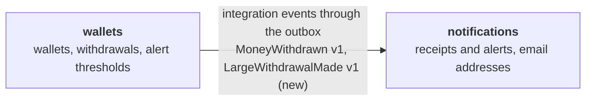
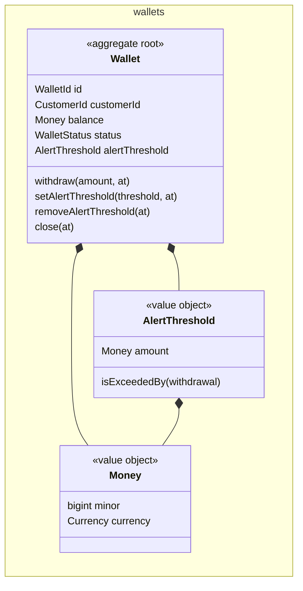
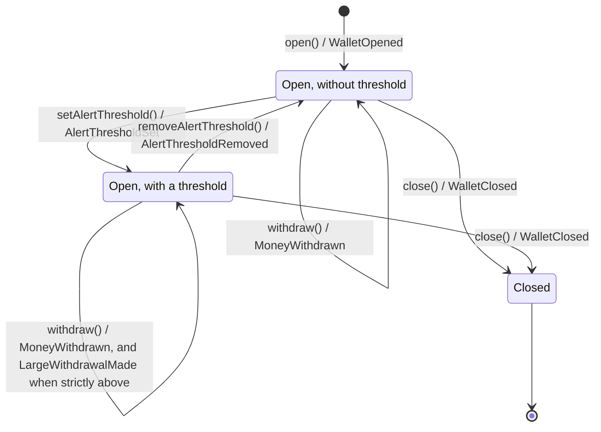
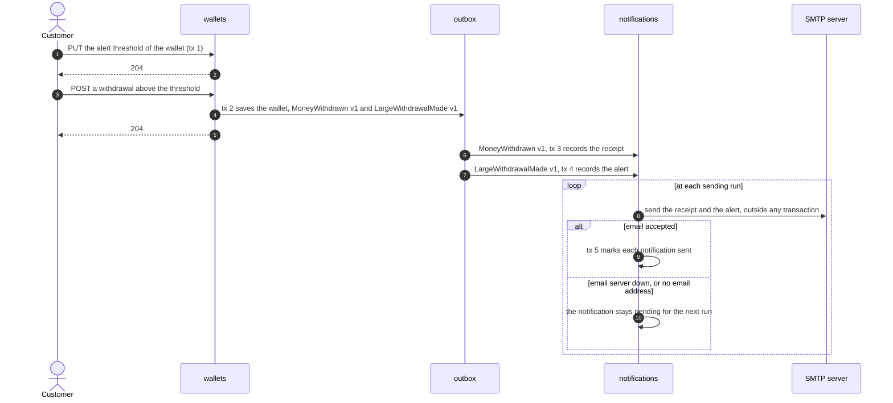
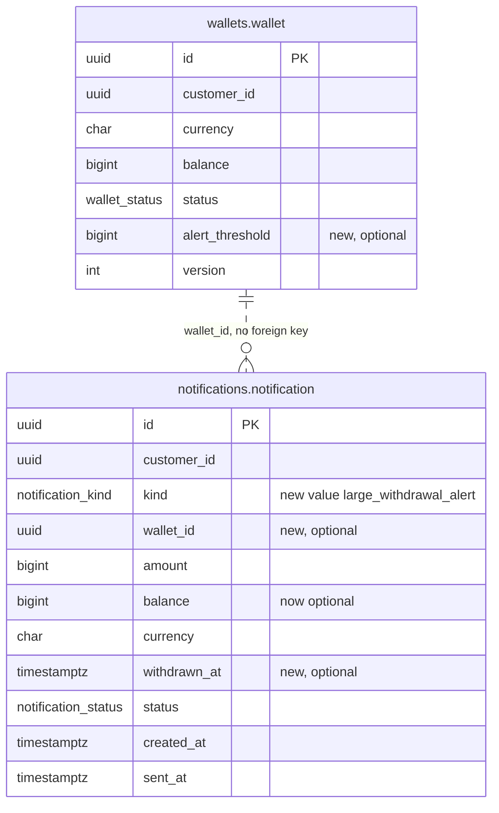

<!--
FILLING RULES. This comment stays in the document: it does not render.

Writing
- The language of the story, headings included. Short sentences, one idea per sentence.
- A section with no content keeps its heading and says "None.". Never remove a section: its absence does not tell whether the question was asked.
- Section numbers (1 to 15, A to C) never change: tools find a section by its number.
- Alveolus rule codes (AGG-06, PUB-07...) go to appendix B. In the body, only when a rule is itself the subject (a question, a waiver).
- Blocks between angle brackets are to be replaced. Help comments are removed once their section is filled, except this one.

Identifiers
- AC-n acceptance criterion, D-n decision, Q-n question, INV-n invariant, T-n test, In increment, ADR-n, W-n waiver.
- Prefix:Name for the elements of the model: AGG:, VO:, ERR:, EVT:, UC:, QRY:, API:, TBL:.
- An element is defined once, in one place:
  - AC, D, Q, INV, T, I, ADR, W: in the first column of a table row ("| AC-1 |").
  - AGG: in a heading "### 7.<n> <context>: AGG:<Name> (<new | existing, changed>)".
  - TBL: in a heading "### TBL:<schema>.<table> (<new | existing>)".
  - VO, ERR, EVT, UC, QRY, API: in the first column of a table row.
- Elsewhere, cite the identifier, never copy the definition.
- When two contexts share a name (CTX-08), prefix it with the context: AGG:payments/Transfer.

Checks before "approved", run by `alveolus-claude design check <file>`
- Every identifier cited is defined.
- Every AC and every INV is proven by at least one T.
- Every D has a reason. Every Q has an assumption and says what it blocks.
- Every increment says why it is safe to merge.
- Every Mermaid diagram renders without error.
-->

# Alert on a large withdrawal

> **How to read this document.** The business reads parts 1 and 2. The tech team reads everything. Identifiers (`AC-n`, `D-n`, `Q-n`, `INV-n`, `UC:...`) point to their definition in the document. The Alveolus rules applied are gathered in appendix B.

## Summary

A customer can set an alert threshold on each of their wallets, change it and remove it. The threshold lives with the wallet, in the wallet's currency. When a withdrawal is strictly above it, the wallet records a "large withdrawal" at the same moment as the withdrawal itself. The notifications side receives that fact, and emails the customer an alert with the wallet, the amount and the date, alongside the withdrawal receipt they already get. If the email server or the application is down, nothing is lost: the alert waits and leaves at the next sending run.

| | |
| --- | --- |
| Contexts touched | wallets (alert threshold on the wallet, new published event), notifications (alert email) |
| Decisions to validate | 8, in part 2 |
| Blocking questions | Business: Q-1, Q-2, Q-5, Q-6. Tech team: Q-8, Q-9, Q-10 |
| Delivery | 7 increments, the HTTP routes of wallets come last |

---

# Part 1. The need

## 1. Story

As a customer, I want an alert when a large withdrawal is made from one of my wallets, so that I can react quickly if it was not me.

**What already exists.**

- In wallets, the aggregate `Wallet` opens, withdraws and closes. A withdrawal records `MoneyWithdrawn`, which the translator publishes as `wallets.wallet.MoneyWithdrawn` version 1, through the outbox, in the transaction of the withdrawal.
- In notifications, a consumer records a pending `withdrawal_receipt` for each `MoneyWithdrawn`. A scheduler sends the pending notifications by SMTP, to the address the customer set with `PUT /customers/{customerId}/email`, and marks them sent.
- Nothing knows a threshold or an alert today.
- No route authenticates its caller. No use case deposits money: balances only come from stored data.
- The only test is the unit test of the aggregate. The repository has no migration folder and no integration test setup.

The story builds on the withdrawal of `Wallet`, on the outbox, and on the pending notifications of notifications.

## 2. Acceptance criteria

In every row, Alice owns the wallet W1, in euros, with a balance of 1,000.00 EUR, and her email address is alice@example.com.

| ID | Given | When | Then |
| --- | --- | --- | --- |
| AC-1 | W1 has no alert threshold | Alice sets the threshold of W1 to 500.00 EUR | W1 has a threshold of 500.00 EUR |
| AC-2 | W1 has a threshold of 500.00 EUR | Alice sets the threshold of W1 to 200.00 EUR | W1 has a threshold of 200.00 EUR |
| AC-3 | W1 has a threshold of 500.00 EUR | Alice removes the threshold of W1 | W1 has no threshold |
| AC-4 | W1 has a threshold of 500.00 EUR | 500.01 EUR is withdrawn from W1 on 2026-03-02 at 09:30 UTC | Alice receives an alert email that names W1, 500.01 EUR and 2026-03-02 09:30 UTC |
| AC-5 | W1 has a threshold of 500.00 EUR | exactly 500.00 EUR is withdrawn from W1 | Alice receives the withdrawal receipt, and no alert email |
| AC-6 | W1 has a threshold of 500.00 EUR | 120.00 EUR is withdrawn from W1 | Alice receives the withdrawal receipt, and no alert email |
| AC-7 | W1 has no threshold | 900.00 EUR is withdrawn from W1 | Alice receives the withdrawal receipt, and no alert email |
| AC-8 | W1 has a threshold of 500.00 EUR | 600.00 EUR is withdrawn from W1 | Alice receives the withdrawal receipt as before, and the alert email, as two separate emails |
| AC-9 | W1 has no threshold | Alice sets a threshold of 500.00 USD on W1 | The request is refused as a currency mismatch, and W1 still has no threshold (D-4) |
| AC-10 | W1 is closed, with a zero balance and a threshold of 500.00 EUR | Alice sets or removes the threshold of W1 | The request is refused because the wallet is closed, and the threshold stays 500.00 EUR (Q-6) |

## 3. Out of scope

- Knowing who calls: the routes, like every route of the app, do not authenticate the caller (W-1).
- Any channel other than email: no SMS, no push.
- Telling the customer that a threshold was set, changed or removed (Q-7).
- Reading a threshold back: no route shows the threshold of a wallet.
- A threshold per customer across all their wallets, or on the total withdrawn over a day.
- Blocking or delaying a large withdrawal: the alert never stops a withdrawal.
- Repairing the pending notifications that never leave for lack of an email address (Q-11).
- A deposit use case.

---

# Part 2. To validate

## 4. Design decisions

| ID | Decision | Why | Rejected alternative | ADR |
| --- | --- | --- | --- | --- |
| D-1 | The alert threshold belongs to the wallet, in wallets, as a part of AGG:Wallet. | The threshold is an amount in the currency of the wallet, and only the wallet knows that currency and its owner. The wallet compares the withdrawal with the threshold in the same transaction as the withdrawal, so no withdrawal escapes the check. | A preference in notifications, next to the email address: notifications would need the currency and the owner of each wallet, through a call to wallets or a copy of its data, and would redo a wallets calculation on raw data. A separate aggregate for the alert settings: a second aggregate read in each withdrawal, for no invariant of its own. | None. |
| D-2 | The wallet records a distinct fact, EVT:LargeWithdrawalMade, published as a new integration event `wallets.wallet.LargeWithdrawalMade` version 1. `MoneyWithdrawn` version 1 does not change. | "Alert me if" is a business fact, and it deserves a name. The receipt keeps its message, so it keeps working whatever happens to the alert (AC-8). | A flag "above the threshold" added to `MoneyWithdrawn`: it changes the meaning of a published message read by the receipt, for a concern that is not the receipt's. | None. |
| D-3 | Notifications records the alert as a pending notification of a new kind, `large_withdrawal_alert`, sent by the existing scheduler. | The alert gets the same path as the receipt: recorded in a transaction, emailed outside it, retried at the next run when the email server fails. | Emailing from the consumer, as soon as the message arrives: a remote call inside the transaction of the consumer, and an alert lost when the email server is down. | None. |
| D-4 | A threshold in another currency than its wallet is refused, with ERR:CurrencyMismatch. | A withdrawal can only be compared with an amount in its own currency, and no exchange rate exists in the app. | Converting the threshold with an exchange rate: no rate source, and a threshold that moves with the market. | None. |
| D-5 | Removing a threshold from a wallet that has none succeeds, and records nothing. | The customer's intent, no threshold, is met. A repeated request gets the same answer. | Refusing with a "no threshold" error: a retry after a lost response would fail. | None. |
| D-6 | The published message carries the wallet, the customer and the amount. The date of the withdrawal is the date of the message envelope. It carries neither the threshold nor the balance. | The consumer reads only these fields. Less data published is less personal data spread. | Adding the threshold and the balance "in case": a contract wider than its use, harder to change later. | None. |
| D-7 | The alert is a row of the existing table `notifications.notification`, with two new optional columns, the wallet and the date of the withdrawal. The balance becomes optional. A check per kind keeps each row complete. | One table and one sending path for every kind of notification. The checks keep a receipt with its balance, and an alert with its wallet and date. | A separate table for alerts, with its own scheduler: a parallel version of what exists. | None. |
| D-8 | The threshold is a resource of the wallet: `PUT /wallets/{id}/alert-threshold` sets or replaces it, `DELETE /wallets/{id}/alert-threshold` removes it. | One resource per intent. Both verbs can be repeated safely. | `PATCH /wallets/{id}` with an optional field: a generic update, where the intent is lost. | None. |

## 5. Open questions

### For the business

| ID | Question | Assumption meanwhile | Blocks |
| --- | --- | --- | --- |
| Q-1 | A wallet has no name. How does the email name the wallet? | By its currency and its identifier: "your EUR wallet 0190f5a2-7c1e-…". | I5 (email template) |
| Q-2 | In which time zone, and in which format, does the email give the date? | Date and time in UTC, to the minute: "2026-03-02 09:30 UTC". | I5 (email template) |
| Q-3 | "Within a minute": a wish, or a commitment we monitor and alert on? | A commitment: the sending run is set to 30 seconds or less in production, and an alert still pending 60 seconds after its withdrawal raises an operations alert. | Section 13, production configuration |
| Q-4 | When the customer has no email address, the alert waits, and leaves once the address is set, maybe days later. Should a late alert still leave? | Yes, as the receipt does today. | I5 |
| Q-5 | Can a threshold be zero, to be alerted on every withdrawal? | Yes: any amount of zero or more is accepted. | I1, AC-1 |
| Q-6 | Can a customer set or remove the threshold of a closed wallet? | No: a closed wallet refuses every change, as it refuses a withdrawal (AC-10). | I1, AC-10 |
| Q-7 | Should the customer be told when a threshold is set, changed or removed? Someone else could remove it to hide a withdrawal. | No, in this story. A later story can add it. | None |

### For the tech team

| ID | Question | Assumption meanwhile | Blocks |
| --- | --- | --- | --- |
| Q-8 | No route of the app authenticates its caller, so nothing checks that the wallet belongs to the caller. How do we authorize the threshold routes? | Like the existing wallet routes, under the waiver W-1, until an authentication story lands. | I7 |
| Q-9 | The repository has no `prisma/migrations` folder. How is the production schema migrated today? | A baseline migration of the existing schema is created, and marked applied in production with `prisma migrate resolve`, before the first change. | I3, I4, I5 |
| Q-10 | The app has no integration or end-to-end test setup. Can the CI run Docker? | Yes: the tests start PostgreSQL and Mailpit with Testcontainers. | I3 |
| Q-11 | A notification without an email address stays pending, and each run reads the 100 oldest pending ones. Once 100 such notifications pile up, no newer notification leaves, alerts included. Do we fix it in this story? | No: a separate task. The operations alert of section 13 shows it. | None (risk on the delay of AC-4 in production) |
| Q-12 | What is the polling interval of the outbox forwarder, which is not in the repository? | A few seconds, small against the one minute target. | Q-3 |

### On the rules

| ID | Question | Assumption meanwhile | Blocks |
| --- | --- | --- | --- |
| Q-13 | TXS-08: `NotificationService.send` now chooses the email by kind. Is this the repeated branching on one field that TXS-08 warns about? | Not yet: one choice of template. The question comes back with a third kind. | None |
| Q-14 | MAP-01 and CTX-03 point to a context map and a glossary, and the repository has neither. | Sections 6.2 and 6.3 stand in for them. No file is created in this story. | None |
| Q-15 | PUB-01 asks for a documented schema of each published message, and `public` only holds TypeScript types today. | The new message follows the existing TypeScript types, as `MoneyWithdrawn` does. | None |

---

# Part 3. Design

## 6. Contexts and language

### 6.1 New bounded context

None.

### 6.2 Relationships

| Upstream | Downstream | Patterns (upstream / downstream) | Integration | Contract | Change |
| --- | --- | --- | --- | --- | --- |
| wallets | notifications | Published language / Conformist | Integration events through the outbox, delivered in process | `src/wallets/public/wallets.integration-events.ts` | New message `wallets.wallet.LargeWithdrawalMade` version 1, beside `wallets.wallet.MoneyWithdrawn` version 1, unchanged |

### 6.3 Glossary

| Context | Term | Code | Definition | Rejected terms |
| --- | --- | --- | --- | --- |
| wallets | Alert threshold | `AlertThreshold` | The amount, in the currency of the wallet, above which a withdrawal from this wallet is large. The customer sets it, changes it and removes it. | limit, ceiling: both suggest the withdrawal is blocked |
| wallets | Large withdrawal | `LargeWithdrawalMade` | A withdrawal whose amount is strictly above the alert threshold of its wallet. | suspicious withdrawal: the wallet does not judge fraud |
| notifications | Large withdrawal alert | `large_withdrawal_alert` | The email that tells the customer a large withdrawal was made from one of their wallets, with the wallet, the amount and the date. | warning, fraud alert |

## 7. Model

### 7.1 wallets: AGG:Wallet (existing, changed)

The wallet holds the money of a customer in one currency. It now also holds the alert threshold the customer chose, and tells when a withdrawal goes above it.

- **Identity**: `WalletId`, a UUIDv7 generated by the repository when the wallet opens. Unchanged.
- **Holds**: its balance, its status, and at most one VO:AlertThreshold.
- **References**: the customer, by `CustomerId`.

Every method is in the state diagram.

| ID | Invariant | Guarded by | If broken |
| --- | --- | --- | --- |
| INV-1 | An alert threshold is in the currency of its wallet. | `Wallet.setAlertThreshold` | Refused with ERR:CurrencyMismatch. Nothing changes, nothing is recorded. |
| INV-2 | A withdrawal strictly above the alert threshold records EVT:LargeWithdrawalMade right after EVT:MoneyWithdrawn. A withdrawal at or below it, or from a wallet without one, records only EVT:MoneyWithdrawn. | `Wallet.withdraw`, with `AlertThreshold.isExceededBy` | Not refusable: it is a rule of the withdrawal. A broken rule means a missed or a false alert, which the domain tests prevent. |
| INV-3 | The alert threshold of a closed wallet does not change. | `Wallet.setAlertThreshold`, `Wallet.removeAlertThreshold` | Refused with ERR:WalletIsClosed. Nothing changes, nothing is recorded. |

### 7.2 notifications: scripts

| Script | Use case | Checks before writing | Refusals |
| --- | --- | --- | --- |
| `NotificationService.recordLargeWithdrawalAlert` (new) | UC:RecordLargeWithdrawalAlert | None: the message was validated by the consumer, and duplicates were discarded before. | None |
| `NotificationService.send` (existing, changed) | UC:SendNotification | The notification exists and is pending. The customer has an email address. | ERR:NotificationNotPending, ERR:NoEmailAddress, both existing |

### Value objects

| ID | Context | Holds | Validity |
| --- | --- | --- | --- |
| VO:AlertThreshold | wallets | An amount of `Money`. Tells whether a withdrawn amount is strictly above it. | Built from a valid `Money`: zero or more, in a supported currency. Its currency matches the wallet's, which the wallet checks (INV-1). |

### Errors

| ID | Context | Refusal | Raised by |
| --- | --- | --- | --- |
| ERR:CurrencyMismatch | wallets | The threshold is not in the currency of the wallet. Existing error, new use. | `Wallet.setAlertThreshold` |
| ERR:WalletIsClosed | wallets | The wallet is closed. Existing error, new use. | `Wallet.setAlertThreshold`, `Wallet.removeAlertThreshold` |
| ERR:WalletNotFound | wallets | No wallet has this identifier. Existing error. | UC:SetAlertThreshold, UC:RemoveAlertThreshold |
| ERR:InvalidMoney | wallets | The amount is negative. Existing error. | UC:SetAlertThreshold, through `Money.of` |
| ERR:UnsupportedCurrency | wallets | The currency is not supported. Existing error. | UC:SetAlertThreshold, through `Currency.of` |
| ERR:InvalidIdentifier | wallets | The wallet identifier is not a UUID. Existing error. | UC:SetAlertThreshold, UC:RemoveAlertThreshold, through `WalletId.of` |
| ERR:NotificationNotPending | notifications | The notification does not exist or was already sent. Existing error. | UC:SendNotification |
| ERR:NoEmailAddress | notifications | The customer has no email address. Existing error. | UC:SendNotification |

### Ports

| Port | Context | Role | Implemented by |
| --- | --- | --- | --- |
| `WalletRepository` (existing, unchanged) | wallets | Loads and saves whole wallets, threshold included | `PrismaWalletRepository`, through `WalletMapper` (changed) |
| `EmailSender` (existing, changed) | notifications | Sends the emails of notifications. Gains `sendLargeWithdrawalAlert`, beside `sendReceipt`. | `SmtpEmailSender` (changed) |

## 8. Processes and events

If the application stops after tx 2, the outbox keeps both messages and the forwarder delivers them on restart. A message delivered twice is discarded by its identifier. If it stops between an accepted email and tx 5, that email leaves a second time at the next run, as a receipt does today.

### Domain events

| ID | Context | Fact | Payload | Triggers |
| --- | --- | --- | --- | --- |
| EVT:AlertThresholdSet | wallets | The customer set or replaced the alert threshold of a wallet. | walletId, customerId, threshold, occurredAt | Nothing: no handler in this story. |
| EVT:AlertThresholdRemoved | wallets | The customer removed the alert threshold of a wallet. | walletId, customerId, occurredAt | Nothing: no handler in this story. |
| EVT:LargeWithdrawalMade | wallets | A withdrawal strictly above the alert threshold was made. | walletId, customerId, amount, threshold, occurredAt | `WalletEventsTranslator`, synchronous: writes `wallets.wallet.LargeWithdrawalMade` v1 in the outbox. |
| EVT:MoneyWithdrawn | wallets | Money was withdrawn. Existing, unchanged. | walletId, customerId, amount, balance, occurredAt | `WalletEventsTranslator`: `wallets.wallet.MoneyWithdrawn` v1, unchanged. |

### Messages between contexts

| Message | From → to | Version | Fields | Consumer side |
| --- | --- | --- | --- | --- |
| `wallets.wallet.LargeWithdrawalMade` (new) | wallets → notifications | 1 | Envelope: id, type, version, source, occurredAt, correlationId. Payload: walletId, customerId, amount (minor as a string, currency). | Consumer `notifications.large-withdrawal-alert`. It reads id, type, version, occurredAt, walletId, customerId and amount, and ignores the rest. A duplicate is discarded by its message id, in the transaction that records the alert. Order does not matter: each alert stands alone. |
| `wallets.wallet.MoneyWithdrawn` (existing) | wallets → notifications | 1 | Unchanged. | Consumer `notifications.withdrawal-receipt`, unchanged. |

## 9. Use cases

### wallets

| Use case | Triggered by | Outside the transaction | Inside the transaction | Events |
| --- | --- | --- | --- | --- |
| UC:SetAlertThreshold | API:SetAlertThreshold | Reads the wallet identifier, the currency and the amount as value objects | Loads the wallet, sets the threshold, saves the wallet, dispatches its events | EVT:AlertThresholdSet |
| UC:RemoveAlertThreshold | API:RemoveAlertThreshold | Reads the wallet identifier | Loads the wallet, removes the threshold, saves the wallet, dispatches its events | EVT:AlertThresholdRemoved, or none when no threshold was set |
| UC:WithdrawMoney | `POST /wallets/{id}/withdrawals`, existing | Unchanged | Code unchanged. The wallet now also records the large withdrawal, and the translator writes its message in the same transaction. | EVT:MoneyWithdrawn, and EVT:LargeWithdrawalMade when strictly above the threshold |

What holds for every command:

- Before the transaction, the command turns its input into value objects. An invalid input returns its refusal, and no transaction opens.
- No command calls another context: wallets refuses nothing on behalf of notifications.
- A technical failure rolls the transaction back. A wallet changed by another request since it was read fails the transaction, as for a withdrawal today. The caller can repeat the request.
- A repeated `PUT` leaves the same threshold, and records the fact again. A repeated `DELETE` succeeds and records nothing.

Specifics:

- **UC:SetAlertThreshold** returns `Result<void, InvalidIdentifier | UnsupportedCurrency | InvalidMoney | WalletNotFound | WalletIsClosed | CurrencyMismatch>`. No authorization today (W-1).
- **UC:RemoveAlertThreshold** returns `Result<void, InvalidIdentifier | WalletNotFound | WalletIsClosed>`. No authorization today (W-1).

### notifications

| Use case | Triggered by | Outside the transaction | Inside the transaction | Events |
| --- | --- | --- | --- | --- |
| UC:RecordLargeWithdrawalAlert | Message `wallets.wallet.LargeWithdrawalMade` v1, through `LargeWithdrawalMadeConsumer` | The consumer validates the fields it reads | Inserts a pending notification of kind `large_withdrawal_alert`, with the customer, the wallet, the amount, the currency and the date of the withdrawal. The message is marked processed in the same transaction. | None |
| UC:SendNotification | `PendingNotificationsScheduler`, at each run. Existing, changed. | Reads the notification and the address, then sends the email of its kind: the receipt or the alert | Marks the notification sent | None |

What holds for every command:

- The consumer reads the message before the transaction. A message it cannot read fails, and the forwarder handles it as for the receipt today.
- No call to another context: everything the alert needs is in the message.
- A technical failure rolls the transaction back, and the message is delivered again.
- A replayed message is discarded by its identifier, so one withdrawal gives at most one alert.

Specifics:

- **UC:RecordLargeWithdrawalAlert** returns `Result<void, never>`.
- **UC:SendNotification** keeps its signature. It sends the email outside any transaction, as today.

## 10. Contracts

### HTTP routes

| ID | Request | Success | Errors | Access |
| --- | --- | --- | --- | --- |
| API:SetAlertThreshold | `PUT /wallets/{id}/alert-threshold`, body `{ "threshold": { "minor": "50000", "currency": "EUR" } }` | 204, no body | 400 `InvalidIdentifier`, `InvalidMoney`, or a body that fails validation. 404 `WalletNotFound`. 409 `WalletIsClosed`. 422 `UnsupportedCurrency`, `CurrencyMismatch`. | As the other wallet routes: no authentication today (W-1) |
| API:RemoveAlertThreshold | `DELETE /wallets/{id}/alert-threshold` | 204, no body, also when no threshold was set | 400 `InvalidIdentifier`. 404 `WalletNotFound`. 409 `WalletIsClosed`. | As the other wallet routes: no authentication today (W-1) |

### Facade wallets

None.

## 11. Data

### TBL:wallets.wallet (existing)

| Column | Type | Null | Comes from |
| --- | --- | --- | --- |
| `alert_threshold` (new) | `BigInt`, minor units of the currency in `currency` | yes | VO:AlertThreshold of the wallet, null when the wallet has none |

The other columns do not change.

- **Constraints**: none new. The wallet alone guarantees the threshold, its currency and its sign.
- **Indexes**: none new. The threshold is read with its wallet, by identifier.
- **Deletion**: never. Removing a threshold sets the column to null.

### TBL:notifications.notification (existing)

| Column | Type | Null | Comes from |
| --- | --- | --- | --- |
| `kind` (changed) | enum `notification_kind`, new value `large_withdrawal_alert` | no | The script that records the notification |
| `wallet_id` (new) | `String @db.Uuid` | yes, required for an alert | `payload.walletId` of `LargeWithdrawalMade` v1 |
| `withdrawn_at` (new) | `DateTime @db.Timestamptz(3)` | yes, required for an alert | `occurredAt` of the envelope of `LargeWithdrawalMade` v1 |
| `balance` (changed) | `BigInt` | becomes yes, still required for a receipt | `payload.balance` of `MoneyWithdrawn` v1, unchanged |

- **Constraints**: two checks, written by hand in the migration, as Prisma cannot declare them. A `withdrawal_receipt` has a balance. A `large_withdrawal_alert` has a wallet and a date of withdrawal.
- **Indexes**: none new. The existing index on `status, created_at` serves the sending run, for both kinds.
- **Deletion**: unchanged. The app never deletes a notification.

### Repositories, views and outbox

| Component | Context | Role |
| --- | --- | --- |
| `PrismaWalletRepository` and `WalletMapper` | wallets | Write and read `alert_threshold` with the wallet. A stored threshold is read back through `Money` and VO:AlertThreshold. |
| `WalletEventsTranslator` | wallets | Turns EVT:LargeWithdrawalMade into `wallets.wallet.LargeWithdrawalMade` v1, written in `outbox.event` in the transaction of the withdrawal. |
| `outbox.processed_message` | shared | Remembers the messages handled by `notifications.large-withdrawal-alert`, to discard duplicates. |

### Migrations

| Order | Context | Migration | Safe for the version in production |
| --- | --- | --- | --- |
| 1 | shared | `0_init`: the existing schema of every context, as a baseline (Q-9) | Yes: it is marked applied in production and changes no table. |
| 2 | wallets | `add_wallet_alert_threshold`: adds the optional column `alert_threshold` | Yes: the running version neither reads nor writes it, and its updates leave it untouched. |
| 3 | notifications | `add_large_withdrawal_alert_kind`: adds the value `large_withdrawal_alert` to `notification_kind` | Yes: the running version never writes it. It is a migration of its own, as PostgreSQL cannot use a new enum value in the transaction that adds it. |
| 4 | notifications | `add_notification_alert_columns`: adds `wallet_id` and `withdrawn_at`, makes `balance` optional, adds the two checks | Yes: the running version always writes a balance, and every existing row is a receipt with a balance, so the checks hold. |

## 12. External integrations

The SMTP server, already used for the receipts. The alert goes through the same `SmtpEmailSender` and the same connection, with a template of its own. The call policy does not change: the email leaves outside any transaction, and a failure leaves the notification pending for the next run. In the tests, a Mailpit server stands in for the SMTP server. No contract test: SMTP is a standard protocol, and no field is read back from the server.

## 13. Operations

- **Correlation**: the correlation identifier of the withdrawal request. The outbox records it with `LargeWithdrawalMade`, and the consumer resumes it before recording the alert. The logs of the sending run carry the notification identifier.
- **Alerts**: an alert notification still pending 60 seconds after its withdrawal raises an operations alert, from I6 on (Q-3). The existing alerts on the outbox and its dead letters cover the new message.
- **Personal data**: the message carries identifiers and an amount, never the email address. The address stays in `notifications.notification_channel`. The alert email goes only to the address the customer set. Logs carry identifiers only.

---

# Part 4. Delivery

## 14. Increments

Each increment is deployed to production before the next one merges. The alert crosses two contexts, so it is cut by context and by layer, not in one increment. The route that lets a customer set a threshold comes last: no threshold exists before every piece that turns it into an email is running.

| # | Context | Increment | Covers | Done when | Safe because | State |
| --- | --- | --- | --- | --- | --- | --- |
| I1 | wallets | Domain: the alert threshold of the wallet, and the large withdrawal | AC-1, AC-2, AC-3, AC-4, AC-5, AC-6, AC-7, AC-9, AC-10, INV-1, INV-2, INV-3 | T-1 to T-8 green, and the domain stays fully covered | Nothing calls the new methods. A wallet restored without a threshold withdraws exactly as before, and the existing aggregate tests stay green. | todo |
| I2 | wallets | Use cases UC:SetAlertThreshold and UC:RemoveAlertThreshold | AC-1, AC-2, AC-3, AC-9, AC-10 | Type check and lint green. T-10 and T-11 prove them end to end in I7. | The handlers are not in the module: no route reaches them. | todo |
| I3 | shared | Test setup and baseline migration | None: groundwork for the tests of I4 to I7 | The existing tests run in the new setup. A disposable PostgreSQL gets its schema from the committed migrations, and a Mailpit server starts. | Test tooling only, and a baseline migration marked applied in production: no table changes. | todo |
| I4 | wallets | Store the threshold, publish the large withdrawal | AC-1, AC-3, AC-4 | T-9 green | The new column is optional, and no threshold can be set before I7: the mapper reads null, and the translator never publishes the new message. `MoneyWithdrawn` v1 does not change. | todo |
| I5 | notifications | Record and email the alert, with its schema | AC-4, AC-8 | T-13 and T-14 green | No code records an alert yet, so no alert row exists. The receipt keeps its template, proven by T-13 and T-14. The migrations only add or relax, and existing rows meet the new checks. | todo |
| I6 | notifications | Consume `LargeWithdrawalMade` | AC-4, AC-8 | T-15 green | Wallets cannot publish the message before I7. The consumer has its own name, so the receipt consumer does not change. | todo |
| I7 | wallets | HTTP routes and wiring | AC-1, AC-2, AC-3, AC-4, AC-5, AC-6, AC-7, AC-8, AC-9, AC-10 | T-10, T-11 and T-12 green | Every running version already stores the threshold, publishes the message and consumes it, so the first threshold set already produces alerts. The existing routes do not change. | todo |

## 15. Tests

| ID | Proves | File | Level |
| --- | --- | --- | --- |
| T-1 | AC-1: an open wallet without threshold takes one, and records EVT:AlertThresholdSet with the wallet, the customer and the threshold | `src/wallets/internal/domain/wallet/__test__/wallet.aggregate.spec.ts` | unit |
| T-2 | AC-2: setting a threshold again replaces it, and records EVT:AlertThresholdSet with the new one | `src/wallets/internal/domain/wallet/__test__/wallet.aggregate.spec.ts` | unit |
| T-3 | AC-3: removing a threshold leaves none, and records EVT:AlertThresholdRemoved. Removing when none is set succeeds and records nothing. | `src/wallets/internal/domain/wallet/__test__/wallet.aggregate.spec.ts` | unit |
| T-4 | INV-1, AC-9: a threshold in USD on a EUR wallet is refused with ERR:CurrencyMismatch, the wallet keeps its threshold, and no event is recorded | `src/wallets/internal/domain/wallet/__test__/wallet.aggregate.spec.ts` | unit |
| T-5 | INV-3, AC-10: a closed wallet refuses to set and to remove a threshold with ERR:WalletIsClosed, and records no event | `src/wallets/internal/domain/wallet/__test__/wallet.aggregate.spec.ts` | unit |
| T-6 | INV-2 holds, AC-4: 500.01 EUR withdrawn above a threshold of 500.00 EUR records EVT:MoneyWithdrawn then EVT:LargeWithdrawalMade, with the wallet, the customer, the amount and the date | `src/wallets/internal/domain/wallet/__test__/wallet.aggregate.spec.ts` | unit |
| T-7 | INV-2 resists, AC-5, AC-6, AC-7: 500.00 EUR and 120.00 EUR withdrawn under a threshold of 500.00 EUR, and 900.00 EUR from a wallet without threshold, record only EVT:MoneyWithdrawn | `src/wallets/internal/domain/wallet/__test__/wallet.aggregate.spec.ts` | unit |
| T-8 | INV-2: VO:AlertThreshold is exceeded only by an amount strictly above it, a zero threshold by any positive amount, and two thresholds of the same amount are equal | `src/wallets/internal/domain/wallet/__test__/alert-threshold.value-object.spec.ts` | unit |
| T-9 | AC-1, AC-3: a wallet saved with a threshold reads back with it, a removed threshold reads back as none, and a row stored before the column existed reads as a wallet without threshold | `src/wallets/internal/driven/prisma/__test__/prisma-wallet.repository.integration-spec.ts` | integration |
| T-10 | AC-1, AC-2, AC-9, AC-10: API:SetAlertThreshold answers 204, then 404 for an unknown wallet, 409 for a closed one, 422 for another currency, 400 for an invalid body | `src/wallets/__test__/scenarios/set-alert-threshold.e2e-spec.ts` | end-to-end |
| T-11 | AC-3: API:RemoveAlertThreshold answers 204, twice in a row, and a later withdrawal above the old threshold publishes no `LargeWithdrawalMade` | `src/wallets/__test__/scenarios/remove-alert-threshold.e2e-spec.ts` | end-to-end |
| T-12 | AC-4, AC-5, AC-6, AC-7, AC-8: with a threshold set by API:SetAlertThreshold, a withdrawal above it writes `MoneyWithdrawn` v1 and `LargeWithdrawalMade` v1 in the outbox, with the same correlation identifier and the expected payload. At or below the threshold, or without one, only `MoneyWithdrawn` v1. | `src/wallets/__test__/scenarios/withdraw-money.e2e-spec.ts` | end-to-end |
| T-13 | AC-4, AC-8: UC:RecordLargeWithdrawalAlert stores a pending alert with the wallet, the amount and the date. UC:SendNotification emails it and marks it sent, still emails a receipt with the receipt template, and leaves an alert pending when the customer has no address. | `src/notifications/internal/application/__test__/notification.service.integration-spec.ts` | integration |
| T-14 | AC-4, AC-8: `SmtpEmailSender` sends an alert that names the wallet, 500.01 EUR and 2026-03-02 09:30 UTC, and a receipt unchanged | `src/notifications/internal/driven/smtp/__test__/smtp-email-sender.adapter.integration-spec.ts` | integration |
| T-15 | AC-4, AC-8: delivering `LargeWithdrawalMade` v1 and `MoneyWithdrawn` v1 of one withdrawal, then running the sending, leaves two emails to alice@example.com, the receipt and the alert. The same `LargeWithdrawalMade` delivered twice gives one alert. | `src/notifications/__test__/scenarios/record-large-withdrawal-alert.e2e-spec.ts` | end-to-end |

---

# Appendices

## A. Files

### Project artifacts

| Inc. | File | New or changed |
| --- | --- | --- |
| I3 | `prisma/migrations/0_init/migration.sql` | new |
| I3 | `prisma/migrations/migration_lock.toml` | new |
| I3 | `vitest.config.ts` | new |
| I3 | `package.json` (Testcontainers in the dev dependencies, test scripts) | changed |
| I4 | `prisma/wallets.prisma` | changed |
| I4 | `prisma/migrations/<timestamp>_add_wallet_alert_threshold/migration.sql` | new |
| I5 | `prisma/notifications.prisma` | changed |
| I5 | `prisma/migrations/<timestamp>_add_large_withdrawal_alert_kind/migration.sql` | new |
| I5 | `prisma/migrations/<timestamp>_add_notification_alert_columns/migration.sql` | new |
| I7 | `README.md` | changed |

### Code

| Inc. | File | New or changed |
| --- | --- | --- |
| I1 | `src/wallets/internal/domain/wallet/alert-threshold.value-object.ts` | new |
| I1 | `src/wallets/internal/domain/wallet/wallet.aggregate.ts` | changed |
| I1 | `src/wallets/internal/domain/wallet/wallet.events.ts` | changed |
| I1 | `src/wallets/internal/domain/wallet/__test__/wallet.fixtures.ts` | changed |
| I1 | `src/wallets/internal/domain/wallet/__test__/wallet.aggregate.spec.ts` | changed |
| I1 | `src/wallets/internal/domain/wallet/__test__/alert-threshold.value-object.spec.ts` | new |
| I2 | `src/wallets/internal/application/wallet/set-alert-threshold.command.ts` | new |
| I2 | `src/wallets/internal/application/wallet/remove-alert-threshold.command.ts` | new |
| I3 | `src/shared/__test__/database.global-setup.ts` | new |
| I3 | `src/shared/__test__/database.setup.ts` | new |
| I3 | `src/shared/__test__/mail.global-setup.ts` | new |
| I4 | `src/wallets/internal/driven/prisma/wallet.mapper.ts` | changed |
| I4 | `src/wallets/internal/driven/outbox/wallet-events.translator.ts` | changed |
| I4 | `src/wallets/public/wallets.integration-events.ts` | changed |
| I4 | `src/wallets/composition/event-handlers.composition.ts` | changed |
| I4 | `src/wallets/internal/driven/prisma/__test__/prisma-wallet.repository.integration-spec.ts` | new |
| I5 | `src/notifications/internal/application/notification.service.ts` | changed |
| I5 | `src/notifications/internal/application/email-sender.port.ts` | changed |
| I5 | `src/notifications/internal/driven/smtp/smtp-email-sender.adapter.ts` | changed |
| I5 | `src/notifications/internal/application/__test__/notification.service.integration-spec.ts` | new |
| I5 | `src/notifications/internal/driven/smtp/__test__/smtp-email-sender.adapter.integration-spec.ts` | new |
| I6 | `src/notifications/internal/driving/in-process/large-withdrawal-made.consumer.ts` | new |
| I6 | `src/notifications/composition/notifications.module.ts` | changed |
| I6 | `src/notifications/__test__/support/notification.driver.ts` | new |
| I6 | `src/notifications/__test__/scenarios/record-large-withdrawal-alert.e2e-spec.ts` | new |
| I7 | `src/wallets/internal/driving/http/set-alert-threshold.request.ts` | new |
| I7 | `src/wallets/internal/driving/http/wallet.controller.ts` | changed |
| I7 | `src/wallets/composition/wallets.module.ts` | changed |
| I7 | `src/wallets/__test__/support/wallet.driver.ts` | new |
| I7 | `src/wallets/__test__/support/outbox.driver.ts` | new |
| I7 | `src/wallets/__test__/scenarios/set-alert-threshold.e2e-spec.ts` | new |
| I7 | `src/wallets/__test__/scenarios/remove-alert-threshold.e2e-spec.ts` | new |
| I7 | `src/wallets/__test__/scenarios/withdraw-money.e2e-spec.ts` | new |

## B. Alveolus rules applied

| Rule | Where | How |
| --- | --- | --- |
| EVT-01 | D-2, EVT:LargeWithdrawalMade | "Alert me if" becomes a named fact, recorded by the method that produces it. |
| EVT-03 | AGG:Wallet | `Wallet.withdraw` records the large withdrawal, not the use case. |
| EVT-04 | EVT:AlertThresholdSet, EVT:AlertThresholdRemoved, EVT:LargeWithdrawalMade | Named in the past tense, in the language of the glossary. |
| EVT-05 | EVT:LargeWithdrawalMade | Carries the wallet, the customer, the amount and its date: the consumer never reads the wallet back. |
| ENT-12 | AGG:Wallet | One method per intent, `setAlertThreshold` and `removeAlertThreshold`, each with its event. |
| AGG-01 | INV-1, INV-2, INV-3 | The rules of the threshold live in the wallet. |
| AGG-06 | UC:SetAlertThreshold, UC:RemoveAlertThreshold, UC:WithdrawMoney | Each transaction changes one wallet. |
| AGG-10 | D-1, D-3, Q-3 | The withdrawal and its large-withdrawal fact are in one transaction. The email is eventually consistent, within the minute of Q-3. |
| AGG-12 | AGG:Wallet | The wallet holds at most one threshold. |
| VO-01 | VO:AlertThreshold | The threshold is a value object, not a bare integer. |
| VO-03 | VO:AlertThreshold | Immutable. Changing the threshold replaces it. |
| CTX-03 | Section 6.3 | Code, routes, columns and tests use the glossary terms. |
| CTX-09 | TBL:wallets.wallet, TBL:notifications.notification | Columns named after the model: `alert_threshold`, `withdrawn_at`. |
| UC-01 | UC:SetAlertThreshold, UC:RemoveAlertThreshold | One handler per operation. |
| UC-03 | UC:SetAlertThreshold, UC:RemoveAlertThreshold | Commands named after their operation. |
| UC-07 | ERR:WalletNotFound | An unknown wallet is an explicit refusal. |
| UC-11 | UC:SetAlertThreshold, UC:RemoveAlertThreshold | Each `Result` is tested or returned. |
| REP-02 | `PrismaWalletRepository` | The threshold is loaded and saved with the whole wallet. |
| PER-04 | `WalletMapper` | A stored threshold goes back through `Money` and VO:AlertThreshold, and a corrupt one stops the read. |
| PER-05 | `WalletMapper` | The mapper translates the column, and decides nothing. |
| PER-02 | TBL:wallets.wallet, TBL:notifications.notification | `BigInt` amounts in minor units, `@db.Uuid` identifiers, `Timestamptz(3)` instants, an enum for the kind. |
| PER-03 | TBL:notifications.notification | A check per kind keeps each notification complete. |
| PER-08 | UC:SendNotification, D-3 | The email leaves outside any transaction. |
| PER-10 | Migrations | Every schema change is a committed migration, starting with a baseline (Q-9). |
| PER-11 | Migrations | Each migration adds or relaxes, and suits the running version. |
| MSG-01 | `WalletEventsTranslator` | The message is written in the outbox in the transaction of the withdrawal. |
| MSG-04 | `LargeWithdrawalMadeConsumer` | Registered under its own name, duplicates discarded in the transaction of the alert. |
| MSG-06 | Messages between contexts | Order does not matter to the alert. |
| PUB-03 | `wallets.wallet.LargeWithdrawalMade` | The type names its context and its aggregate, in a constant of `public`. |
| PUB-04 | D-2 | A new integration event, version 1. `MoneyWithdrawn` v1 does not change. |
| PUB-05 | `LargeWithdrawalMadeConsumer` | The consumer schema declares only the fields it reads. |
| LAY-04 | `LargeWithdrawalMadeConsumer` | Notifications imports only `wallets/public`. |
| SEC-01 | API:SetAlertThreshold | The body is validated at the boundary by its request schema. |
| SEC-04 | D-6, section 13 | The message carries identifiers and an amount, no email address. Logs carry identifiers. |
| API-02 | D-8 | `PUT` and `DELETE`, both idempotent. |
| TXS-01 | UC:RecordLargeWithdrawalAlert | One public method of `NotificationService` per use case. |
| TXS-02 | UC:RecordLargeWithdrawalAlert | The script runs in one unit of work. |
| TXS-06 | UC:RecordLargeWithdrawalAlert | The script writes through the client of the unit of work. |
| WIR-01 | I6, I7 | The modules are the only places that wire the new handlers and the consumer. |
| WIR-07 | `EmailSender` | The port stays an abstract class, its own injection token. |
| OBS-01 | UC:SendNotification | Structured logs, with identifiers in fields. |
| OBS-03 | Section 13 | The correlation identifier follows the withdrawal to the alert. |
| TST-01 | T-9, T-13, T-14 | Real PostgreSQL and a real SMTP server (Mailpit), no mock. |
| TST-03 | T-10, T-11, T-12, T-15 | End-to-end tests compile `AppModule`. |
| TST-05 | Section 15 | Each test lives beside what it proves. |
| TST-06 | Section 15 | `.spec.ts`, `.integration-spec.ts`, `.e2e-spec.ts` by level. |
| INF-01 | I3 | A disposable PostgreSQL, its schema from the committed migrations. |
| COV-01 | I1 | The domain stays fully covered. |
| COV-02 | T-4, T-5, T-6, T-7 | Each rule is tested where it lives, accepting and refusing. |
| COV-03 | T-1 to T-7, T-12 | Each command test reads its events, and each refusal checks that nothing is recorded. |

**Waivers**:

| ID | Rule | Reason | What limits the risk | ADR |
| --- | --- | --- | --- | --- |
| W-1 | UC-06, SEC-02 | The app has no authentication. Every wallet route, withdrawal included, takes the wallet from the URL without knowing the caller. The threshold routes cannot check ownership either until authentication exists (Q-8). | The routes change an alert setting, never money. The alert goes to the address the owner of the wallet set, never to the caller. Whoever could misuse them can already withdraw through an unauthenticated route. | ADR-1 |

## C. ADRs to write

| ID | Decision | Rules | Depends on |
| --- | --- | --- | --- |
| ADR-1 | The wallet routes, the threshold routes included, stay without authentication until an authentication story lands. | UC-06, SEC-02 | Q-8 |
