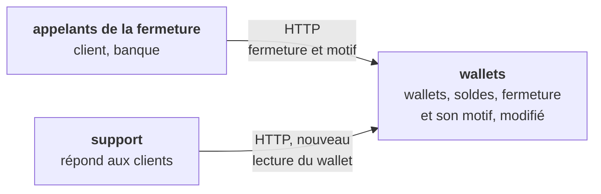
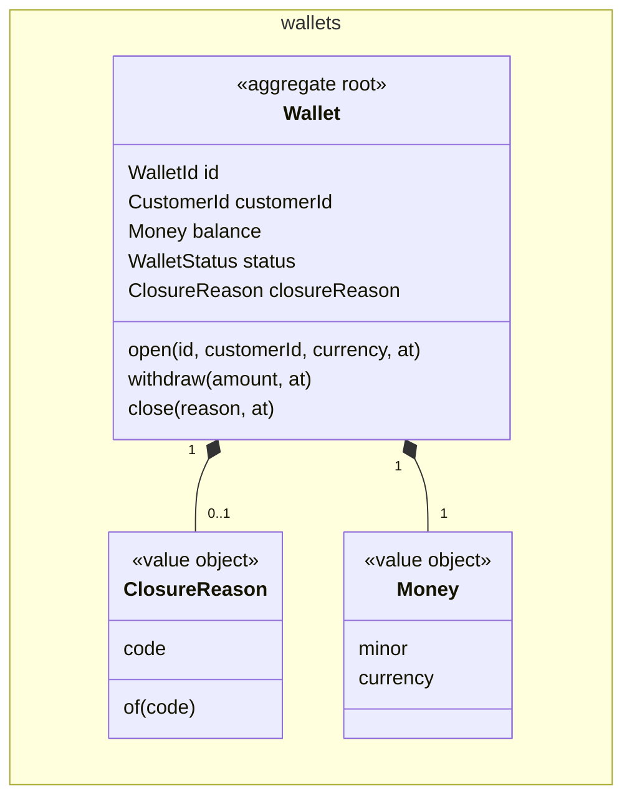
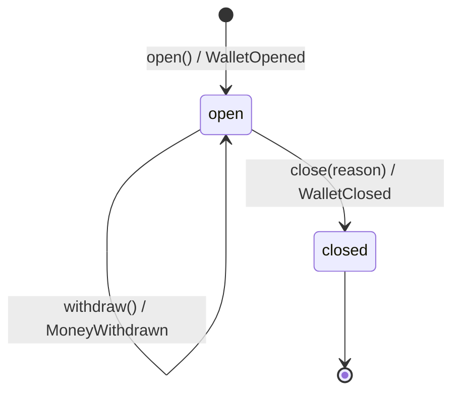
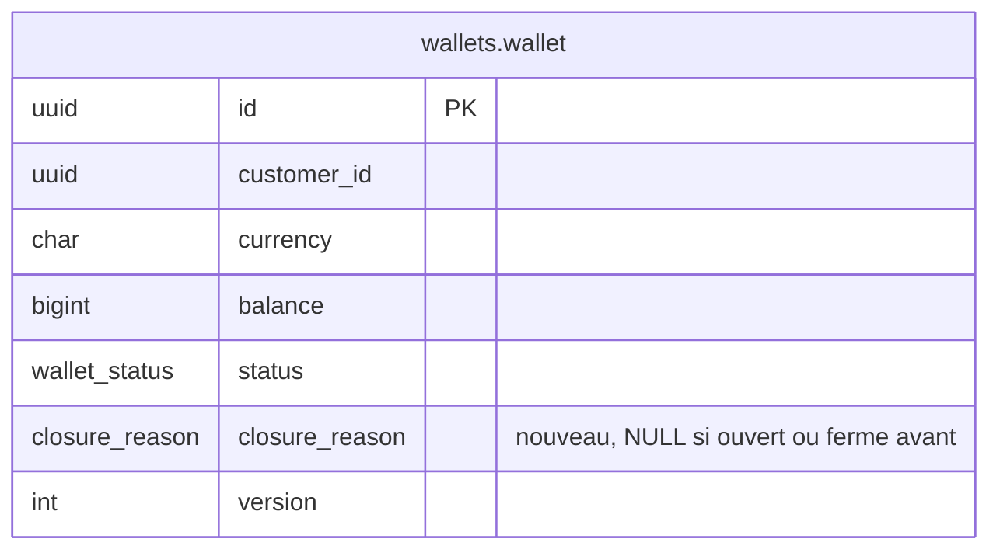

<!--
FILLING RULES. This comment stays in the document: it does not render.

Writing
- The language of the story, headings included. Short sentences, one idea per sentence.
- A section with no content keeps its heading and says "None.". Never remove a section: its absence does not tell whether the question was asked.
- Section numbers (1 to 15, A to C) never change: tools find a section by its number.
- Alveolus rule codes (AGG-06, PUB-07...) go to appendix B. In the body, only when a rule is itself the subject (a question, a waiver).
- Blocks between angle brackets are to be replaced. Help comments are removed once their section is filled, except this one.

Identifiers
- AC-n acceptance criterion, D-n decision, Q-n question, INV-n invariant, T-n test, In increment, ADR-n, W-n waiver.
- Prefix:Name for the elements of the model: AGG:, VO:, ERR:, EVT:, UC:, QRY:, API:, TBL:.
- An element is defined once, in one place:
  - AC, D, Q, INV, T, I, ADR, W: in the first column of a table row ("| AC-1 |").
  - AGG: in a heading "### 7.<n> <context>: AGG:<Name> (<new | existing, changed>)".
  - TBL: in a heading "### TBL:<schema>.<table> (<new | existing>)".
  - VO, ERR, EVT, UC, QRY, API: in the first column of a table row.
- Elsewhere, cite the identifier, never copy the definition.
- When two contexts share a name (CTX-08), prefix it with the context: AGG:payments/Transfer.

Checks before "approved", run by `alveolus-claude design check <file>`
- Every identifier cited is defined.
- Every AC and every INV is proven by at least one T.
- Every D has a reason. Every Q has an assumption and says what it blocks.
- Every increment says why it is safe to merge.
- Every Mermaid diagram renders without error.
-->

# Garder le motif de fermeture d'un wallet

> **Comment lire ce document.** Le métier lit les parties 1 et 2. L'équipe technique lit tout. Les identifiants (`AC-n`, `D-n`, `Q-n`, `INV-n`, `UC:...`) renvoient à leur définition dans le document. Les règles Alveolus appliquées sont rassemblées dans l'annexe B.

## Résumé

Quand un wallet se ferme, il garde désormais pourquoi : à la demande du client, ou par la banque. Le support lit ce motif avec le reste du wallet, par une lecture du wallet qui lui est réservée. Les wallets fermés avant cette livraison affichent un motif « inconnu » : aucun motif n'est inventé pour eux. Le motif s'ajoute sans casser les appelants actuels de la fermeture : il reste optionnel jusqu'à ce qu'ils l'envoient tous, puis il devient obligatoire. Une fermeture refusée, pour un motif hors de la liste ou un solde non nul, laisse le wallet ouvert et sans motif.

| | |
| --- | --- |
| Contextes touchés | wallets (le wallet garde le motif de sa fermeture ; une lecture du wallet pour le support) |
| Décisions à valider | 10, dans la partie 2 |
| Questions bloquantes | Équipe technique : Q-7 avant I2, Q-6 avant I5, Q-5 avant I6. Métier : Q-1 à Q-4, à confirmer avant I1 |
| Livraison | 6 incréments ; la lecture du support (I5), puis le motif obligatoire (I6), en dernier |

---

# Partie 1. Le besoin

## 1. Story

En tant que conseiller du support, je veux lire le motif de fermeture d'un wallet avec le reste du wallet, afin de répondre au client qui ne comprend pas pourquoi son wallet est fermé.

Le ticket se présente comme une tâche technique. Il a pourtant un rôle, une action et un bénéfice, et il change le comportement de la fermeture : ce design le traite comme une story (D-1).

**Ce qui existe déjà.** Le bounded context `wallets` (tactique, core) ouvre un wallet, en retire de l'argent et le ferme. `Wallet.close(at)` refuse un wallet déjà fermé ou dont le solde n'est pas nul, passe le statut à `closed`, et enregistre EVT:WalletClosed, qui ne porte que l'identité du client. La route `POST /wallets/{id}/closure` n'a pas de corps. La table `wallets.wallet` ne garde que le statut : aucun motif. L'application n'a aucune lecture de wallet : ni query, ni view, ni route `GET`. Aucun handler ne lit EVT:WalletClosed, et la fermeture n'est publiée à aucun autre contexte. Aucune route n'a de contrôle d'accès. Le design réutilise AGG:Wallet, UC:CloseWallet, `WalletRepository` et `WalletMapper`.

## 2. Critères d'acceptation

Alice (cliente `0190f5a2-8a4b-7c2d-8e1f-3a5b7c9d1e2f`) a un wallet W en euros (`0190f5a2-7c1e-7b3a-9d4e-2f6a8b1c3d5e`).

| ID | Étant donné | Quand | Alors |
| --- | --- | --- | --- |
| AC-1 | W est ouvert, son solde est de 0,00 € | W est fermé à la demande du client | W est fermé, et son motif est « à la demande du client » |
| AC-2 | W est ouvert, son solde est de 0,00 € | La banque ferme W | W est fermé, et son motif est « par la banque » |
| AC-3 | W est ouvert, son solde est de 0,00 € | W est fermé avec le motif « autre », qui n'est pas dans la liste | La fermeture est refusée ; W reste ouvert, sans motif |
| AC-4 | W a été fermé par la banque | Le support lit W | Il voit W fermé, le motif « par la banque », un solde de 0,00 €, la devise EUR et la cliente Alice |
| AC-5 | W a été fermé avant cette livraison, sans motif gardé | Le support lit W | Il voit W fermé, et le motif « inconnu » |
| AC-6 | W est ouvert, son solde est de 12,50 € | Le support lit W | Il voit W ouvert, sans motif, avec un solde de 12,50 € |
| AC-7 | W est ouvert, son solde est de 0,00 €, et I6 est livré | W est fermé sans motif | La fermeture est refusée ; W reste ouvert |
| AC-8 | W est ouvert, son solde est de 12,50 € | La banque ferme W | La fermeture est refusée, car le solde n'est pas nul ; W reste ouvert, sans motif (hypothèse de Q-1) |

## 3. Hors périmètre

- Rouvrir un wallet fermé.
- La date et l'auteur de la fermeture : le ticket ne les demande pas.
- Un détail du motif « par la banque », comme la fraude ou l'inactivité (Q-2).
- Prévenir le client de la fermeture, ou publier la fermeture aux autres contextes.
- Chercher les wallets d'un client, ou lister les wallets fermés : le support lit un wallet par son identité.
- Le contrôle d'accès des routes existantes (Q-8).
- Les libellés affichés au support : son outil traduit les valeurs du contrat.

---

# Partie 2. À valider

## 4. Décisions de conception

| ID | Décision | Pourquoi | Alternative écartée | ADR |
| --- | --- | --- | --- | --- |
| D-1 | Ce ticket est traité comme une story, et non comme une tâche technique. | Il a un rôle (le support), une action (lire le motif) et un bénéfice (répondre au client). Il change aussi le comportement métier de la fermeture. | Une tâche technique : ses critères ne diraient rien de ce que le support attend. | Aucun |
| D-2 | Le motif est un value object à ensemble fixe d'instances, VO:ClosureReason, avec deux valeurs : `customer_request` et `bank_decision`. | Le motif arrive en texte. Le use case le convertit, et refuse toute autre valeur, comme il le fait déjà pour la devise. | Un `string` libre : un motif mal écrit entrerait. Une union de littéraux, convertie par une fonction libre (Q-9). | Aucun |
| D-3 | Le motif est une partie du wallet, rangé dans sa ligne, et non dans un journal à part. | Un wallet ne se ferme qu'une fois, et le support lit le motif avec le reste du wallet. | Une table des fermetures, ou un journal d'historique : pour un seul fait, qui ne change plus. | Aucun |
| D-4 | Les wallets fermés avant cette livraison gardent un motif absent, jamais rempli après coup. | Le ticket dit que leur motif est inconnu. En inventer un changerait un fait métier. | Remplir les anciens wallets avec « à la demande du client ». Stocker une valeur `unknown` parmi les motifs : elle deviendrait un motif qu'on peut choisir. | Aucun |
| D-5 | Le motif s'ajoute par un changement parallèle : optionnel sur la route de fermeture (I4), puis obligatoire (I6). Entre les deux, une fermeture sans motif garde un motif inconnu, comme aujourd'hui. | La route existe déjà, et ses appelants ne sont pas dans ce dépôt (Q-5). Un motif obligatoire tout de suite les casserait. | Le motif obligatoire dès I4 : chaque appelant actuel recevrait 400. Un motif par défaut : il inventerait un fait. | Aucun |
| D-6 | Le support lit le wallet par une query, QRY:GetWallet, sur une view, servie par API:GetWallet. | L'application n'a aucune lecture de wallet. Une query lit une view sans charger l'aggregate, et l'écran ne dépend pas de sa structure. | Charger l'aggregate par son repository, et le sérialiser. Laisser le support lire la base : aucun contrat, et la table change sans prévenir. | Aucun |
| D-7 | La view garde l'absence de motif. La représentation HTTP en tire `"unknown"` pour un wallet fermé sans motif, et `null` pour un wallet ouvert. | « Inconnu » est une traduction pour l'écran, pas une règle : elle vit dans `driving`, ni dans le mapper ni dans le modèle. | `unknown` dans le modèle, ou dans la view. | Aucun |
| D-8 | La requête HTTP liste les deux motifs, et le use case les vérifie encore. | Les appelants lisent les valeurs permises dans le contrat de l'API. Le use case protège le modèle de tout autre appelant. | Un texte libre dans la requête, comme la devise : le contrat ne dirait pas quelles valeurs envoyer. | Aucun |
| D-9 | EVT:WalletClosed porte le motif. Aucun integration event n'est publié. | Un futur handler saura pourquoi le wallet est fermé, sans le relire. Aucun autre contexte ne lit la fermeture aujourd'hui. | Publier `wallets.wallet.WalletClosed` maintenant : aucun consumer ne le demande. | Aucun |
| D-10 | Jusqu'à I6, une fermeture sans motif écrit une ligne de log structurée, `wallet.closure.without_reason`, avec l'identité du wallet. | Elle dit quand plus aucun appelant ne ferme sans motif, et donc quand I6 peut partir. | Attendre que chaque équipe appelante confirme : rien ne le vérifierait. | Aucun |

## 5. Questions ouvertes

### Pour le métier

| ID | Question | Hypothèse en attendant | Bloque |
| --- | --- | --- | --- |
| Q-1 | Une fermeture par la banque exige-t-elle aussi un solde nul ? Aujourd'hui, seul un wallet vide se ferme. | Oui : la même règle vaut pour les deux motifs. | AC-8. Si la réponse est non, un nouveau critère et une nouvelle règle de AGG:Wallet. |
| Q-2 | Le motif « par la banque » doit-il se détailler (fraude, inactivité, obligation réglementaire), ou porter un commentaire ? | Non : deux motifs seulement, comme le ticket les nomme. | VO:ClosureReason. Ajouter une valeur plus tard est un ajout, sans migration des données. |
| Q-3 | Quand un conseiller ferme le wallet parce que le client l'a demandé au téléphone, le motif est-il « à la demande du client » ? | Oui : le motif dit pourquoi le wallet est fermé, pas qui l'a fermé. | Le glossaire, AC-1, I4. |
| Q-4 | Comment le support lit-il un wallet aujourd'hui ? L'application n'a aucune lecture de wallet. | Il ne le peut pas : ce design ajoute une lecture du wallet pour lui (D-6). | I3, I5. |

### Pour l'équipe technique

| ID | Question | Hypothèse en attendant | Bloque |
| --- | --- | --- | --- |
| Q-5 | Qui appelle `POST /wallets/{id}/closure` aujourd'hui ? Ces appelants peuvent-ils envoyer le motif dans la même livraison que l'application ? | Des appelants hors de ce dépôt, livrés à part : le motif reste optionnel jusqu'à ce qu'ils l'envoient tous (D-5). | I6. Si tous les appelants partent avec l'application, I6 se fond dans I4. |
| Q-6 | Comment l'application authentifie-t-elle ses appelants, et comment sait-elle qu'un appelant est du support, ou de la banque ? Aucun guard n'existe. | Une story d'authentification fournit, avant I5, l'appelant authentifié et ses rôles. I5 l'attend. | I5. Réserver le motif « par la banque » aux agents de la banque. |
| Q-7 | Le dépôt n'a ni dossier `prisma/migrations`, ni base de test jetable. | Une tâche à part les ajoute avant I2, avec une migration de référence du schéma actuel. | I2, I3, I4, I5 : leurs tests d'intégration et end-to-end. |

### Sur les règles

| ID | Question | Hypothèse en attendant | Bloque |
| --- | --- | --- | --- |
| Q-8 | UC-06 demande une autorisation vérifiée pour chaque use case. La route de fermeture n'en a pas aujourd'hui. Ajouter le motif à cette route oblige-t-il ce design à y ajouter l'autorisation ? | Non : le manque existe avant ce design, et se traite avec Q-6. La nouvelle route de lecture, elle, ne part pas sans autorisation. | I4. |
| Q-9 | VO-08 choisit une union de littéraux pour une liste fermée, et interdit les fonctions libres qui la lisent. La command porte pourtant le motif en texte, que le use case doit convertir. | Une classe à ensemble fixe d'instances, comme `Currency` : VO-08 l'admet quand le type a un comportement propre, ici sa conversion (D-2). | I1. |

---

# Partie 3. Conception

## 6. Contextes et langage

### 6.1 Nouveau bounded context

Aucun.

### 6.2 Relations

Aucune. Le support et les appelants de la fermeture sont des acteurs de l'API HTTP, pas des bounded contexts de l'application.

### 6.3 Glossaire

| Contexte | Terme | Code | Définition | Termes écartés |
| --- | --- | --- | --- | --- |
| wallets | motif de fermeture | `ClosureReason` | Pourquoi un wallet a été fermé. Il dit pourquoi, pas qui a fermé. | cause, raison, `closeReason` |
| wallets | à la demande du client | `customer_request` | Le client a demandé la fermeture de son wallet. | `customer`, `voluntary` |
| wallets | par la banque | `bank_decision` | La banque a décidé de fermer le wallet. | `bank`, `forced` |
| wallets | motif inconnu | `unknown`, dans l'API seulement | Le wallet a été fermé avant que la fermeture ne garde son motif. | `legacy`, `none` |

## 7. Modèle

### 7.1 wallets: AGG:Wallet (existant, modifié)

Le wallet d'un client, dans une devise. Il tient son solde, refuse les retraits qui le rendraient négatif, et ne se ferme que vide. Il garde désormais le motif de sa fermeture.

- **Identité** : `WalletId`, un UUIDv7 généré par le repository avant l'ouverture. Inchangée.
- **Contient** : son solde (`Money`), son statut, et au plus un motif de fermeture (VO:ClosureReason).
- **Référence** : le client, par `CustomerId`.

Chaque méthode est dans le diagramme d'états. `restore`, réservée au mapper, reçoit en plus le motif stocké, absent pour un wallet ouvert ou fermé avant.

| Méthode | Intention métier | Event |
| --- | --- | --- |
| `close(reason, at)` | Fermer un wallet vide, pour un motif. Le motif est optionnel jusqu'à I6 (D-5), puis obligatoire. | EVT:WalletClosed |

| ID | Invariant | Gardé par | Si cassé |
| --- | --- | --- | --- |
| INV-1 | Un wallet ouvert n'a pas de motif de fermeture. | `Wallet.open` crée le wallet sans motif ; seul `Wallet.close` en pose un. | Le support lirait un motif sur un wallet ouvert. |
| INV-2 | Le motif d'un wallet fermé ne change plus. | `Wallet.close` refuse un wallet déjà fermé (ERR:WalletIsClosed). | Le support lirait un autre motif que celui de la fermeture. |
| INV-3 | Un motif est « à la demande du client » ou « par la banque », rien d'autre. | `of` de VO:ClosureReason refuse toute autre valeur (ERR:UnknownClosureReason). L'enum de la colonne fait de même. | Le support lirait un motif qu'il ne sait pas expliquer. |

### Value objects

| ID | Contexte | Contient | Validité |
| --- | --- | --- | --- |
| VO:ClosureReason | wallets | `code` : `customer_request` ou `bank_decision`. Deux instances fixes, `customerRequest` et `bankDecision`. | `of(code)` renvoie l'une des deux instances, ou ERR:UnknownClosureReason pour tout autre texte. |

### Erreurs

| ID | Contexte | Refus | Levée par |
| --- | --- | --- | --- |
| ERR:UnknownClosureReason | wallets | Le motif n'est pas dans la liste. | `of` de VO:ClosureReason (nouveau) |
| ERR:WalletIsClosed | wallets | Le wallet est déjà fermé. | `Wallet.close`, `Wallet.withdraw` (existant) |
| ERR:BalanceNotZero | wallets | Le solde du wallet n'est pas nul. | `Wallet.close` (existant) |
| ERR:WalletNotFound | wallets | Aucun wallet n'a cette identité. | UC:CloseWallet (existant), QRY:GetWallet (nouveau) |

### Ports

| Port | Contexte | Rôle | Implémenté par |
| --- | --- | --- | --- |
| `WalletRepository` | wallets | Charge et enregistre AGG:Wallet, motif compris. Inchangé. | `PrismaWalletRepository` (existant) |
| `WalletViews` | wallets | Lit la view d'un wallet par son identité. | `PrismaWalletViews` (nouveau) |

## 8. Processus et events

Une transaction. UC:CloseWallet ferme le wallet et garde son motif dans une seule transaction, sur un seul aggregate. QRY:GetWallet lit, sans rien écrire. Aucun autre contexte n'intervient.

### Domain events

| ID | Contexte | Fait | Payload | Déclenche |
| --- | --- | --- | --- | --- |
| EVT:WalletClosed | wallets | Le wallet est fermé. | `customerId` ; `reason`, nouveau, absent jusqu'à I6 pour une fermeture sans motif | Rien : aucun handler, aucun integration event |

### Messages entre contextes

Aucun.

## 9. Use cases

### wallets

| Use case | Déclenché par | Hors de la transaction | Dans la transaction | Events |
| --- | --- | --- | --- | --- |
| UC:CloseWallet | API:CloseWallet | Convertit l'identité du wallet, et le motif s'il est donné, en value objects | Charge le wallet, le ferme pour ce motif, l'enregistre, dispatche ses events | EVT:WalletClosed |
| QRY:GetWallet | API:GetWallet | Convertit l'identité du wallet, puis lit sa view par `WalletViews` | Aucune transaction | Aucun |

Ce qui vaut pour chaque command :

- Avant la transaction, la command convertit ses champs en value objects. Un refus revient tel quel, sans ouvrir de transaction.
- Aucun autre contexte n'est appelé : aucun refus extérieur à traiter.
- Une panne technique, comme un wallet modifié entre sa lecture et son écriture, lève une exception. La transaction est annulée, et la route répond 500.
- Un rejeu de la fermeture est refusé par ERR:WalletIsClosed. Le premier motif reste.

Spécificités :

- **UC:CloseWallet** (existant, modifié) renvoie `Result<void, CloseWalletError>`, avec `CloseWalletError = InvalidIdentifier | UnknownClosureReason | WalletNotFound | WalletIsClosed | BalanceNotZero`. `CloseWalletCommand` gagne `reason?: string` en I1, obligatoire en I6. Aucune autorisation aujourd'hui (Q-8).
- **QRY:GetWallet** (nouveau) renvoie `Result<WalletView, InvalidIdentifier | WalletNotFound>`. `WalletView` porte `id`, `customerId`, `currency`, `balance` en unités mineures, `status` et `closureReason`, absent pour un wallet ouvert ou fermé avant. La query est réservée au support (Q-6) : le guard de API:GetWallet le vérifie, et un test l'appelle sans ce rôle.

## 10. Contrats

### Routes HTTP

| ID | Requête | Succès | Erreurs | Accès |
| --- | --- | --- | --- | --- |
| API:CloseWallet | `POST /wallets/{id}/closure`, corps `{ "reason": "customer_request" \| "bank_decision" }`. Le corps est optionnel jusqu'à I6. Un champ inconnu est refusé. | 204 | 400 identité ou corps invalide, motif hors de la liste compris ; 404 `WalletNotFound` ; 409 `WalletIsClosed` ; 409 `BalanceNotZero` | Inchangé : aucun contrôle (Q-8) |
| API:GetWallet | `GET /wallets/{id}`, l'identité validée comme un UUID | 200 `{ id, customerId, currency, balance: { minor, currency }, status, closureReason }`. `closureReason` vaut `"customer_request"`, `"bank_decision"`, `"unknown"` pour un wallet fermé sans motif, ou `null` pour un wallet ouvert. `minor` est une chaîne, comme dans les requêtes. | 400 identité invalide, 401 sans authentification, 403 sans le rôle support, 404 `WalletNotFound` | Rôle support (Q-6) |

### Facade wallets

Aucune.

## 11. Données

### TBL:wallets.wallet (existante)

| Colonne | Type | Null | Vient de |
| --- | --- | --- | --- |
| `id` | `uuid` | non | `WalletId` |
| `customer_id` | `uuid` | non | `CustomerId` |
| `currency` | `char(3)` | non | la devise du solde |
| `balance` | `bigint` | non | le solde, en unités mineures |
| `status` | enum `wallets.wallet_status` | non | `WalletStatus` |
| `closure_reason`, nouvelle | enum `wallets.closure_reason` : `customer_request`, `bank_decision` | oui | VO:ClosureReason. NULL pour un wallet ouvert, ou fermé avant cette livraison. |
| `version` | `int` | non | la concurrence optimiste, hors du modèle |

- **Contraintes** : `closure_reason` est nullable, car le modèle ne la remplit ni pour un wallet ouvert, ni pour un wallet fermé avant. Son enum refuse un motif hors de la liste. Les autres colonnes restent `NOT NULL`.
- **Index** : la lecture du support passe par l'identité, donc par la clé primaire. Aucun nouvel index.
- **Suppression** : jamais.

### Repositories, views et outbox

| Composant | Contexte | Rôle |
| --- | --- | --- |
| `PrismaWalletRepository` et `WalletMapper` | wallets | Lisent et écrivent `closure_reason`. Le mapper reconstruit le motif stocké par VO:ClosureReason ; un motif refusé arrête la lecture. |
| `PrismaWalletViews` | wallets | Lit `WalletView` dans `wallets.wallet`, par identité, sans charger l'aggregate. Renvoie l'absence de motif telle quelle. |
| Outbox | wallets | Inchangée : EVT:WalletClosed n'est pas traduit. |

### Migrations

| Ordre | Contexte | Migration | Sûre pour la version en production |
| --- | --- | --- | --- |
| 1 | wallets | `add_wallet_closure_reason` : crée l'enum `wallets.closure_reason`, et ajoute la colonne `closure_reason`, nullable, sans valeur par défaut. | Oui. La version en service ne lit ni n'écrit la colonne, et ses mises à jour ne la touchent pas. Aucune ligne n'est réécrite : les wallets déjà fermés gardent NULL. |

## 12. Intégrations externes

Aucune.

## 13. Exploitation

- **Corrélation** : l'identifiant de corrélation de la requête HTTP, tenu par `CorrelationContext`. Les logs portent l'identité du wallet.
- **Alertes** : aucune nouvelle. Jusqu'à I6, les lignes `wallet.closure.without_reason` se comptent : I6 part quand ce compte reste à zéro (D-10).
- **Données personnelles** : le motif ne sort pas de `wallets`. API:GetWallet renvoie l'identité du client et son solde, au seul support (Q-6). Aucun log ne porte de donnée personnelle.

---

# Partie 4. Livraison

## 14. Incréments

| # | Contexte | Incrément | Couvre | Fini quand | Sûr parce que | État |
| --- | --- | --- | --- | --- | --- | --- |
| I1 | wallets | Le wallet garde le motif de sa fermeture : VO:ClosureReason, ERR:UnknownClosureReason, AGG:Wallet, EVT:WalletClosed, et UC:CloseWallet qui accepte un motif optionnel (domain et application) | AC-1, AC-2, AC-3, AC-8, INV-1, INV-2, INV-3 | Les tests unitaires passent, le domaine reste couvert à 100 %, le build passe | Le controller n'envoie toujours aucun motif : une fermeture se passe comme avant. La forme stockée ne change pas. | todo |
| I2 | wallets | Le motif est stocké : l'enum et la colonne `closure_reason`, leur migration, et `WalletMapper` (driven, schéma) | AC-1, AC-2, AC-5, INV-1 | Le test d'intégration du repository passe, sur un PostgreSQL construit par les migrations | La migration ne fait qu'ajouter une colonne nullable, que la version en service ignore. Aucun appelant n'envoie encore de motif. | todo |
| I3 | wallets | La lecture d'un wallet : QRY:GetWallet, `WalletView`, `WalletViews` et `PrismaWalletViews`, câblés dans le module (application, driven, wiring) | AC-4, AC-5, AC-6 | Le test d'intégration de `PrismaWalletViews` passe | Aucune route n'appelle la query : rien de nouveau n'est joignable, et elle ne fait que lire. | todo |
| I4 | wallets | La route de fermeture accepte le motif : `CloseWalletRequest`, le controller, et le log de D-10 (driving) | AC-1, AC-2, AC-3 | Les tests end-to-end de la fermeture passent | Le motif est optionnel : un appelant qui n'en envoie pas ferme comme avant (D-5). | todo |
| I5 | wallets | Le support lit le wallet : API:GetWallet, sa représentation, son guard (driving, wiring) | AC-4, AC-5, AC-6 | Les tests end-to-end de la lecture passent, refus sans le rôle support compris | Une route nouvelle, qui ne fait que lire : rien d'existant ne change. Elle attend Q-6, et ne part pas sans autorisation. | todo |
| I6 | wallets | Le motif devient obligatoire : la requête, la command, `Wallet.close` et EVT:WalletClosed. Le test et le log de la transition partent (toutes les couches). | AC-7 | Les tests passent, et le log de D-10 est resté à zéro deux semaines en production | Il ne part qu'une fois Q-5 répondue et le log à zéro : plus aucun appelant ne ferme sans motif. | todo |

## 15. Tests

| ID | Prouve | Fichier | Niveau |
| --- | --- | --- | --- |
| T-1 | AC-1 : fermé à la demande du client, le wallet garde ce motif, et enregistre EVT:WalletClosed avec `customerId` et `reason` | `src/wallets/internal/domain/wallet/__test__/wallet.aggregate.spec.ts` | unitaire |
| T-2 | AC-2 : fermé par la banque, le wallet garde ce motif, et enregistre EVT:WalletClosed avec ce motif | `src/wallets/internal/domain/wallet/__test__/wallet.aggregate.spec.ts` | unitaire |
| T-3 | INV-2 : un wallet fermé refuse une deuxième fermeture pour un autre motif, garde le premier, et n'enregistre aucun event | `src/wallets/internal/domain/wallet/__test__/wallet.aggregate.spec.ts` | unitaire |
| T-4 | INV-1, AC-6 : un wallet qui vient d'ouvrir n'a pas de motif | `src/wallets/internal/domain/wallet/__test__/wallet.aggregate.spec.ts` | unitaire |
| T-5 | INV-3, AC-3 : VO:ClosureReason accepte les deux valeurs, et refuse `other` et une chaîne vide par ERR:UnknownClosureReason | `src/wallets/internal/domain/wallet/__test__/closure-reason.value-object.spec.ts` | unitaire |
| T-6 | AC-8 : la banque ne ferme pas un wallet de 12,50 € : ERR:BalanceNotZero, aucun motif, aucun event | `src/wallets/internal/domain/wallet/__test__/wallet.aggregate.spec.ts` | unitaire |
| T-7 | AC-5 : un wallet reconstitué fermé, sans motif stocké, n'a pas de motif | `src/wallets/internal/domain/wallet/__test__/wallet.aggregate.spec.ts` | unitaire |
| T-8 | D-5 : jusqu'à I6, une fermeture sans motif ferme le wallet sans motif. Supprimé en I6. | `src/wallets/internal/domain/wallet/__test__/wallet.aggregate.spec.ts` | unitaire |
| T-9 | AC-1, AC-2, AC-5, INV-1 : le repository enregistre puis relit un wallet fermé pour chaque motif ; il relit une ligne fermée sans motif, et une ligne ouverte, sans motif | `src/wallets/internal/driven/prisma/__test__/prisma-wallet.repository.integration-spec.ts` | intégration |
| T-10 | AC-4, AC-5, AC-6 : `PrismaWalletViews` lit la view d'un wallet ouvert, fermé avec motif, et fermé sans motif ; rien pour une identité inconnue | `src/wallets/internal/driven/prisma/__test__/prisma-wallet-views.adapter.integration-spec.ts` | intégration |
| T-11 | AC-1, AC-2 : `POST /wallets/{id}/closure` avec chaque motif répond 204, et QRY:GetWallet renvoie ce motif | `src/wallets/__test__/scenarios/close-wallet.e2e-spec.ts` | end-to-end |
| T-12 | AC-3 : le motif `other` répond 400 ; le wallet reste ouvert, sans motif | `src/wallets/__test__/scenarios/close-wallet.e2e-spec.ts` | end-to-end |
| T-13 | D-5, D-10 : jusqu'à I6, une fermeture sans corps répond 204 ; le wallet est fermé sans motif, et la ligne `wallet.closure.without_reason` est écrite. Supprimé en I6. | `src/wallets/__test__/scenarios/close-wallet.e2e-spec.ts` | end-to-end |
| T-14 | AC-4, AC-5, AC-6 : `GET /wallets/{id}` par le support renvoie le wallet et son motif, `"unknown"` pour un wallet fermé avant, `null` pour un wallet ouvert | `src/wallets/__test__/scenarios/get-wallet.e2e-spec.ts` | end-to-end |
| T-15 | API:GetWallet : sans authentification, la route répond 401 ; sans le rôle support, 403 | `src/wallets/__test__/scenarios/get-wallet.e2e-spec.ts` | end-to-end |
| T-16 | AC-7 : à partir de I6, une fermeture sans motif répond 400, et le wallet reste ouvert | `src/wallets/__test__/scenarios/close-wallet.e2e-spec.ts` | end-to-end |

---

# Annexes

## A. Fichiers

### Artefacts du projet

| Inc. | Fichier | Nouveau ou modifié |
| --- | --- | --- |
| I2 | `prisma/wallets.prisma` | modifié : enum `ClosureReason`, champ `closureReason` |
| I2 | `prisma/migrations/<horodatage>_add_wallet_closure_reason/migration.sql` | nouveau |

### Code

| Inc. | Fichier | Nouveau ou modifié |
| --- | --- | --- |
| I1 | `src/wallets/internal/domain/wallet/closure-reason.value-object.ts` | nouveau |
| I1 | `src/wallets/internal/domain/wallet/wallet.errors.ts` | modifié : `UnknownClosureReason` |
| I1 | `src/wallets/internal/domain/wallet/wallet.aggregate.ts` | modifié : motif, `close(reason, at)`, `restore`, snapshot |
| I1 | `src/wallets/internal/domain/wallet/wallet.events.ts` | modifié : `reason` dans EVT:WalletClosed |
| I1 | `src/wallets/internal/domain/wallet/__test__/wallet.fixtures.ts` | modifié : un wallet fermé, avec ou sans motif |
| I1 | `src/wallets/internal/domain/wallet/__test__/wallet.aggregate.spec.ts` | modifié |
| I1 | `src/wallets/internal/domain/wallet/__test__/closure-reason.value-object.spec.ts` | nouveau |
| I1 | `src/wallets/internal/application/wallet/close-wallet.command.ts` | modifié : `reason?: string`, converti avant la transaction |
| I2 | `src/wallets/internal/driven/prisma/wallet.mapper.ts` | modifié |
| I2 | `src/wallets/internal/driven/prisma/__test__/prisma-wallet.repository.integration-spec.ts` | nouveau |
| I3 | `src/wallets/internal/application/wallet/get-wallet.query.ts` | nouveau |
| I3 | `src/wallets/internal/application/wallet/wallet.view.ts` | nouveau |
| I3 | `src/wallets/internal/application/wallet/wallet-views.port.ts` | nouveau |
| I3 | `src/wallets/internal/driven/prisma/prisma-wallet-views.adapter.ts` | nouveau |
| I3 | `src/wallets/internal/driven/prisma/__test__/prisma-wallet-views.adapter.integration-spec.ts` | nouveau |
| I3 | `src/wallets/composition/wallets.module.ts` | modifié : `WalletViews` lié à `PrismaWalletViews`, `GetWalletHandler` |
| I4 | `src/wallets/internal/driving/http/close-wallet.request.ts` | nouveau |
| I4 | `src/wallets/internal/driving/http/wallet.controller.ts` | modifié : le corps de la fermeture, le log |
| I4 | `src/wallets/__test__/scenarios/close-wallet.e2e-spec.ts` | nouveau |
| I5 | `src/wallets/internal/driving/http/get-wallet.request.ts` | nouveau : le paramètre `id` |
| I5 | `src/wallets/internal/driving/http/wallet.representation.ts` | nouveau |
| I5 | `src/wallets/internal/driving/http/support.guard.ts` | nouveau, selon la réponse à Q-6 |
| I5 | `src/wallets/internal/driving/http/wallet.controller.ts` | modifié : `GET /wallets/{id}` |
| I5 | `src/wallets/__test__/support/legacy-wallet.fixtures.ts` | nouveau : un wallet fermé sans motif |
| I5 | `src/wallets/__test__/scenarios/get-wallet.e2e-spec.ts` | nouveau |
| I6 | `src/wallets/internal/domain/wallet/wallet.aggregate.ts` | modifié : motif obligatoire |
| I6 | `src/wallets/internal/domain/wallet/wallet.events.ts` | modifié : `reason` obligatoire |
| I6 | `src/wallets/internal/domain/wallet/__test__/wallet.aggregate.spec.ts` | modifié : T-8 supprimé |
| I6 | `src/wallets/internal/application/wallet/close-wallet.command.ts` | modifié : `reason` obligatoire |
| I6 | `src/wallets/internal/driving/http/close-wallet.request.ts` | modifié : `reason` obligatoire |
| I6 | `src/wallets/internal/driving/http/wallet.controller.ts` | modifié : le log de D-10 supprimé |
| I6 | `src/wallets/__test__/scenarios/close-wallet.e2e-spec.ts` | modifié : T-13 remplacé par T-16 |

## B. Règles Alveolus appliquées

| Règle | Où | Comment |
| --- | --- | --- |
| VO-01 | VO:ClosureReason | Le motif n'est pas un `string` nu. |
| VO-08 | VO:ClosureReason | Liste fermée : une classe à ensemble fixe d'instances, et un enum Prisma aux mêmes valeurs (Q-9). |
| ENT-12 | AGG:Wallet | Une intention, `close(reason, at)`, qui enregistre un event. |
| ENT-15 | VO:ClosureReason | `of` renvoie un `Result` pour une valeur venue de l'extérieur. |
| EVT-05 | EVT:WalletClosed | L'event porte le motif, un paramètre utile de la méthode. |
| REP-06 | TBL:wallets.wallet | Un wallet n'est jamais supprimé. |
| REP-08 | AGG:Wallet | Le mapper reconstitue le wallet et son motif par `restore`. |
| REP-10 | `WalletViews` | Aucun finder ajouté au repository pour l'écran du support. |
| REP-16 | T-9 | Le repository est testé sur PostgreSQL. |
| PER-02 | TBL:wallets.wallet | Le motif est un enum Prisma. |
| PER-03 | TBL:wallets.wallet | La colonne est nullable, car le modèle ne la remplit pas toujours. |
| PER-04 | `WalletMapper` | Le motif stocké repasse par VO:ClosureReason ; un motif refusé arrête la lecture. |
| PER-05 | `WalletMapper`, `PrismaWalletViews` | Ils traduisent ; « inconnu » se décide dans la représentation HTTP (D-7). |
| PER-10 | Migration `add_wallet_closure_reason` | Commitée avec le schéma, relue en SQL. |
| PER-11 | Migration `add_wallet_closure_reason` | Colonne ajoutée nullable, sans défaut. |
| PER-12 | D-4 | Aucun motif inventé pour les wallets déjà fermés. |
| UC-03 | UC:CloseWallet | La command porte le motif en texte ; le handler le convertit en value object. |
| UC-06 | API:GetWallet | Réservée au support, vérifiée côté serveur, et testée sans le rôle (T-15). |
| UC-07 | QRY:GetWallet | Une identité inconnue est ERR:WalletNotFound, traduite en 404. |
| UC-08 | QRY:GetWallet | La query lit une view par un view port, sans repository. |
| UC-09 | API:GetWallet | L'écran du support ne lit pas l'aggregate. |
| UC-10 | API:GetWallet | `"unknown"` est calculé par la représentation, hors du modèle. |
| UC-11 | UC:CloseWallet | Le `Result` de la conversion du motif est testé avant la transaction. |
| API-01 | API:GetWallet | Une représentation propre à l'API, construite depuis la view. |
| API-02 | API:GetWallet | `GET`, sans effet. |
| SEC-01 | API:CloseWallet, API:GetWallet | Schémas Zod stricts pour le corps et le paramètre. |
| SEC-02 | API:GetWallet | Le rôle support vient de l'authentification, jamais de la requête (Q-6). |
| SEC-04 | API:GetWallet | Les données du client ne vont qu'au support ; les logs ne portent que des identités. |
| OBS-01 | D-10 | Un log structuré, au message fixe, avec l'identité du wallet. |
| COV-01 | I1 | Le domaine reste couvert à 100 %, branche sans motif comprise. |
| COV-03 | T-1, T-2, T-3, T-6 | Les tests lisent le contenu de EVT:WalletClosed, et aucun event après un refus. |
| TST-01 | T-9 à T-16 | Le vrai PostgreSQL, aucun double. |
| TST-03 | T-11 à T-16 | Les tests end-to-end démarrent `AppModule`. |
| TST-05 | Section 15 | Chaque test vit à côté de ce qu'il prouve. |
| TST-06 | Section 15 | Le nom du fichier dit le niveau du test. |
| NAM-02 | Annexe A | `<concept>.<rôle>.ts`, en kebab-case. |
| PLC-03 | Annexe A | Chaque fichier dans la couche de son rôle. |
| PLC-04 | `application/wallet/` | La query et sa view sous le concept wallet. |
| WIR-01 | `wallets.module.ts` | Le module lie `WalletViews` à `PrismaWalletViews`. |
| WIR-07 | `WalletViews` | Le port est une abstract class, et son propre injection token. |

**Waivers** : aucun.

## C. ADRs à écrire

Aucun.
