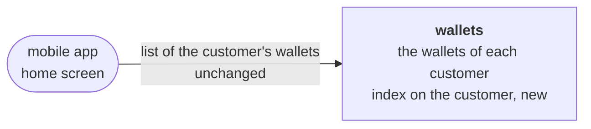
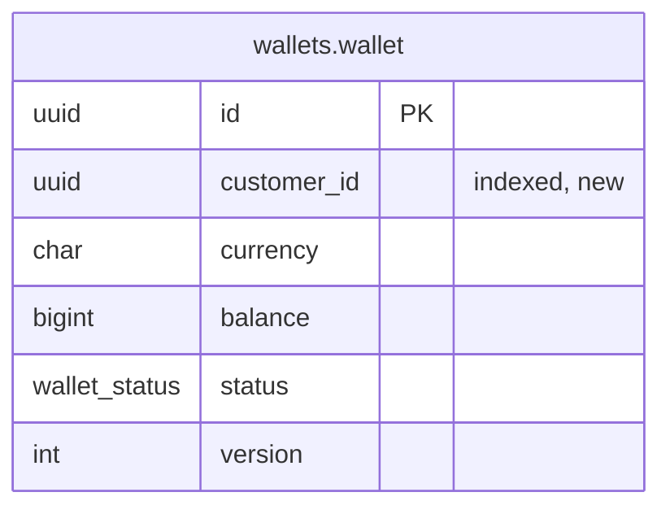

<!--
FILLING RULES. This comment stays in the document: it does not render.

Writing
- The language of the story, headings included. Short sentences, one idea per sentence.
- A section with no content keeps its heading and says "None.". Never remove a section: its absence does not tell whether the question was asked.
- Section numbers (1 to 15, A to C) never change: tools find a section by its number.
- Alveolus rule codes (AGG-06, PUB-07...) go to appendix B. In the body, only when a rule is itself the subject (a question, a waiver).
- Blocks between angle brackets are to be replaced. Help comments are removed once their section is filled, except this one.

Identifiers
- AC-n acceptance criterion, D-n decision, Q-n question, INV-n invariant, T-n test, In increment, ADR-n, W-n waiver.
- Prefix:Name for the elements of the model: AGG:, VO:, ERR:, EVT:, UC:, QRY:, API:, TBL:.
- An element is defined once, in one place:
  - AC, D, Q, INV, T, I, ADR, W: in the first column of a table row ("| AC-1 |").
  - AGG: in a heading "### 7.<n> <context>: AGG:<Name> (<new | existing, changed>)".
  - TBL: in a heading "### TBL:<schema>.<table> (<new | existing>)".
  - VO, ERR, EVT, UC, QRY, API: in the first column of a table row.
- Elsewhere, cite the identifier, never copy the definition.
- When two contexts share a name (CTX-08), prefix it with the context: AGG:payments/Transfer.

Checks before "approved", run by `alveolus-claude design check <file>`
- Every identifier cited is defined.
- Every AC and every INV is proven by at least one T.
- Every D has a reason. Every Q has an assumption and says what it blocks.
- Every increment says why it is safe to merge.
- Every Mermaid diagram renders without error.
-->

# Speed up the list of a customer's wallets

> **How to read this document.** The business reads parts 1 and 2. The tech team reads everything. Identifiers (`AC-n`, `D-n`, `Q-n`, `INV-n`, `UC:...`) point to their definition in the document. The Alveolus rules applied are gathered in appendix B.

## Summary

The mobile home screen lists the signed-in customer's wallets, and this list has become slow because the database reads every wallet to find the customer's. The task adds an index on the customer to the wallet table of the wallets context, so the database goes straight to the customer's few wallets. What the list returns does not change, and the index is built without stopping withdrawals. The app has no history of its database changes yet, so a first step records the current schema, and the index then arrives as a reviewed change on top of it. If the index fails to build, the deploy stops before the new version starts, the running version keeps serving, and the build is retried.

| | |
| --- | --- |
| Contexts touched | wallets (an index on the wallet table, and the migration history it needs) |
| Decisions to validate | 6, in part 2 |
| Blocking questions | Tech: Q-3 (where the call runs), Q-4 (how the schema reaches production) |
| Delivery | 2 increments, the index last |

---

# Part 1. The need

## 1. Story

Why: the mobile app lists the wallets of the signed-in customer on its home screen. The read behind it filters the wallet table on the customer. No index covers that column, so PostgreSQL reads the whole table. The cost of the read grows with the total number of wallets, and now passes one second at busy hours. The list must be fast again, and return exactly what it returns today.

**What already exists.**

- The table TBL:wallets.wallet holds one row per wallet: its identity, its customer, its currency, its balance, its status and its version. Its only index is the primary key on the identity.
- `PrismaWalletRepository` reads a wallet by its identity and saves it under optimistic concurrency. It has no read by customer.
- `WalletController` opens a wallet, withdraws money from it and closes it. It has no route that lists wallets.
- So the call the ticket describes is not in this repository (Q-3). The index serves it wherever it runs, as long as it filters the wallet table on the customer.
- `prisma/` has no `migrations` folder: the schema has no migration history (Q-4).
- The only test is the unit test of the wallet aggregate. No test runs on a database.

## 2. Acceptance criteria

In every row, customer Alice (`0190f5a2-8a4b-7c2d-8e1f-3a5b7c9d1e2f`) holds three wallets: EUR open with a balance of 120.00, USD open with 0.00, and GBP closed with 0.00. The wallet table also holds 100 000 wallets of other customers.

| ID | Given | When | Then |
| --- | --- | --- | --- |
| AC-1 | Alice's three wallets among 100 000 others | the wallets of Alice are read by her customer identity | the database reaches them through an index on the customer, without reading the other 100 000 rows |
| AC-2 | Alice's three wallets among 100 000 others | the wallets of Alice are read by her customer identity | the read returns exactly her three wallets, with the same currency, balance and status as before the change, and no wallet of another customer |

## 3. Out of scope

- The call itself: its route, its response, its order, its paging. It keeps its code (D-5).
- A business rule on the wallets of one customer, such as one wallet per currency. The ticket states none.
- The integration tests that `PrismaWalletRepository` lacks today. The test database of I1 makes them possible, in another task.
- Any other index, in wallets or in another context.
- A response time figure for the list (Q-1).

---

# Part 2. To validate

## 4. Design decisions

| ID | Decision | Why | Rejected alternative | ADR |
| --- | --- | --- | --- | --- |
| D-1 | One index on the customer column of the wallet table, declared in `prisma/wallets.prisma` as `@@index([customerId])`. Prisma names it `wallet_customer_id_idx`. | The read filters on the customer only. A customer holds a few wallets (Q-2), so any extra filter or sort on them costs nothing once the index has found them. The column never changes after a wallet opens, so the index adds little to withdrawals and closures. | An index on the customer and the status, or on the customer and the identity: it fits a query we cannot see (Q-3), and makes the index larger for no measured gain. An index created by hand in production: absent from the schema, lost in every new environment. | None. |
| D-2 | The migration builds the index with `CREATE INDEX CONCURRENTLY`, alone in its migration file. It is generated with `prisma migrate dev --create-only`, then edited and reviewed in SQL. | A plain `CREATE INDEX` blocks every write on the wallet table while it builds. On a large table at busy hours, withdrawals, openings and closures would wait. `CONCURRENTLY` lets reads and writes continue. PostgreSQL refuses it inside a transaction block, so the file holds this one statement. | The generated migration as it is: it blocks writes during the build. A build in a night window: it still blocks writes, and ties the deploy to a schedule. | None. |
| D-3 | No `IF NOT EXISTS` on the index. When the build fails, the operator drops the invalid index concurrently, marks the migration rolled back, and deploys again. | A failed concurrent build leaves an invalid index that the planner ignores. With `IF NOT EXISTS`, the next run would skip it and record the migration as applied, with the list still slow. | `IF NOT EXISTS`, which hides the failure. | None. |
| D-4 | A first increment gives the app a migration history: a baseline `0_init`, generated from the current schema, and marked as applied on every existing database. It also adds the disposable test database, built by the migrations. | Without a history, `prisma migrate dev` writes a first migration that creates every table, and it fails on every database that already has them. The index must arrive by a committed migration. Its test must run on a database built by the same migrations. | The index migration alone, with no baseline: it recreates every table. `prisma db push`: no history, no review of the SQL, and no way to build concurrently. | ADR-1 |
| D-5 | The read itself does not change, and no read by customer is added to the code. | The ticket asks not to change what the call returns. The call is not in this repository (Q-3). The index serves it wherever it runs. | Add a read of a customer's wallets to the code now: it would invent a second call beside the one the app uses. | None. |
| D-6 | The tests fill the table with 100 000 wallets of other customers, refresh the statistics, and check the plan the planner chooses. | The planner picks the index only at a realistic volume, and only once it knows that volume. Checking its own choice proves the list is fast, not only that the index exists. | Turn off sequential scans in the test: it proves the index can serve the filter, not that PostgreSQL uses it. Only check that the index exists: it proves nothing about the read. | None. |

## 5. Open questions

### For the business

| ID | Question | Assumption meanwhile | Blocks |
| --- | --- | --- | --- |
| Q-1 | Which response time makes the list "fast again" at busy hours? | No figure. The read no longer scans the table, so its time no longer grows with the number of wallets. | The alert threshold of section 13. |
| Q-2 | How many wallets can one customer hold? | A few, never hundreds. | D-1: with many wallets per customer and a sorted list, the index would also take the sort column. |

### For the tech team

| ID | Question | Assumption meanwhile | Blocks |
| --- | --- | --- | --- |
| Q-3 | Where does the call that lists a customer's wallets run? This repository has no such read: no route, no finder by customer. If it runs outside the wallets context, it reads another context's table directly, which is a separate story. | It runs in code outside this repository, filters the wallet table on the customer alone, and sorts a customer's few wallets, if at all, after the lookup. | D-1 and D-5. AC-2 is proven by a read written in the test until the call is found, then by the call's own test. |
| Q-4 | How does the schema reach production today, with no migration history? Does the deploy run `prisma migrate deploy` before the new version starts? | The tables were created by `prisma db push`. The deploy can run `prisma migrate resolve --applied 0_init` once on each existing database, after a drift check, then `prisma migrate deploy` before each start. | I1, D-4, ADR-1. |
| Q-5 | How many rows does the wallet table hold in production, on which PostgreSQL major version, and can the CI run Docker? | Hundreds of thousands of rows. The test container pins the production major version, `postgres:18` until it is known. The CI runs Docker. | I1 (test container image, CI), D-6 (test volume), the build time of the index in I2. |

### On the rules

| ID | Question | Assumption meanwhile | Blocks |
| --- | --- | --- | --- |
| Q-6 | TST-06 names an integration test after the file it tests, and TST-01 has a test go through the real adapter. Here the index lives in the schema, and no adapter in the code runs the read. Where does the test of the index live, and what is its name? | `src/wallets/internal/driven/prisma/__test__/wallets-schema.integration-spec.ts`, next to the Prisma adapters of the context. It saves Alice's wallets through `PrismaWalletRepository`, and runs the read by customer itself. | T-2, T-3. |

---

# Part 3. Design

## 6. Contexts and language

### 6.1 New bounded context

None.

### 6.2 Relationships

None. The task changes no relationship between contexts.

### 6.3 Glossary

None.

## 7. Model

None. The task changes no aggregate, value object, error or port.

### Value objects

None.

### Errors

None.

### Ports

None.

## 8. Processes and events

None. The task changes no process. The migration builds the index once, during the deploy.

### Domain events

None.

### Messages between contexts

None.

## 9. Use cases

None. No use case changes (D-5).

## 10. Contracts

### HTTP routes

None.

### Facade wallets

None.

## 11. Data

### TBL:wallets.wallet (existing)

| Column | Type | Null | Comes from |
| --- | --- | --- | --- |
| `id` | `uuid` | no | the identity of the wallet |
| `customer_id` | `uuid` | no | the customer who opened the wallet, never changed |
| `currency` | `char(3)` | no | the currency of the balance |
| `balance` | `bigint` | no | the balance, in minor units |
| `status` | `wallet_status` | no | `open` or `closed` |
| `version` | `integer` | no | the optimistic concurrency of the repository |

- **Constraints**: unchanged. The primary key on `id`, and `NOT NULL` on every column.
- **Indexes**: the primary key serves the read of a wallet by its identity, before each withdrawal and closure. The new `wallet_customer_id_idx` on `customer_id` serves the list of a customer's wallets (D-1).
- **Deletion**: never. A closed wallet keeps its row, with the status `closed`.

### Repositories, views and outbox

None. `PrismaWalletRepository` does not change.

### Migrations

| Order | Context | Migration | Safe for the version in production |
| --- | --- | --- | --- |
| 1 | wallets, with the notifications and outbox schemas as they are | `0_init`: the baseline of the current schema, generated by `prisma migrate diff` from empty to the schema files | Yes. Each existing database records it as applied after a drift check, and never runs it. A database left unmarked fails on its first existing object, changes nothing, and the deploy stops before the new version starts. |
| 2 | wallets | `<timestamp>_wallet_customer_index`: `CREATE INDEX CONCURRENTLY "wallet_customer_id_idx" ON "wallets"."wallet"("customer_id");`, alone in the file | Yes. It only adds an index. Reads and writes continue during the build. The running version never names the index. Dropping the index undoes it. |

## 12. External integrations

None.

## 13. Operations

- **Correlation**: unchanged. The task adds no operation.
- **Alerts**: the response time of the list at busy hours, against the threshold of Q-1. A failed `prisma migrate deploy` stops the deploy and alerts whoever deploys, then D-3 applies. After the deploy, `pg_stat_user_indexes` shows the scans of `wallet_customer_id_idx` growing: the call uses the index.
- **Personal data**: nothing new leaves the context. The index holds the customer identities already in the table, in the same schema.

---

# Part 4. Delivery

## 14. Increments

| # | Context | Increment | Covers | Done when | Safe because | State |
| --- | --- | --- | --- | --- | --- | --- |
| I1 | wallets | Migration history and disposable test database: baseline `0_init`, Testcontainers PostgreSQL built by `prisma migrate deploy`, unit and integration test projects, ADR-1 | D-4 | T-1 passes in the CI. Each existing database shows no drift against `0_init`, and records it as applied. | No production code changes. Existing databases record `0_init` as applied and never run it. An unmarked database fails on its first existing object, changes nothing, and the deploy stops before the new version starts. | todo |
| I2 | wallets | Index on the customer of a wallet: `@@index([customerId])` and its concurrent migration | AC-1, AC-2, D-1, D-2, D-3, D-6 | T-2 and T-3 pass on a database built by the migrations. The migration SQL is reviewed. | It only adds an index: no column, no row and no result changes. It builds concurrently, so reads and writes continue. The running version never names it. Dropping it undoes the increment. | todo |

## 15. Tests

| ID | Proves | File | Level |
| --- | --- | --- | --- |
| T-1 | D-4: on a database built by `prisma migrate deploy`, `prisma migrate diff` against the schema files finds no difference | `src/shared/__test__/migrations.integration-spec.ts` | integration |
| T-2 | AC-1: Alice's three wallets among 100 000 others, statistics refreshed. The plan of the read by her customer identity scans `wallet_customer_id_idx`, and holds no sequential scan of the wallet table. | `src/wallets/internal/driven/prisma/__test__/wallets-schema.integration-spec.ts` | integration |
| T-3 | AC-2: on the same data, the read by Alice's customer identity returns her EUR, USD and GBP wallets, saved through `PrismaWalletRepository`, with their balance and status, and nothing else | `src/wallets/internal/driven/prisma/__test__/wallets-schema.integration-spec.ts` | integration |

---

# Appendices

## A. Files

### Project artifacts

| Inc. | File | New or changed |
| --- | --- | --- |
| I1 | `prisma/migrations/migration_lock.toml` | new |
| I1 | `prisma/migrations/0_init/migration.sql` | new |
| I1 | `vitest.config.ts` | new: a `unit` project for `*.spec.ts`, an `integration` project for `*.integration-spec.ts` with the database setup |
| I1 | `package.json` | changed: `@testcontainers/postgresql` as a dev dependency, the test scripts |
| I1 | `docs/adr/0001-prisma-migrate-baseline.md` | new |
| I2 | `prisma/wallets.prisma` | changed: `@@index([customerId])` |
| I2 | `prisma/migrations/<timestamp>_wallet_customer_index/migration.sql` | new |

### Code

| Inc. | File | New or changed |
| --- | --- | --- |
| I1 | `src/shared/__test__/database.global-setup.ts` | new |
| I1 | `src/shared/__test__/database.setup.ts` | new |
| I1 | `src/shared/__test__/migrations.integration-spec.ts` | new |
| I2 | `src/wallets/internal/driven/prisma/__test__/wallets-schema.integration-spec.ts` | new |

## B. Alveolus rules applied

| Rule | Where | How |
| --- | --- | --- |
| PER-07 | `prisma/wallets.prisma` | The read of a customer's wallets gets an index declared in the schema, never created by hand. T-2 checks it on a realistic volume. |
| PER-10 | `prisma/migrations/` | The index arrives by a committed migration, reviewed in SQL. The baseline gives it the history it needs. The tests build their database from the same migrations. |
| PER-11 | migration `<timestamp>_wallet_customer_index` | The index builds concurrently, so the version in production keeps reading and writing. |
| PER-12 | both migrations | Neither migration reads or changes a row. |
| PER-01 | `prisma/wallets.prisma` | The index stays in the schema file of the wallets context. |
| CTX-09 | `wallet_customer_id_idx` | The name follows the table and the column, as Prisma names it. |
| INF-01 | `src/shared/__test__/database.global-setup.ts` | A disposable PostgreSQL per run, from Testcontainers, built by `prisma migrate deploy`. |
| INF-02 | `src/shared/__test__/database.setup.ts` | One database per worker, copied from the migrated template, its tables emptied before each test. |
| REP-16 | T-3 | Alice's wallets are saved through `PrismaWalletRepository`, against the real PostgreSQL. |
| TST-05 | `src/shared/__test__/`, `src/wallets/internal/driven/prisma/__test__/` | The shared database setup lives in `shared`, the index test next to the Prisma adapters of wallets. |
| TST-06 | T-1, T-2, T-3 | Database tests are named `.integration-spec.ts`, and run apart from the unit tests. |
| TST-07 | T-2, T-3 | Fixed identities, statistics refreshed before the plan is read. |

**Waivers**: none.

## C. ADRs to write

| ID | Decision | Rules | Depends on |
| --- | --- | --- | --- |
| ADR-1 | The schema of every context reaches each database by Prisma Migrate, from a baseline `0_init` of the schema in production, run by `prisma migrate deploy` before the new version starts. | PER-10, PER-11, INF-01 | Q-4 |
