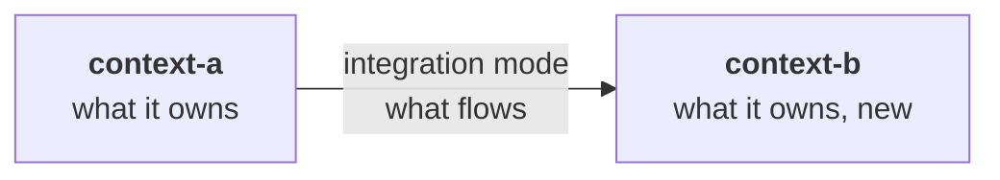
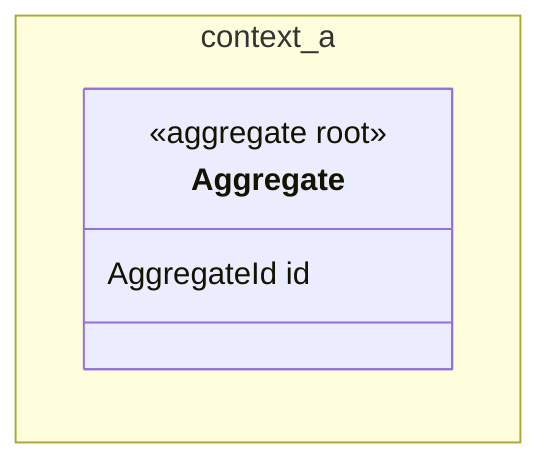
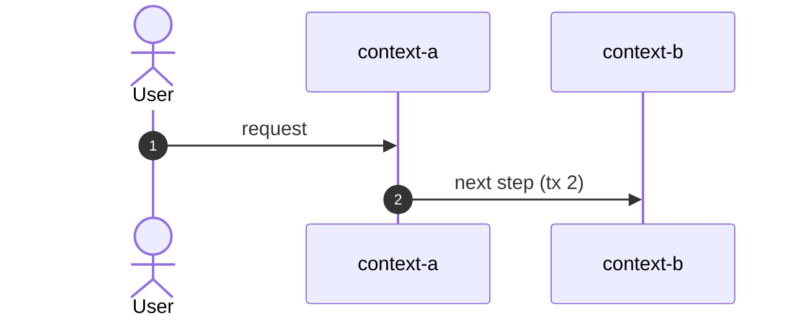

<!--
FILLING RULES. This comment stays in the document: it does not render.

An epic design splits the epic into stories, fixes what they share (the contexts, the language, the model, the events) and the order they ship in. It goes no further: each story is then designed on its own with /alveolus-design, from this design, so that every story uses the same names.

Writing
- The language of the epic, headings included. Short sentences, one idea per sentence.
- A section with no content keeps its heading and says "None.". Never remove a section.
- Section numbers (1 to 9, B, C) never change: tools find a section by its number. They match the sections of a story design.
- Alveolus rule codes go to appendix B. In the body, only when a rule is itself the subject.
- Blocks between angle brackets are to be replaced. Help comments are removed once their section is filled, except this one.

Identifiers
- S-n story, D-n decision, Q-n question, ADR-n, W-n waiver; AGG:, EVT: for the model.
- An element is defined once, in one place: S, D, Q, ADR, W in the first column of a table row; AGG in a heading "### 7.<n> <context>: AGG:<Name> (<new | existing, changed>)"; EVT in the first column of a row of section 8.

Checks before "approved", run by `alveolus-claude design check <file>`
- Every identifier cited is defined. Every story has its value. Every D has a reason. Every Q has an assumption and says what it blocks.
- Every Mermaid diagram renders without error.
-->

# <Title of the epic>

> **How to read this document.** The business reads parts 1 and 2. The tech team reads everything. Each story of section 2 is then designed on its own. The Alveolus rules applied are gathered in appendix B.

## Summary

<!-- Written last. 3 to 6 sentences: what the epic delivers, where it lives, the principle of the solution, the order of the stories. No technical detail. -->

| | |
| --- | --- |
| Contexts touched | <context> (<what changes>) |
| Stories | <number>, in section 2 |
| Decisions to validate | <number>, in part 2 |
| Blocking questions | <Q-n to settle before the first story, by audience> |

---

# Part 1. The need

## 1. Epic

<The goal of the epic, in two or three sentences, for a business reader.>

**What already exists.** <What the code does today in the contexts touched, and what the epic builds on.>

## 2. Stories

<!-- One row per story: small enough to be designed and shipped on its own, and worth shipping on its own. Every requirement of the epic lands in a story. No invented behaviour: what the epic does not say goes to a question. -->

| ID | Story | Value | Contexts | Depends on |
| --- | --- | --- | --- | --- |
| S-1 | As a <role>, I want <action>, so that <benefit> | | | |

## 3. Out of scope

<What the epic does not cover, explicitly.>

---

# Part 2. To validate

## 4. Design decisions

| ID | Decision | Why | Rejected alternative | ADR |
| --- | --- | --- | --- | --- |
| D-1 | | | | |

## 5. Open questions

### For the business

| ID | Question | Assumption meanwhile | Blocks |
| --- | --- | --- | --- |
| Q-1 | | | |

### For the tech team

| ID | Question | Assumption meanwhile | Blocks |
| --- | --- | --- | --- |

### On the rules

| ID | Question | Assumption meanwhile | Blocks |
| --- | --- | --- | --- |

---

# Part 3. Design

## 6. Contexts and language

### 6.1 New bounded context

<!-- Only when the epic creates a context: the table of the story template, and why a bounded context and not a module. Otherwise: "None." -->

None.

### 6.2 Relationships

| Upstream | Downstream | Patterns (upstream / downstream) | Integration | Contract | Change |
| --- | --- | --- | --- | --- | --- |

### 6.3 Glossary

| Context | Term | Code | Definition | Rejected terms |
| --- | --- | --- | --- | --- |

## 7. Model sketch

<!-- The aggregates the stories create or change, and how they relate. No invariant tables: each story design writes them. -->

### 7.1 <context>: AGG:<Name> (<new | existing, changed>)

<Its role in one or two sentences, and the stories that change it.>

## 8. Processes and events

<!-- The flow across contexts and stories, as a sequence diagram, when the epic runs more than one transaction. -->

### Domain events

| ID | Context | Fact | Payload | Triggers |
| --- | --- | --- | --- | --- |

### Messages between contexts

| Message | From → to | Version | Fields | Consumer side |
| --- | --- | --- | --- | --- |

---

# Part 4. Delivery

## 9. Delivery order

<!-- The stories in the order they ship: the upstream before the downstream, what each one makes possible. Each story is then designed with /alveolus-design, from this design and the story's row. -->

| Order | Story | Why now | Unlocks |
| --- | --- | --- | --- |
| 1 | S-1 | | |

---

# Appendices

## B. Alveolus rules applied

| Rule | Where | How |
| --- | --- | --- |

**Waivers**: <"none", or a W-n table: rule, reason, what limits the risk, ADR>

## C. ADRs to write

| ID | Decision | Rules | Depends on |
| --- | --- | --- | --- |
