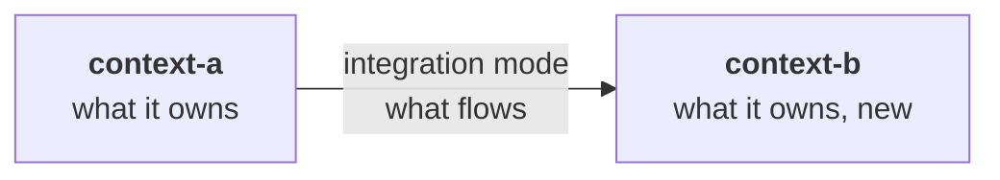
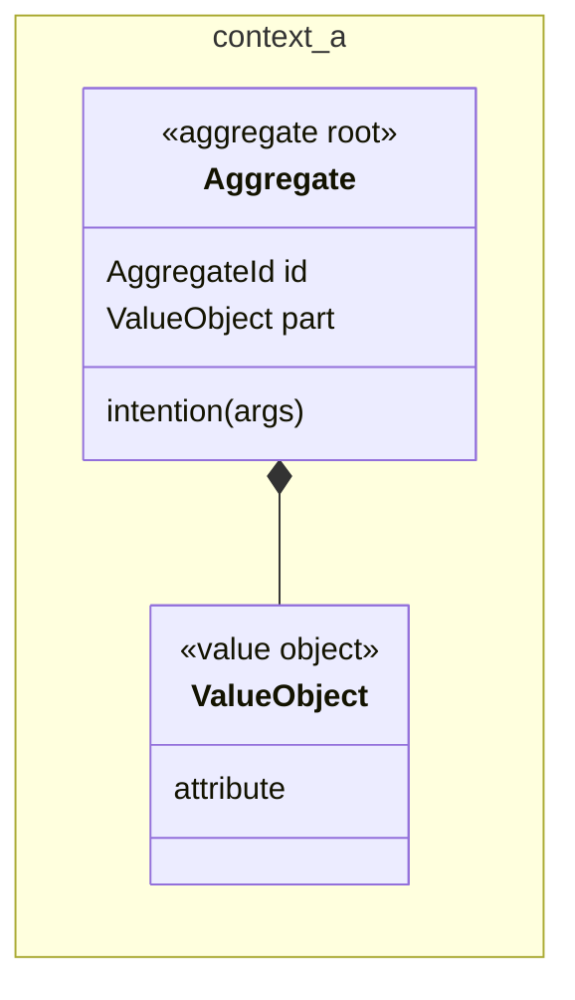
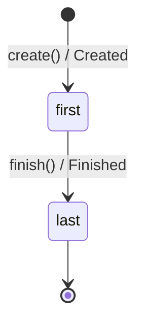
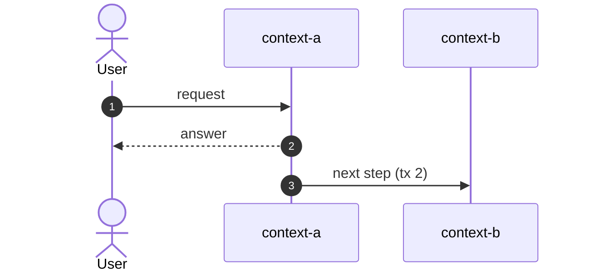
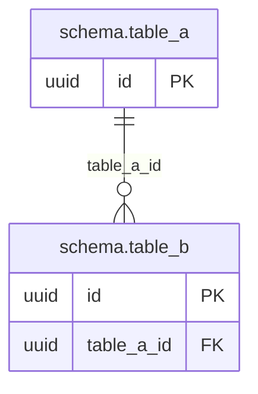

<!--
FILLING RULES. This comment stays in the document: it does not render.

Writing
- The language of the story, headings included. Short sentences, one idea per sentence.
- A section with no content keeps its heading and says "None.". Never remove a section: its absence does not tell whether the question was asked.
- Section numbers (1 to 15, A to C) never change: tools find a section by its number.
- Alveolus rule codes (AGG-06, PUB-07...) go to appendix B. In the body, only when a rule is itself the subject (a question, a waiver).
- Blocks between angle brackets are to be replaced. Help comments are removed once their section is filled, except this one.

Identifiers
- AC-n acceptance criterion, D-n decision, Q-n question, INV-n invariant, T-n test, In increment, ADR-n, W-n waiver.
- Prefix:Name for the elements of the model: AGG:, VO:, ERR:, EVT:, UC:, QRY:, API:, TBL:.
- An element is defined once, in one place:
  - AC, D, Q, INV, T, I, ADR, W: in the first column of a table row ("| AC-1 |").
  - AGG: in a heading "### 7.<n> <context>: AGG:<Name> (<new | existing, changed>)".
  - TBL: in a heading "### TBL:<schema>.<table> (<new | existing>)".
  - VO, ERR, EVT, UC, QRY, API: in the first column of a table row.
- Elsewhere, cite the identifier, never copy the definition.
- When two contexts share a name (CTX-08), prefix it with the context: AGG:payments/Transfer.

Checks before "approved", run by `alveolus-claude design check <file>`
- Every identifier cited is defined.
- Every AC and every INV is proven by at least one T.
- Every D has a reason. Every Q has an assumption and says what it blocks.
- Every increment says why it is safe to merge.
- Every Mermaid diagram renders without error.
-->

# <Title of the story>

> **How to read this document.** The business reads parts 1 and 2. The tech team reads everything. Identifiers (`AC-n`, `D-n`, `Q-n`, `INV-n`, `UC:...`) point to their definition in the document. The Alveolus rules applied are gathered in appendix B.

## Summary

<!-- Written last, once everything else is filled. 3 to 6 sentences: what the story does, where it lives, the principle of the solution, what happens on failure. No technical detail. -->

<!-- The context map of the story: the contexts touched and their relationships, with what changes. A new context is marked "new". -->

| | |
| --- | --- |
| Contexts touched | <context> (<what changes>) |
| Decisions to validate | <number>, in part 2 |
| Blocking questions | <Q-n to settle before implementation, by audience> |
| Delivery | <number> increments, <what comes last> |

---

# Part 1. The need

## 1. Story

As a <role>, I want <action>, so that <benefit>.

<!-- A task has no role: write "Why: <the need behind the task>." instead. -->

**What already exists.** <What the code does today in the contexts touched, and what the story builds on. "Nothing" for a new context.>

## 2. Acceptance criteria

<!-- One scenario per row. Concrete examples, with amounts and names. A sentence of shared context above the table avoids repeating it in each row. No invented behaviour: what the story does not say goes to a question (section 5). -->

| ID | Given | When | Then |
| --- | --- | --- | --- |
| AC-1 | | | |

## 3. Out of scope

<What the story does not cover, explicitly.>

---

# Part 2. To validate

## 4. Design decisions

<!-- The choices a reviewer must validate. A decision always has a reason. The rejected alternative is expected whenever another choice was reasonable. A decision that needs an ADR names it. -->

| ID | Decision | Why | Rejected alternative | ADR |
| --- | --- | --- | --- | --- |
| D-1 | | | | |

## 5. Open questions

<!-- What the story or the rules leave open. Each question has the assumption the design makes meanwhile, and what it blocks: a decision, an AC or an increment. -->

### For the business

| ID | Question | Assumption meanwhile | Blocks |
| --- | --- | --- | --- |
| Q-1 | | | |

### For the tech team

| ID | Question | Assumption meanwhile | Blocks |
| --- | --- | --- | --- |

### On the rules

<!-- An Alveolus rule that is silent, ambiguous or contradictory for this case. -->

| ID | Question | Assumption meanwhile | Blocks |
| --- | --- | --- | --- |

---

# Part 3. Design

## 6. Contexts and language

### 6.1 New bounded context

<!-- Only when the story creates a context. Otherwise: "None." -->

| | |
| --- | --- |
| Name | <name, taken from the language> |
| Subdomain | <core, supporting or generic, and why> |
| Style | <tactical or transaction-script, and why> |
| Team | <owning team> |
| Folder | `src/<context>` |
| Schema | `<context>`, file `prisma/<context>.prisma` |
| Tables owned | <tables> |
| Aggregates kept | <aggregates never physically deleted> |

**Why a bounded context and not a module.** <The two languages that diverge, with concrete words that change meaning. To confirm with the domain experts if not done yet.>

### 6.2 Relationships

<!-- The relationships the story creates or changes. "None." when nothing changes. -->

| Upstream | Downstream | Patterns (upstream / downstream) | Integration | Contract | Change |
| --- | --- | --- | --- | --- | --- |

### 6.3 Glossary

<!-- New or changed terms, by context. -->

| Context | Term | Code | Definition | Rejected terms |
| --- | --- | --- | --- | --- |

## 7. Model

<!-- One namespace per context. Solid lines: composition inside an aggregate. Dotted lines: reference by identity. Between contexts, only the identity crosses. -->

<!--
One block per aggregate touched, numbered 7.1, 7.2...
Transaction script style: a block "### 7.<n> <context>: scripts" instead, with a table
| Script | Use case | Checks before writing | Refusals |
-->

### 7.1 <context>: AGG:<Name> (<new | existing, changed>)

<The role of the aggregate in one or two sentences.>

- **Identity**: <type, who generates it and when>
- **Holds**: <parts, bounded>
- **References**: <other aggregates, by identity>

<!-- When the aggregate has a life cycle. Each transition: method / event. -->

<!-- Methods: those the state diagram does not show. Otherwise: "Every method is in the state diagram." -->

| Method | Business intent | Event |
| --- | --- | --- |

| ID | Invariant | Guarded by | If broken |
| --- | --- | --- | --- |
| INV-1 | | | |

### Value objects

| ID | Context | Holds | Validity |
| --- | --- | --- | --- |

### Errors

| ID | Context | Refusal | Raised by |
| --- | --- | --- | --- |

### Ports

| Port | Context | Role | Implemented by |
| --- | --- | --- | --- |

## 8. Processes and events

<!-- A sequence diagram is required as soon as the story runs more than one transaction. It shows each transaction and the context it runs in, and the failure branches with alt. Then one sentence on what happens when a component goes down between two transactions. Otherwise: "One transaction." -->

### Domain events

| ID | Context | Fact | Payload | Triggers |
| --- | --- | --- | --- | --- |

### Messages between contexts

<!-- The integration events published and consumed. On the consumer side: how duplicates are discarded, and whether order matters. -->

| Message | From → to | Version | Fields | Consumer side |
| --- | --- | --- | --- | --- |

## 9. Use cases

<!-- One table per context. Then the rules shared by every command, once. Then what is specific to one use case: return type, authorization, edge cases. -->

### <context>

| Use case | Triggered by | Outside the transaction | Inside the transaction | Events |
| --- | --- | --- | --- | --- |
| UC:<Name> | | | | |

What holds for every command:

- <What happens before the transaction, what it changes.>
- <How a refusal from another context is handled.>
- <How a technical failure is handled.>
- <How a replay is handled.>

Specifics:

- **UC:<Name>** returns `Result<<Type>, <Errors>>`. <Authorization, edge cases.>

## 10. Contracts

### HTTP routes

| ID | Request | Success | Errors | Access |
| --- | --- | --- | --- | --- |

### Facade <context>

<!-- The operations added to or changed in the facade of a context, one per need of a calling context. "None." otherwise. -->

| Operation | Called by | Input | Output |
| --- | --- | --- | --- |

## 11. Data

<!-- A diagram is required as soon as a schema changes. Entities named "<schema>.<table>". Dotted lines: logical link without a foreign key, required between two schemas. -->

### TBL:<schema>.<table> (<new | existing>)

| Column | Type | Null | Comes from |
| --- | --- | --- | --- |

- **Constraints**: <what the database guarantees>
- **Indexes**: <each frequent read and the index that serves it>
- **Deletion**: <never, or how>

### Repositories, views and outbox

| Component | Context | Role |
| --- | --- | --- |

### Migrations

| Order | Context | Migration | Safe for the version in production |
| --- | --- | --- | --- |

## 12. External integrations

<!-- Third-party system, anticorruption layer, call policy (timeout, retry, batching), simulation in tests and contract test. "None." otherwise. -->

## 13. Operations

- **Correlation**: <the identifier that follows the operation end to end>
- **Alerts**: <what must alert, and from when>
- **Personal data**: <what leaves each context>

---

# Part 4. Delivery

## 14. Increments

<!--
One increment = one pull request, reviewed in one sitting, that leaves every check green and breaks nothing.
Order: a new context starts with I0 (structure, project artifacts, migration of the empty schema). Then the upstream before the downstream. Then, in each context, from the inside out: domain, application, driven, driving. The route or trigger that makes the story reachable comes last.
State is todo, or done once /alveolus-implement has built it. The files of each increment are in appendix A.
-->

| # | Context | Increment | Covers | Done when | Safe because | State |
| --- | --- | --- | --- | --- | --- | --- |
| I1 | | | | | | todo |

## 15. Tests

| ID | Proves | File | Level |
| --- | --- | --- | --- |
| T-1 | | | |

---

# Appendices

## A. Files

<!-- Optional: a diagram of the dependencies between layers, when the story touches several of them in several contexts. -->

### Project artifacts

| Inc. | File | New or changed |
| --- | --- | --- |

<!-- architecture.json, context map, glossaries, ADRs, CODEOWNERS, Prisma files and migrations, and .claude/ regenerated when a context is added. -->

### Code

| Inc. | File | New or changed |
| --- | --- | --- |

## B. Alveolus rules applied

| Rule | Where | How |
| --- | --- | --- |

**Waivers**: <"none", or a W-n table: rule, reason, what limits the risk, ADR>

## C. ADRs to write

| ID | Decision | Rules | Depends on |
| --- | --- | --- | --- |
