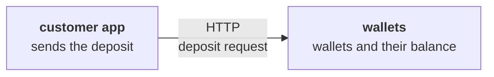
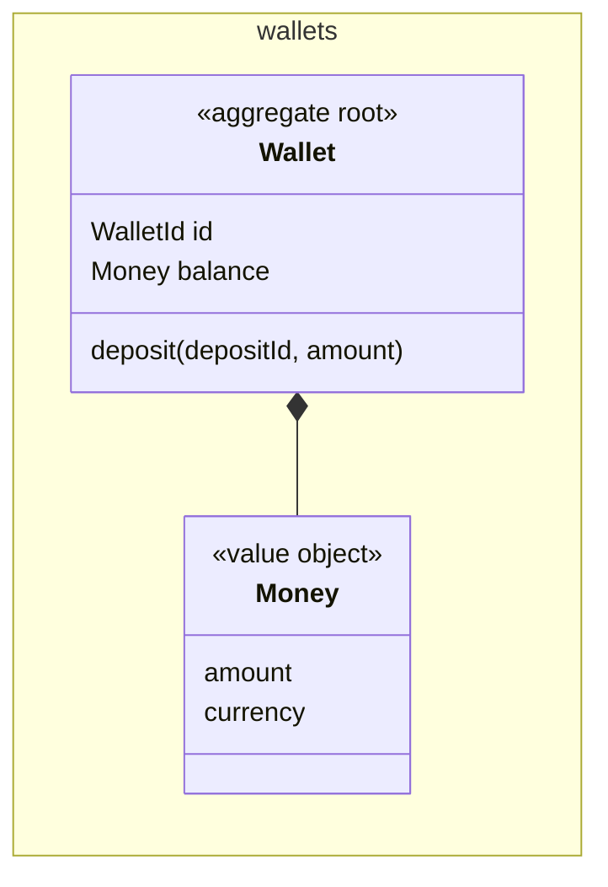
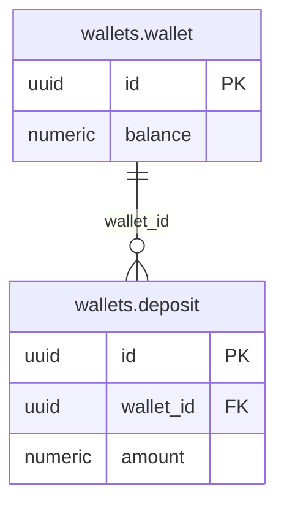

<!--
FILLING RULES. This comment stays in the document: it does not render.
-->

# Deposit money into a wallet

> **How to read this document.** The business reads parts 1 and 2. The tech team reads everything. Identifiers (`AC-n`, `D-n`, `Q-n`, `INV-n`, `UC:...`) point to their definition in the document. The Alveolus rules applied are gathered in appendix B.

## Summary

A customer deposits money into one of their wallets, and the balance grows by the amount. The deposit lives in the wallets bounded context, on the existing wallet. The wallet records each deposit under the identifier the customer sends, so a deposit sent twice is credited once. A closed wallet or an amount that is not positive is refused, and the balance does not change.

| | |
| --- | --- |
| Contexts touched | wallets (a deposit operation on the wallet) |
| Decisions to validate | 2, in part 2 |
| Blocking questions | None |
| Delivery | 4 increments, the HTTP route comes last |

---

# Part 1. The need

## 1. Story

As a customer, I want to deposit money into my wallet, so that I can spend it later.

**What already exists.** The wallets context holds AGG:Wallet with its balance, and a withdrawal. Nothing records a deposit yet.

## 2. Acceptance criteria

Alice owns the open wallet W1, with a balance of 100.00 EUR.

| ID | Given | When | Then |
| --- | --- | --- | --- |
| AC-1 | | Alice deposits 50.00 EUR into W1 | The balance of W1 is 150.00 EUR |
| AC-2 | | Alice deposits 0.00 EUR into W1 | The deposit is refused with ERR:InvalidAmount, the balance stays 100.00 EUR |
| AC-3 | W1 is closed | Alice deposits 50.00 EUR into W1 | The deposit is refused with ERR:WalletClosed, the balance stays 100.00 EUR |
| AC-4 | Alice deposited 50.00 EUR with deposit id d-1 | Alice sends deposit d-1 again | The balance stays 150.00 EUR and the answer is the same |

## 3. Out of scope

Deposits in another currency than the wallet's. Fees.

---

# Part 2. To validate

## 4. Design decisions

| ID | Decision | Why | Rejected alternative | ADR |
| --- | --- | --- | --- | --- |
| D-1 | The wallet keeps the ids of the deposits it credited | A replay is detected in the same transaction as the credit | A separate table of processed requests, outside the aggregate | |
| D-2 | The customer app generates the deposit id | A retry after a timeout carries the same id | An id generated by the server, which a retry cannot know | |

## 5. Open questions

### For the business

| ID | Question | Assumption meanwhile | Blocks |
| --- | --- | --- | --- |
| Q-1 | Is there a maximum amount for one deposit? | No maximum | AC-2 |

### For the tech team

None.

### On the rules

None.

---

# Part 3. Design

## 6. Contexts and language

### 6.1 New bounded context

None.

### 6.2 Relationships

None.

### 6.3 Glossary

| Context | Term | Code | Definition | Rejected terms |
| --- | --- | --- | --- | --- |
| wallets | Deposit | `Deposit` | Money added to a wallet by its owner | Top-up, credit |

## 7. Model

### 7.1 wallets: AGG:Wallet (existing, changed)

The wallet holds the balance of one customer and guards it.

- **Identity**: `WalletId`, generated when the wallet opens
- **Holds**: its balance, and the ids of the last 1000 deposits
- **References**: the customer, by identity

Every method is in the table below.

| Method | Business intent | Event |
| --- | --- | --- |
| `deposit(depositId, amount)` | Add money to the balance | EVT:MoneyDeposited |

| ID | Invariant | Guarded by | If broken |
| --- | --- | --- | --- |
| INV-1 | A deposit amount is positive | `Wallet.deposit` | ERR:InvalidAmount |
| INV-2 | A closed wallet takes no deposit | `Wallet.deposit` | ERR:WalletClosed |

### Value objects

| ID | Context | Holds | Validity |
| --- | --- | --- | --- |
| VO:Money | wallets | An amount and a currency | Two decimals at most |

### Errors

| ID | Context | Refusal | Raised by |
| --- | --- | --- | --- |
| ERR:InvalidAmount | wallets | The amount is zero or negative | AGG:Wallet |
| ERR:WalletClosed | wallets | The wallet is closed | AGG:Wallet |

### Ports

| Port | Context | Role | Implemented by |
| --- | --- | --- | --- |
| `WalletRepository` | wallets | Load and save a wallet | `PrismaWalletRepository` |

## 8. Processes and events

One transaction.

### Domain events

| ID | Context | Fact | Payload | Triggers |
| --- | --- | --- | --- | --- |
| EVT:MoneyDeposited | wallets | Money was added to a wallet | wallet id, deposit id, amount | Nothing yet |

### Messages between contexts

None.

## 9. Use cases

### wallets

| Use case | Triggered by | Outside the transaction | Inside the transaction | Events |
| --- | --- | --- | --- | --- |
| UC:DepositMoney | API:DepositMoney | Validate the request | Load AGG:Wallet, deposit, save | EVT:MoneyDeposited |

What holds for every command:

- The command loads one wallet and saves it in one transaction.
- No other context is called.
- A technical failure rolls the transaction back.
- A replay returns the first answer.

Specifics:

- **UC:DepositMoney** returns `Result<Balance, InvalidAmount | WalletClosed>`. Only the owner of the wallet may deposit.

## 10. Contracts

### HTTP routes

| ID | Request | Success | Errors | Access |
| --- | --- | --- | --- | --- |
| API:DepositMoney | `POST /wallets/:walletId/deposits` | 201, the new balance | 422 ERR:InvalidAmount, 409 ERR:WalletClosed | The owner of the wallet |

### Facade wallets

None.

## 11. Data

### TBL:wallets.wallet (existing)

None of its columns change.

- **Constraints**: unchanged
- **Indexes**: unchanged
- **Deletion**: never

### TBL:wallets.deposit (new)

| Column | Type | Null | Comes from |
| --- | --- | --- | --- |
| id | uuid | no | The deposit id sent by the customer app |
| wallet_id | uuid | no | AGG:Wallet |
| amount | numeric(19,2) | no | VO:Money |

- **Constraints**: the id is unique
- **Indexes**: `wallet_id`, to load the deposits of a wallet
- **Deletion**: never

### Repositories, views and outbox

| Component | Context | Role |
| --- | --- | --- |
| `PrismaWalletRepository` | wallets | Saves the wallet and its new deposits together |

### Migrations

| Order | Context | Migration | Safe for the version in production |
| --- | --- | --- | --- |
| 1 | wallets | Create `wallets.deposit` | Yes: it only adds a table |

## 12. External integrations

None.

## 13. Operations

- **Correlation**: the deposit id
- **Alerts**: none for this story
- **Personal data**: none leaves the wallets context

---

# Part 4. Delivery

## 14. Increments

| # | Context | Increment | Covers | Done when | Safe because | State |
| --- | --- | --- | --- | --- | --- | --- |
| I1 | wallets | Deposit on the wallet | INV-1, INV-2 | T-1 and T-2 pass | Not reachable yet | done |
| I2 | wallets | The deposit command | AC-1, AC-2, AC-3 | T-3 passes | Not reachable yet | todo |
| I3 | wallets | Save deposits | AC-4 | T-4 passes | The migration only adds a table | todo |
| I4 | wallets | The deposit route | AC-1 to AC-4 | T-5 passes | Last increment: the story becomes reachable | todo |

## 15. Tests

| ID | Proves | File | Level |
| --- | --- | --- | --- |
| T-1 | INV-1, AC-2 | `src/wallets/internal/domain/__test__/wallet.spec.ts` | Unit |
| T-2 | INV-2, AC-3 | `src/wallets/internal/domain/__test__/wallet.spec.ts` | Unit |
| T-3 | AC-1 | `src/wallets/internal/application/__test__/deposit-money.spec.ts` | Use case |
| T-4 | AC-4 | `src/wallets/internal/driven/__test__/prisma-wallet.repository.spec.ts` | Integration |
| T-5 | AC-1, AC-2, AC-3, AC-4 | `src/wallets/__test__/deposit-money.e2e-spec.ts` | End to end |

---

# Appendices

## A. Files

### Project artifacts

| Inc. | File | New or changed |
| --- | --- | --- |
| I3 | `prisma/wallets.prisma` | Changed |

### Code

| Inc. | File | New or changed |
| --- | --- | --- |
| I1 | `src/wallets/internal/domain/wallet.aggregate.ts` | Changed |
| I2 | `src/wallets/internal/application/deposit-money.command.ts` | New |
| I3 | `src/wallets/internal/driven/prisma/prisma-wallet.repository.ts` | Changed |
| I4 | `src/wallets/internal/driving/http/wallet.controller.ts` | Changed |

## B. Alveolus rules applied

| Rule | Where | How |
| --- | --- | --- |
| AGG-01 | AGG:Wallet | INV-1 and INV-2 live in `Wallet.deposit` |
| AGG-06 | UC:DepositMoney | One wallet per transaction |
| UC-01 | UC:DepositMoney | One use case, one operation |
| COV-02 | T-1, T-2 | The invariants are proven in the domain |

**Waivers**: none.

## C. ADRs to write

None.
