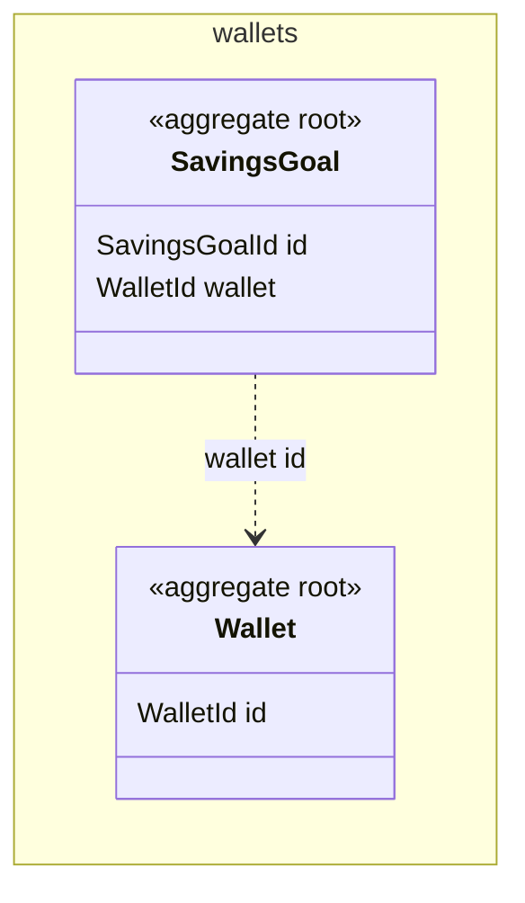

Working notes.

<!-- slot: 7 -->

### 7.1 wallets: AGG:Wallet (existing, changed)

Its spendable balance leaves out the money set aside. S-2 and S-3 change it.

### 7.2 wallets: AGG:SavingsGoal (new)

A goal, its target and the money set aside for it. S-1, S-2 and S-3 change it.

<!-- slot: 8.events -->

| ID | Context | Fact | Payload | Triggers |
| --- | --- | --- | --- | --- |
| EVT:MoneySetAside | wallets | Money was set aside for a goal | goal id, wallet id, amount | Nothing yet |

<!-- slot: rules -->

| AGG-01 | AGG:SavingsGoal | Its target and progress live in the goal |
