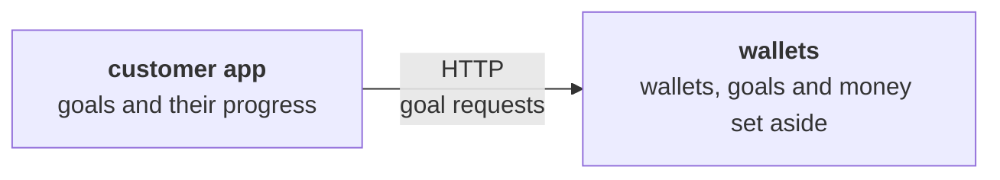
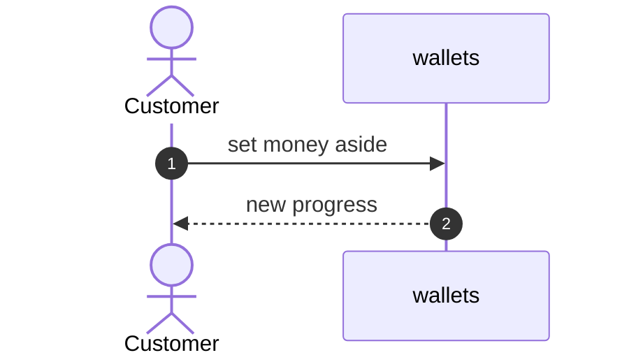

Working notes.

<!-- slot: map -->

<!-- slot: 6 -->

### 6.1 New bounded context

None.

### 6.2 Relationships

None.

### 6.3 Glossary

| Context | Term | Code | Definition | Rejected terms |
| --- | --- | --- | --- | --- |
| wallets | Savings goal | `SavingsGoal` | Money a customer sets aside for a project | Pot, vault |

<!-- slot: 8.process -->

<!-- slot: decisions -->

| D-S1 | A goal is an aggregate of its own, that refers to its wallet by identity | A goal changes without loading the wallet | Goals inside the wallet, which grows with each goal | |
