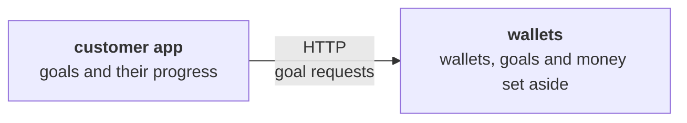
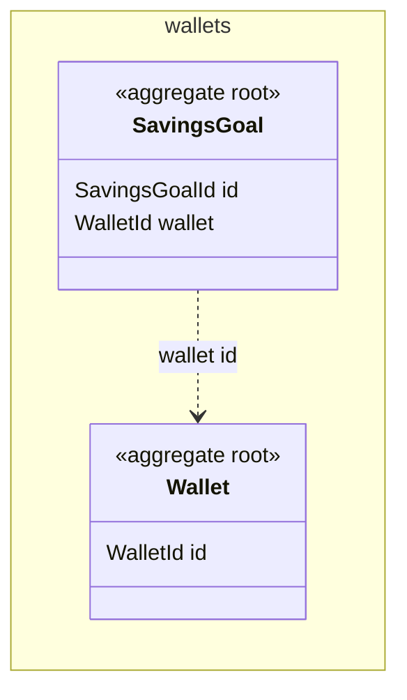
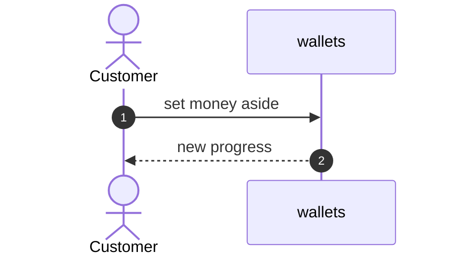

<!--
FILLING RULES. This comment stays in the document: it does not render.
-->

# Savings goals

> **How to read this document.** The business reads parts 1 and 2. The tech team reads everything. Each story of section 2 is then designed on its own. The Alveolus rules applied are gathered in appendix B.

## Summary

A customer sets money aside for a goal, follows how far they are, and takes the money back when they want. The goals live in the wallets context, next to the wallet the money comes from. Money set aside leaves the balance the customer can spend, but stays in the wallet. The stories ship in order: create a goal, set money aside, take it back, close the goal.

| | |
| --- | --- |
| Contexts touched | wallets (savings goals) |
| Stories | 3, in section 2 |
| Decisions to validate | 1, in part 2 |
| Blocking questions | None |

---

# Part 1. The need

## 1. Epic

Help customers put money aside for a project, and see how far they are.

**What already exists.** The wallets context holds wallets and their balance, with withdrawals. Nothing sets money aside yet.

## 2. Stories

| ID | Story | Value | Contexts | Depends on |
| --- | --- | --- | --- | --- |
| S-1 | As a customer, I want to create a savings goal, so that I can name what I save for | The goal exists | wallets | |
| S-2 | As a customer, I want to set money aside for a goal, so that I do not spend it | Money is protected | wallets | S-1 |
| S-3 | As a customer, I want to take money back from a goal, so that I can use it | Money is free again | wallets | S-2 |

## 3. Out of scope

Interest. Goals shared between customers.

---

# Part 2. To validate

## 4. Design decisions

| ID | Decision | Why | Rejected alternative | ADR |
| --- | --- | --- | --- | --- |
| D-1 | A goal is an aggregate of its own, that refers to its wallet by identity | A goal changes without loading the wallet | Goals inside the wallet, which grows with each goal | |

## 5. Open questions

### For the business

| ID | Question | Assumption meanwhile | Blocks |
| --- | --- | --- | --- |
| Q-1 | Can a customer have several goals on one wallet? | Yes | S-1 |

### For the tech team

None.

### On the rules

None.

---

# Part 3. Design

## 6. Contexts and language

### 6.1 New bounded context

None.

### 6.2 Relationships

None.

### 6.3 Glossary

| Context | Term | Code | Definition | Rejected terms |
| --- | --- | --- | --- | --- |
| wallets | Savings goal | `SavingsGoal` | Money a customer sets aside for a project | Pot, vault |

## 7. Model sketch

### 7.1 wallets: AGG:Wallet (existing, changed)

Its spendable balance leaves out the money set aside. S-2 and S-3 change it.

### 7.2 wallets: AGG:SavingsGoal (new)

A goal, its target and the money set aside for it. S-1, S-2 and S-3 change it.

## 8. Processes and events

### Domain events

| ID | Context | Fact | Payload | Triggers |
| --- | --- | --- | --- | --- |
| EVT:MoneySetAside | wallets | Money was set aside for a goal | goal id, wallet id, amount | Nothing yet |

### Messages between contexts

None.

---

# Part 4. Delivery

## 9. Delivery order

| Order | Story | Why now | Unlocks |
| --- | --- | --- | --- |
| 1 | S-1 | Nothing to set aside without a goal | S-2 |
| 2 | S-2 | The value of the epic | S-3 |
| 3 | S-3 | Money set aside must come back | Closing a goal later |

---

# Appendices

## B. Alveolus rules applied

| Rule | Where | How |
| --- | --- | --- |
| AGG-01 | AGG:SavingsGoal | Its target and progress live in the goal |

**Waivers**: none.

## C. ADRs to write

None.
