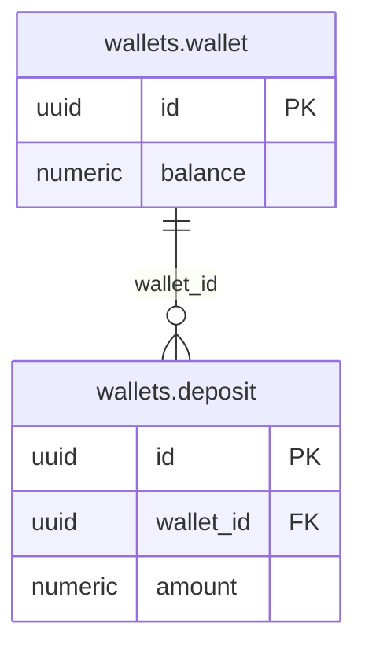

Working notes for the agents after me.

<!-- slot: 8.process -->

One transaction.

<!-- slot: 9 -->

### wallets

| Use case | Triggered by | Outside the transaction | Inside the transaction | Events |
| --- | --- | --- | --- | --- |
| UC:DepositMoney | API:DepositMoney | Validate the request | Load AGG:Wallet, deposit, save | EVT:MoneyDeposited |

What holds for every command:

- The command loads one wallet and saves it in one transaction.
- No other context is called.
- A technical failure rolls the transaction back.
- A replay returns the first answer.

Specifics:

- **UC:DepositMoney** returns `Result<Balance, InvalidAmount | WalletClosed>`. Only the owner of the wallet may deposit.

<!-- slot: 10.routes -->

| ID | Request | Success | Errors | Access |
| --- | --- | --- | --- | --- |
| API:DepositMoney | `POST /wallets/:walletId/deposits` | 201, the new balance | 422 ERR:InvalidAmount, 409 ERR:WalletClosed | The owner of the wallet |

<!-- slot: 11 -->

### TBL:wallets.wallet (existing)

None of its columns change.

- **Constraints**: unchanged
- **Indexes**: unchanged
- **Deletion**: never

### TBL:wallets.deposit (new)

| Column | Type | Null | Comes from |
| --- | --- | --- | --- |
| id | uuid | no | The deposit id sent by the customer app |
| wallet_id | uuid | no | AGG:Wallet |
| amount | numeric(19,2) | no | VO:Money |

- **Constraints**: the id is unique
- **Indexes**: `wallet_id`, to load the deposits of a wallet
- **Deletion**: never

### Repositories, views and outbox

| Component | Context | Role |
| --- | --- | --- |
| `PrismaWalletRepository` | wallets | Saves the wallet and its new deposits together |

### Migrations

| Order | Context | Migration | Safe for the version in production |
| --- | --- | --- | --- |
| 1 | wallets | Create `wallets.deposit` | Yes: it only adds a table |

<!-- slot: decisions -->

| D-R1 | The customer app generates the deposit id | A retry after a timeout carries the same id | An id generated by the server, which a retry cannot know | |

<!-- slot: rules -->

| AGG-06 | UC:DepositMoney | One wallet per transaction |
| UC-01 | UC:DepositMoney | One use case, one operation |

<!-- slot: requests -->

| tester | Prove AC-4 at the repository level | The replay is detected on save |
