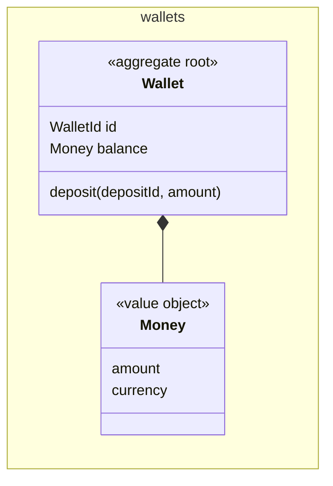

Working notes for the agents after me.

<!-- slot: 7 -->

### 7.1 wallets: AGG:Wallet (existing, changed)

The wallet holds the balance of one customer and guards it.

- **Identity**: `WalletId`, generated when the wallet opens
- **Holds**: its balance, and the ids of the last 1000 deposits
- **References**: the customer, by identity

Every method is in the table below.

| Method | Business intent | Event |
| --- | --- | --- |
| `deposit(depositId, amount)` | Add money to the balance | EVT:MoneyDeposited |

| ID | Invariant | Guarded by | If broken |
| --- | --- | --- | --- |
| INV-1 | A deposit amount is positive | `Wallet.deposit` | ERR:InvalidAmount |
| INV-2 | A closed wallet takes no deposit | `Wallet.deposit` | ERR:WalletClosed |

### Value objects

| ID | Context | Holds | Validity |
| --- | --- | --- | --- |
| VO:Money | wallets | An amount and a currency | Two decimals at most |

### Errors

| ID | Context | Refusal | Raised by |
| --- | --- | --- | --- |
| ERR:InvalidAmount | wallets | The amount is zero or negative | AGG:Wallet |
| ERR:WalletClosed | wallets | The wallet is closed | AGG:Wallet |

### Ports

| Port | Context | Role | Implemented by |
| --- | --- | --- | --- |
| `WalletRepository` | wallets | Load and save a wallet | `PrismaWalletRepository` |

<!-- slot: 8.events -->

| ID | Context | Fact | Payload | Triggers |
| --- | --- | --- | --- | --- |
| EVT:MoneyDeposited | wallets | Money was added to a wallet | wallet id, deposit id, amount | Nothing yet |

<!-- slot: decisions -->

| D-M1 | The wallet keeps the ids of the deposits it credited | A replay is detected in the same transaction as the credit | A separate table of processed requests, outside the aggregate | |

<!-- slot: rules -->

| AGG-01 | AGG:Wallet | INV-1 and INV-2 live in `Wallet.deposit` |
