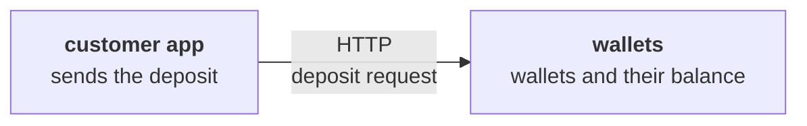

Working notes for the agents after me.

<!-- slot: map -->

<!-- slot: 6 -->

### 6.1 New bounded context

None.

### 6.2 Relationships

None.

### 6.3 Glossary

| Context | Term | Code | Definition | Rejected terms |
| --- | --- | --- | --- | --- |
| wallets | Deposit | `Deposit` | Money added to a wallet by its owner | Top-up, credit |
